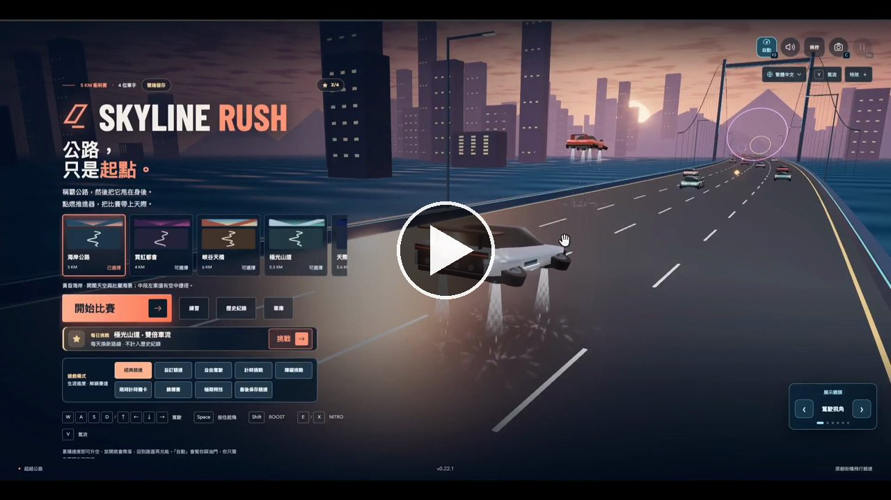
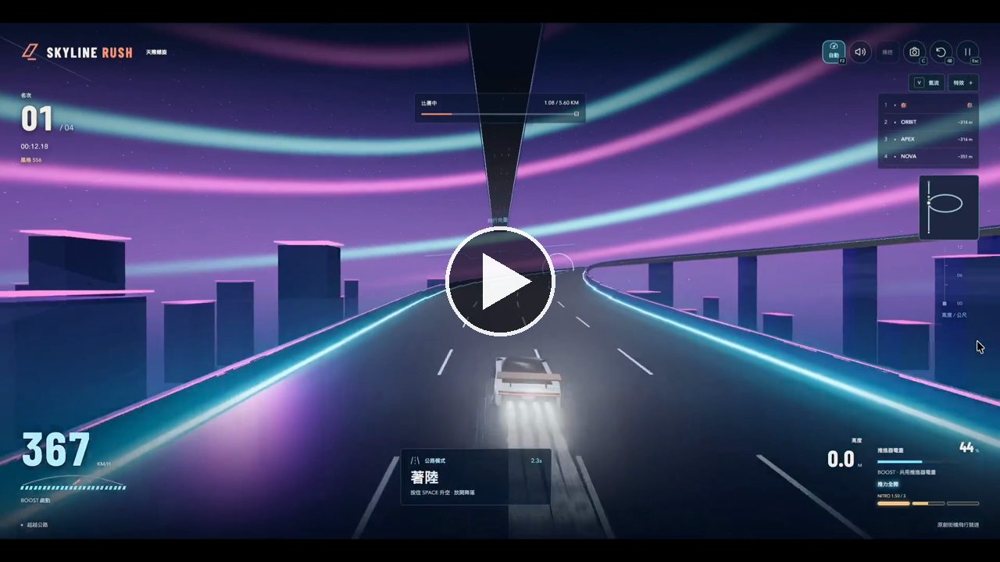
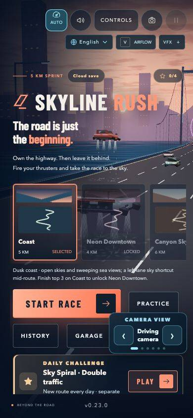
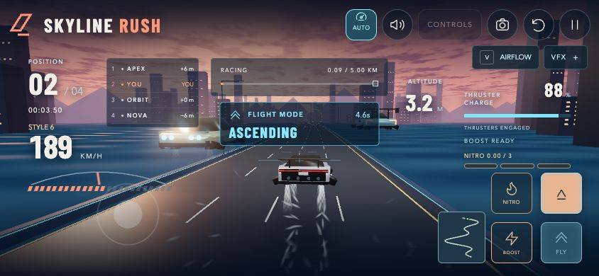

# Skyline Rush

**English** · [繁體中文](README.zh-TW.md)

[**Play Skyline Rush →**](https://weskao.github.io/skyline-rush/)

A playable 3D coastal highway sprint starring a flying electric sports car, modeled on the Tesla Roadster 2 and its rocket-thruster concept. Lift off on four blue thrusters, race three opponents, fly over traffic, manage charge and land to recharge. The handling is fictional arcade physics; this is an unofficial fan project, not affiliated with Tesla or SpaceX.

## The game

In Classic Race, Skyline Rush is a short, replayable arcade sprint in the browser: one player against three rivals and the traffic between them, on desktop or phone, with nothing to install. Other modes offer solo driving, custom rules and multi-stage challenges.

- **Drive, then fly.** Above 65 km/h, hold FLY to lift off over traffic, through rings and across broken bridges. Flight and BOOST share one thruster charge that refills only on the road, so every climb is a choice.
- **Earn NITRO by driving well.** Close passes, drifts, ring groups (PERFECT LINE), slipstreams, landed barrel rolls and pickups fill a three-charge NITRO reserve; spend it in one burst or chain presses to extend it.
- **Ten tracks, unlocked in order.** Coast at dusk, rainy Neon Downtown with low tunnels, Canyon Skyway with bridge gaps and crosswinds, Aurora Pass with ice and uphill climbs, Sky Spiral's 360° elevated helix with jump ramps and broken skybridges, then the World Tour: Taipei Heritage, Tokyo Afterdark, Alpine Rail Pass, Coastal Horizon and Cosmic Orbit. Each has one aerial shortcut for players who can hold a line in the air.
- **Something to chase.** Every finish scores style stars that unlock paints in the Garage. A best-run ghost, a daily challenge with its own board and four medals give reasons to race again.

A Classic sprint lasts about a minute; multi-stage challenges take longer. Sound is synthesized in the browser, and progress stays in local storage, so there is no account or backend.

**Home screen** — pick a track and a camera angle, then start the race.

[](artifacts/home_screen.mp4)

https://github.com/weskao/skyline-rush/blob/main/artifacts/home_screen.mp4

**Racing** — a full run on one of the tracks.

[](artifacts/Play.mp4)

https://github.com/weskao/skyline-rush/blob/main/artifacts/Play.mp4


### Mobile screenshots and demo

Play in portrait or landscape with touch controls. The clip follows a Coast run from the start screen through countdown, FLY lift-off and landing; AUTO keeps the accelerator held.

**Portrait — ready to race**



**Landscape — flying with touch controls**



**Touch gameplay demo** · [Watch the MP4](artifacts/mobile-demo.mp4)


Captured from the running game in Chrome mobile emulation at 390×844 (portrait) and 844×390 (landscape), using a fresh demo profile. These captures do not measure physical-phone performance.

## Game modes and replayability (development branch)

> **Work in progress · 22 October 2026.** These mode additions are on [`feature/race-modes-p0`](https://github.com/weskao/skyline-rush/tree/feature/race-modes-p0), not necessarily on the [deployed GitHub Pages build](https://weskao.github.io/skyline-rush/). The existing screenshots above show earlier gameplay; current mode captures are linked below. The [roadmap](TODO.md) includes additional unfinished features.

Select a **track you have unlocked**, choose **GAME MODE** below the track cards, expand its rules when needed, then press **Start race** (or Enter). Racing still uses the same Three.js road, flying, FLY / BOOST / NITRO and responsive touch controls. Seven modes are available in the development branch:

| Mode | What changes | Win condition / progression |
| --- | --- | --- |
| **Classic Race** | Standard 3-rival sprint on one of 10 tracks, with traffic, shortcuts, rings and NITRO. | Podium finishes unlock the next track; Classic alone awards Career stars, medals and official bests. |
| **Custom Race** | Choose **0–3 rivals**, Easy / Normal / Hard AI, Off / Light / Normal / Heavy traffic, NITRO pickups on/off, and Normal / Relaxed collision penalties. Five presets: Standard, Traffic Rush, No Items, Air Focus and Precision. | Unranked results have their own history. Run **1 / 2 / 3 / 5 sprint stages** and compare aggregate time. Stages replay point-to-point routes; they are **not circuit laps**. |
| **Free Drive** | Explore any unlocked course alone, with adjustable road traffic and pickups, no race placing and no forced victory. | Drive, drift and fly freely, then restart or choose another track. The authored road has an endpoint; this is **not** an infinite-world mode. |
| **Time Attack** | Solo timed sprint, compatible best-run Ghost and ahead/behind split. Optional **Clean Time Trial** toggle. | Track and rules-specific best times; a Clean run with any collision is invalidated and does not replace a personal best. |
| **Obstacle Run** | Seeded roadside barriers; **Standard** or **Extreme** density. Some obstacles sweep sideways; warning HUD previews approaching danger. | Dodge hazards, earn style points for clean passes and use the ordinary route's finish. Obstacle placement and collision share deterministic logic; Classic is unchanged. |
| **Checkpoint Rush** | Race through glowing 3D gate arches. Start with **28 seconds**; each clean gate grants **+10 seconds** (capped at 60) and **250 style points**. | Reach every gate and the finish before the clock expires. Missed gates and timeouts do **not** save a valid best. The HUD shows gates cleared, time remaining and distance to the next target. |
| **Championship Cup** | Pick a **3- or 5-track** Cup made only of already unlocked routes; race NOVA, ORBIT and APEX on each stage. | Placements award **10 / 7 / 5 / 3 points**; cumulative standings and total time decide the champion, with ties broken by time. Cup results are separate from Career unlocks. |

### Race setup, results and accessibility

- Mode and track selection remain accessible by keyboard and touch; contextual panels only show options relevant to the selected mode. Unavailable Cups explain the number of tracks still required.
- HUDs adapt to the mode: solo events hide misleading rival ranks; multi-stage and Cup runs show stage progress; Checkpoint Rush shows its live gate countdown; Obstacle Run warns of approaching barriers; Clean Time Trial visibly indicates an invalidated run.
- Practice, Custom, Time Attack, Obstacle, Checkpoint and Cup results use the separate `skyline-rush-mode-history-v1` record key. Eligible practice Ghosts have their own saved ruleset; Classic unlocks, stars, medals, Daily records and official times are protected from practice runs.
- In **History → Challenge records**, filter by mode to see personal bests per exact track/ruleset and eligible Time Attack Ghosts. The lifetime best stays saved even when the latest 50 runs rotate, under `skyline-rush-mode-bests-v1`. Challenge records are explicitly not Career medals or stars.
- Mode labels, result explanations, setup options and danger warnings support English and Traditional Chinese. Low-quality graphics, touch controls and reduced motion remain part of the verification plan.

### Real game screenshots and verification

The screenshots used to inspect these modes were taken **from the running browser game**, not concept art. [Download the actual Playwright capture set](https://github.com/weskao/skyline-rush/actions/runs/39742666980/artifacts/12410172411) (Custom solo, Free Drive, Time Attack, Obstacle Run, Extreme obstacles, Checkpoint Rush and mobile mode menu). GitHub Actions artifacts may require sign-in and expire; to recreate them locally, run `npx playwright test tests/race-modes-browser.spec.js` and open `test-results/race-mode-*.png`. CI screenshots are software-rendered at reduced resolution, not representative of final device image quality.

**Verification snapshot, commit `beab3e2`:** `npm test`, the production build and the World Tour mid-race test passed; the focused race-mode browser job reported **11 passed / 1 failed** (Clean Time Trial browser test timeout). This branch is **not fully verified or deployed**. Future roadmap items—including Stunt Attack, unlimited procedural roads, genuine closed-circuit laps, active inventory and the course editor—remain pending unless marked `[x]` in [TODO.md](TODO.md).

## Run locally

Requires Node.js 22.12 or newer and a browser with WebGL 2 and hardware acceleration.

```sh
cd "$HOME/Documents/Workspace/skyline-rush"
make         # Installs dependencies on first run, then starts the Vite + Vue dev server
```

Open the local URL Vite prints (normally http://127.0.0.1:5173). Assets and the font are bundled locally; gameplay makes no external requests. No backend or account is needed.

`make` and `make dev-unlocked` also start local Firebase Auth/Firestore emulators (needs Java 21+), so the cloud-save Google sign-in works with fake test accounts and never touches real saves. Cloud-save operations and Spark quota checks for the project owner are in `docs/cloud-save.md`.

`make phone` opens a terminal menu that starts, checks or stops a dev server your phone can open (over Tailscale or the same Wi-Fi) and prints the phone URL once it answers. The menu lists this checkout, other worktrees and recent branches, or takes a typed branch name; `make phone <name>` goes straight to that branch (or `feature/<name>`), creating its worktree under `.claude/worktrees/` when needed. It always serves the normal locked build: the all-unlocked server (`make dev-unlocked`, `make dev-feature`) stays desktop-only. It needs the personal `phone-dev` Claude Code skill (`/phone-dev` asks the same menu) and runs without the emulators, so cloud-save sign-in on the phone uses the real project.

## Controls

| Action | Keyboard |
| --- | --- |
| Accelerate | W / ↑ |
| Brake | S / ↓ |
| Steer | A / D or ← / → |
| Fly | Hold Space once above 65 km/h |
| Land | Release Space |
| Boost | Hold Shift; consumes thruster charge |
| NITRO | E / X (one full charge; press again during NITRO to extend it). WASD hands use E; arrow-key players keep the left hand on Shift / X / Space |
| Drift | Hold S + A / D above 162 km/h (ground only) |
| Start | Enter |
| Pause / resume | Esc / P |
| Restart | Backspace |
| Change camera | C |
| Mute / unmute all audio | M |
| Auto accelerator on / off | F2 / AUTO button |
| AIRFLOW showcase on / off | V / AIRFLOW button |
| Change track on the home screen | Swipe or drag the 3D preview left / right, or two-finger swipe on a trackpad |

Mobile layouts provide steering, accelerator, brake, boost, flight and NITRO buttons. Touch controls support simultaneous holds. AUTO holds the accelerator so you can concentrate on steering and flying; braking always overrides it. It starts on for every device; once you toggle it, your choice is remembered in this browser (`skyline-rush-auto`). Leaving the tab pauses the race and clears held input. Clicking the SKYLINE RUSH logo mid-race pauses and asks first: **Keep racing**, **End race** (back to track select, run not saved) or **Back to home** (reloads); either way the start screen reopens on the track just raced, scrolled to the centre of the track row (the first and last tracks sit at its ends). Esc leaves the race paused. Camera and sound shortcuts preserve held driving controls. On touch, sliding a thumb down on the steering pad brakes and sliding down and sideways drifts; in Buttons mode a slimmer brake sits above the steering buttons, off the row the thumb rests on, so it is only pressed on purpose; sliding the thumb from ← or → up into the brake keeps steering and brakes, so one thumb drifts, and sliding back down releases the brake. Touch buttons stay clear of the screen corners for an easier thumb reach, and tablets lift and enlarge them.

Open **Controls** before a race or while paused to adjust keyboard steering sensitivity or remap a driving action. Select an action, then press a key; conflicting bindings swap, fixed shortcuts stay reserved, and Escape cancels capture. Reset keyboard restores the defaults. Bindings take effect immediately and are saved under `localStorage['skyline-rush-keymap']`.

The same panel controls touch steering mode, handedness, slide sensitivity, size, opacity and hold/toggle FLY. **Edit touch layout** lets you drag the action and classic steering buttons over the race preview; **Done editing** keeps the arrangement and **Reset touch layout** restores it. Positions persist across reloads, mirror with handedness and stay within the viewport after rotation. On short landscape screens (under 380 px tall, such as iPhone Safari with its toolbar showing), the start screen drops its tagline so START RACE needs no scrolling, and the race HUD hides the speed dial and secondary charge lines so no panel overlaps another.

All audio is synthesized with Web Audio; no audio downloads are needed. Background music has two looping synthwave tracks: an intro theme (~64 s) on the start and results screens, and a faster race theme (~55 s) from the countdown on. Each builds up over its loop and ducks while paused. Sound effects cover menu confirmation, three countdown ticks and GO, motor/wind, lift and boost, braking, vehicle/guardrail contact, landing, low-charge warning, close-pass reward and a finish melody. Muting effects stops pending cues, and pausing fades driving sounds. Low-charge warnings rearm only after recharging above 30%.

The speaker icon opens audio settings with a Music row and a Sound effects row, each a mute switch plus a volume slider (shown open in the start-screen screenshot above). **Mute all** (or M) silences both at once. Muting keeps each channel's level, so unmuting returns to it; dragging a slider to zero mutes that channel the same way. Both default to on at 100%, and each on/off choice and volume is remembered in `localStorage` (`skyline-rush-music`, `skyline-rush-sound` holding `on`/`off`, plus `-volume` variants holding the percentage); with nothing stored both channels are on and get stored as `on`. On short screens the panel scrolls. The intro music starts as soon as the page loads where the browser allows autoplay. Where it doesn't (Chrome and most other browsers on a first visit), the first tap, click or key press starts it. On iPhone and iPad the game asks for media playback, so the silent switch doesn't mute it; this also pauses other apps' audio while the game plays.

The flight panel shows ascent, cruise, descent and touchdown, remaining thrust seconds and the next control to use. Cyan rings mark the aerial corridor and are gameplay: see Rings below. Mobile also has a hold-to-boost button. Orange contact reports show the impact type and speed lost; guardrails now rebound and slow a grounded car. Flying above them clears the rails.

The scene includes bloom lighting, sunset water, suspension bridges, thruster vapor, collision sparks and touchdown ripples. Camera motion and nonessential speed streaks respect your system's reduced-motion preference. Sound effects give separate thrust, contact and landing feedback.

**VFX** (top right) picks a Realistic, Cinematic or Extreme look, Low / Medium / High quality (Low turns bloom off and draws less scenery), Comfort mode (no flashes, shake, afterimages or blur) and optional haptics; **Fine tuning** exposes each effect as a slider and **Reset visual settings** restores the defaults. **AIRFLOW** (or V) switches the scene to an aerodynamics showcase: streamlines over the body, a telemetry panel, Low drag or High downforce, and a driving, front, rear, side or orbiting camera. The start panel steps aside for the showcase, leaving only the orange **START RACE** button, docked at the bottom centre below the car; swipe the scene left or right to change track. The first time AIRFLOW is switched on, an animated fingertip shows that gesture.

Three amber start lights turn cyan at GO. The player car is a low wedge roadster with a smoked fastback canopy, a full-width red tail bar, four rear thruster ports, a bronze pop-up wing that rises for boost, braking and flight, spinning five-spoke wheels and steering front wheels. Each rival has its own silhouette and light signature: NOVA is a long-tail with twin fins and split magenta lights, ORBIT a rounded GT with a bubble canopy and round cyan lamps, APEX a track car with a splitter, roof scoop, tall endplate wing and amber C-lights. Traffic uses an upright commuter shape. Steering eases in quickly and releasing boost slows the car progressively instead of instantly cutting speed. All driving and toolbar buttons have at least 44px touch targets, including at 320px width.

For an extra charge reward, overtake traffic closely on the ground above 126 km/h. Clean passes within five seconds chain up to ×5 and refill 8–16% charge (capped at 100%). Collisions break the chain; airborne, distant and recovering passes earn no reward. The HUD announces each pass and the final 500 metres; results show total close passes and contacts.

Flight charge lasts about five seconds at full thrust. At zero charge the car descends automatically; release the flight control and drive on the ground to recharge. The same charge powers boost. A contact slows the car; flying high enough avoids traffic. Rivals and traffic obey the same collision rules: they steer around slower cars and the player, hit props, barriers and hazards like you do, and a ram slows and shoves both cars (traffic then speeds back up to cruise). Finish the sprint (4–8 km depending on the track) ahead of NOVA, ORBIT and APEX. Personal best time is stored in this browser when storage is available.

### Handling

Steering ramps to full over 0.15 s and the lateral speed is capped at 9 m/s at high speed. Holding Fly below 65 km/h is remembered for 1.5 s and lifts off automatically once fast enough. Releasing Fly in the air lowers the fall acceleration (11 → 7 m/s²) for softer landings and slowly recharges flight (4 per second, a third of the ground rate; the charge caption reads GLIDE RECHARGE ACTIVE). An emptied thruster unlocks again once Fly is released and charge is back to 15, even in the air. Within 300 m of a broken bridge (not on Sky Spiral, whose ramps throw the car across), the centre of the HUD warns GAP AHEAD · NEED n% CHARGE while the charge left could not thrust across at the current speed. Vehicles are 1.7 m wide for collisions, so more passes count as near misses. A shallow guardrail touch is a scrape (0.92 speed kept, pushed back onto the road, no collision, combo kept); head-on hits still count as contact. With AUTO on, releasing steering also eases the car to the nearest lane centre (lane assist). Holding Fly + Boost drains 22 charge per second instead of 29, keeps the boost speed cap and displays AIR DASH.

### NITRO and drift

NITRO has its own reserve (`player.nitro`, up to 3 charges, each fills as a float). The three-segment HUD shows partial charge, full segments glow, and NITRO MAX pulses when full (motion is suppressed in comfort/reduced-motion modes). Pickups along the track (blue cell +0.25, orange can +0.5, airborne gold tank +1, one rainbow overcharge that fills to the cap) are placed from the track seed; every NITRO reward (pickups, drifts, barrel rolls, rings, slipstreams) also refills flight charge (each 0.25 banked = +5; the overcharge gives none), and anything above the cap becomes charge (each 0.25 = +8). One charge gives 2.5 s with the speed cap raised by 30 m/s, stronger acceleration, exhaust and lens feedback; pressing again extends it by 2 s without stacking speed, so three presses chain into a 6.5 s burst. Traffic contact during NITRO keeps 70% speed instead of 45%.

Above 162 km/h on the ground, brake + steer drifts instead of hard braking: only 3 m/s² is lost, near-miss combo points double, and releasing pays NITRO plus a mini boost by drift time (1 s: +0.15 and 0.5 s, 2 s: +0.3 and 0.8 s, 3 s: +0.5 and 1.2 s). The body yaws 25°, smoke and blue/orange/purple sparks show the tier, tire screech builds, and the HUD names drift/mini-boost states. Taking off, falling into a gap, or hitting a car or barrier loses the build-up.

NITRO burns no charge, so Fly + NITRO always work together (Fly + Boost + NITRO keeps the 22/s AIR DASH drain).

**Air tricks**: while flying, a quick steer flick (two opposite presses within 0.3 s) starts a 0.7 s barrel roll. Land a finished roll below 11 m/s for +0.25 NITRO; a harder landing (an unpowered drop from about 9 m or more) loses the reward. Landing early, hitting anything, a tunnel roof or a gap cancels the roll. The car spins (reduced motion and Comfortable VFX keep the text but drop the spin), the HUD reads TRICK, and BARREL ROLL / TRICK +0.25 / HARD LANDING callouts, a whoosh and a short haptic buzz on touch mark the roll and its payout.

**Shortcuts**: every track has one aerial corridor 6 m above an edge lane, marked SHORTCUT / FLY HIGH. Inside it, flight costs no charge and the speed cap rises by 12 m/s; it is lined with NITRO cells and holds a tank halfway, but alternating pylons count as barrier hits. A translucent deck in the track's accent colour marks the corridor floor; inside, the HUD reads SHORTCUT and the flight budget shows ∞ (BOOST still drains charge).

### Rings

The 5 km coast has 22 rings every 220 m, in groups of 3 to 5 (placed from the track seed). A ring counts only when the car passes through its visible radius; grazing the edge does not. Types: cyan charge (+20 charge), gold nitro (+0.5), purple slipstream (3 s mini boost), red risk (a small ring, +1 NITRO and 500 score) and rainbow mystery (one random-by-seed effect: shield 10 s or until the first hit, magnet 5 s, ghost through traffic 3 s, or freeze rivals at half speed 2 s). Collected rings burst once and disappear. Clearing a whole group announces PERFECT LINE and awards +1 NITRO; missing one ring breaks it but keeps the rewards already earned.

### Rivals, slipstream and the final sprint

Staying right behind a rival or traffic car for 1.5 s gives +6 m/s of speed cap and +0.25 NITRO (leave the draft to re-arm). Rivals use NITRO too, two charges each, by personality: NOVA fires steadily from 8 s then every 18 s, ORBIT fires while flying, APEX surges from 75% of the race. Light rubber-banding (at most ±4% speed beyond 50 m) keeps the race tense. In the last 500 m the race music speeds up to 115% and the status line shows the gaps to the nearest rival ahead and behind (`FINAL 500 M · +N m · −N m`).

### Saved data

All saves use try/catch, so the game still runs when storage is blocked. `skyline-rush-history`: one record per finished race, latest 50, including `fuelOuts` (times flight charge ran out) and `gapFalls` for tuning flight balance. Open **History** from the start or results screen to filter by track, see the best run and a chart of the latest ten times, and tap a run for details. `skyline-rush-best-tracks`: best time per track; the old single `skyline-rush-best` is migrated into `coast` once and is still written for coast. `skyline-rush-unlocked`: track unlocks, preserved even after older runs leave History. `skyline-rush-keymap`: key bindings. `skyline-rush-controls` and `skyline-rush-vfx`: driving and visual settings (the ghost toggle lives in controls). `skyline-rush-ghosts`: one best-run ghost per track. `skyline-rush-medals`, `skyline-rush-stars`, `skyline-rush-paint`: medals with award dates, best stars per track, equipped paint. `skyline-rush-daily`: daily challenge runs, latest 50. Every saved value is validated on load; anything malformed is ignored.

### Ghost, daily challenge, medals and Garage

- **Ghost**: each run samples the car's distance, lane position and altitude 10 times per second. A new personal best on a track saves that run, and later races on the track show it as a translucent blue car. It is off by default; turn it on with **Show best-run ghost** in Controls.
- **Daily challenge**: History shows today's track and modifier, picked from the local date: no flight, double traffic, or gold rings only. Canyon never gets no flight, because its broken bridges need it. Daily runs go only on their own board (the fastest five today); they never touch history, best times, unlocks, stars or ghosts. Restart keeps the challenge, and **Choose track** leaves it.
- **Medals**: First victory (win), Clean run (no collisions), Perfect flight (5 PERFECT LINEs in one race) and Triple burst (3 NITRO charges in one burst: one press plus two extensions). Only eligible Classic Race finishes can award them; each keeps the date it was first earned.
- **Garage**: your best style stars on each track add up and unlock paints: Aurora at 3, Glacier at 6, Coral at 10, Cobalt at 16 and Obsidian at 24 (30 is the maximum). The most popular real-world car colours, blue and black, are the long-term goals. Locked paints can still be previewed. Paint only changes the look, never the car's stats.

### Sky Spiral (experimental fifth track)

Sky Spiral adds a true 3D ascending helical road above a cyberpunk skyline. Drive one complete horizontal revolution around a glowing central tower, then launch from three dedicated ramps across elevated gaps. Existing FLY, BOOST and NITRO work on the new course, with optional flight corrections. This track uses a separate curved road renderer and its own 3D path mapper; it is still being validated on physical mobile hardware.

### Tracks and style

Start on Coast. Finish top three to unlock Neon Downtown, then Canyon Skyway, Aurora Pass, Sky Spiral, Taipei Heritage, Tokyo Afterdark, Alpine Rail Pass, Coastal Horizon and Cosmic Orbit. Choose a track before starting, or swipe the 3D preview left or right (drag it with a mouse, or swipe two fingers sideways on a trackpad) to page to the neighbouring track like a carousel: it follows the finger, a short flick is enough, the first and last tracks rubber-band, and a chip names the track with page dots; keyboard users can move between track buttons with Left/Right and choose with Enter. Restart keeps the selected track; **Choose track** on the results screen returns to the menu. While tracks remain locked, a podium finish shows a pulsing **Next** button on the results screen that starts the newly unlocked track straight away; it disappears once every track was already open and on daily challenges. If the browser drops the WebGL connection (common on iPhone after locking or switching apps), the game clears the warning when graphics return; otherwise **Start** or **Race again** reloads the page. Each track has its own sky, palette and procedural scenery: rainy neon streets and low tunnels, red desert cliffs and bridge gaps/crosswinds, or snowy mountains with aurora and ice. Warning signs mark special sections. Aurora's uphill sections recharge ground fuel at half the normal rate.

### World Tour tracks, route maps and track names

The five World Tour courses share one curved road renderer (`src/world-tour-scene.js`) with per-course palettes, buildings and landmarks (Presidential Office and North Gate silhouettes, neon crossings and a tower, rail viaducts and peaks, a lighthouse and sea bridge, ringed planets). Selecting a World Tour course on the home screen frames its signature landmark behind the hovering cars: the Presidential Office, Tokyo Tower, an alpine peak, a lighthouse or the cosmic gate. Racing toward it, the roadside keeps that landmark in clear view. Every track card shows the full main route, and during a race a live map plots YOU, NOVA, ORBIT and APEX on it; aerial shortcuts are never drawn. On screens under 500px tall and narrow phones under 700px tall the live map steps aside and the leaderboard still ranks racers. Track names follow the language chosen with the **EN / 繁體中文** switch (see Language below).

Style points reward close passes (100 × combo, with drift's doubled combo), rings (150, plus 500 for a risk ring), PERFECT LINEs (500), moving airtime (10 per second), and every 500 clean metres (100). Contacts and gap falls reset clean-distance progress. Results award one star for finishing, two at 250 points/km, and three at 500 points/km, independently of finishing position.

Fuel and nitro bars ease toward new values, warn below 20% capacity, shimmer on refills and pulse when a nitro charge completes. Comfort mode and system reduced motion disable those animations. The slide pad shows a floating ring/knob while held and a short hint at the start of a race; release returns steering to neutral.

The HUD uses shared motion timings (120 / 240 / 480 ms). A speedometer needle eases with speed; place changes flip the position number with a green up or red down arrow, and leaderboard rows slide into their new places. Compact translucent event callouts sit above the centre of the view, clear of the HUD panels, and queue near misses, PERFECT LINEs, NITRO bursts, charge gains and drift spark tiers without overlapping; a NITRO reward that also refills flight names it (NITRO · +20% CHARGE). Pause, finish and restart clear the queue. Buttons darken while pressed without changing size, so a press anywhere up to the border registers; held touch controls stay illuminated. Optional **Haptic feedback** in VFX settings signals contacts, NITRO and drift rewards on supported touch devices. Comfort mode and system reduced motion keep the text and pressed-state colors while removing the new motion and vibration.

### Language

The whole interface is available in English and Traditional Chinese (繁體中文): start screen, Garage, History, HUD, race callouts, results, route maps, settings and the 3D road signs. One **EN / 繁體中文** switch under the track cards on the start screen changes all of it at once, with no reload. The language is picked in this order:

1. the choice you saved by clicking the switch (`skyline-rush-locale`; it is written only on a click, never from auto-detection);
2. your system language order (`navigator.languages`): the first `en*` or `zh*` entry decides and other languages are skipped (`['ja-JP', 'zh-TW']` selects 繁體中文), any `zh*` tag (zh-TW, zh-HK, zh-Hant, zh-CN, zh-Hans, plain zh) selects 繁體中文, and an empty or missing list falls back to `navigator.language`;
3. otherwise English.

Brand and game terms stay in English in both languages: Skyline Rush, NITRO, FLY, BOOST and the rivals NOVA, ORBIT and APEX. Strings live in `src/locales/`; `src/i18n.js` owns detection, `t()` and the active locale.

Localized images: `node scripts/capture-og-images.mjs` drives the real app in Chrome and saves `public/og-image.en.jpeg` and `public/og-image.zh-TW.jpeg` (1440×900 start screens) plus `artifacts/{readme-start,readme-hero,mobile-flight,race-results}.zh-TW.jpeg` for the Traditional Chinese README (`node scripts/capture-og-images.mjs og` or `readme` runs one half). The English `artifacts/` screenshots are never touched by it. `public/manifest.webmanifest` and the app icons stay as they are: the icons contain no text, and a web app manifest has a single name and description with no per-locale variant, so a second manifest would break installability.

## Verify

```sh
npm test                 # Deterministic simulation, input lifecycle and geometry
npm run build           # Production assets in dist/
npm run test:browser    # Real Chrome: desktop, mobile, graphics errors, full race
npm run test:layout     # Home-screen fit, top bar and touch targets (runs on pre-push)
make run                # All three (test:browser builds first)
make deploy             # Trigger CI checks + GitHub Pages deployment of remote main
```

Browser tests use an installed Google Chrome and allow SwiftShader for headless rendering. CPU-only CI uses a device scale factor of 0.25 to keep the 3D scene responsive while retaining the same CSS viewport sizes and gameplay assertions; local tests render at full resolution. Normal gameplay uses the browser's available GPU. The English README screenshots are written to `artifacts/` as JPEG (quality 70) only when the file is missing or with `UPDATE_ARTIFACTS=1 npm run test:browser`, since the live 3D scene differs every run; test traces/results are ignored. The full sprint test takes roughly a minute on a fast machine, longer when software rendering slows the simulation.

```sh
npm run preview         # Serve the production build after npm run build
```

For a phone check, serve the build on your network (`npx vite preview --host 0.0.0.0`) and open it with `?perf` (for example `http://<computer-ip>:4173/?perf`). A strip at the top then shows racing frame times over the last 20 s: median (p50), 95th percentile (p95), average fps and the sample length. Without `?perf` nothing is measured or shown.

## Deploy

Play at [https://weskao.github.io/skyline-rush/](https://weskao.github.io/skyline-rush/). The website is public: visitors need neither a GitHub account nor Tailscale, and the developer's computer can be offline.

```sh
git tag v0.4.0 && git push origin v0.4.0   # Release: deploys once CI confirms the commit already passed on main
make deploy                              # Deploy remote main manually through the same CI flow
# The on-screen version (ready screen, desktop and mobile) is `package.json`'s version; `/release` bumps it
# after scripts/release-gate.sh has seen a green CI run for the commit on main.
```

CI (`.github/workflows/ci.yml`) builds and runs unit and Chrome browser tests on pushes to `main`, pull requests, version-tag pushes (`v*`) and manual runs. Browser tests run in eight parallel shards (`--shard=N/8`), and a newer push to the same branch cancels the run it supersedes. Manual runs publish after all checks pass; a version-tag push re-runs the unit tests, confirms (`release-verified`) that the tagged code already passed the full suite on `main` instead of re-running the browser suites, then publishes and verifies the public website. A tag on a commit that CI never passed on `main` is not deployed. Ordinary branch pushes and pull requests only run checks. Pages builds use `--base=/skyline-rush/` so scripts, styles and fonts load from the project URL. GitHub Pages must use **GitHub Actions** as its publishing source. Manual deployment requires an authenticated GitHub CLI (`gh auth login`); push your commits first because `make deploy` uses remote `main`. Deployment no longer depends on a local pre-push hook or Netlify login. When any check or the deployment fails on a push, tag or manual run, a `notify-telegram` job sends the failed run's link to Telegram; it needs the repo secrets `TELEGRAM_BOT_TOKEN` and `TELEGRAM_CHAT_ID` (set each with `gh secret set <NAME>`, which prompts for the value) and skips quietly when they are missing.

The link-preview image is `public/og-image.jpeg`, a copy of `public/og-image.en.jpeg`; `node scripts/capture-og-images.mjs og` captures both language covers and refreshes that copy. Crawlers cannot switch language, so `index.html` references only the English cover (with `og:locale` `en_US` and `og:locale:alternate` `zh_TW`), and `public/og-image.zh-TW.jpeg` is its Chinese twin for direct links. After changing the cover, bump the `?v=` on `og:image` in `index.html` so social sites fetch the new one.

## Project

- `src/game.js`: deterministic arcade simulation, opponents, traffic and finish order.
- `src/input.js`: keyboard and multi-pointer controls with cancellation and blur cleanup; reads the saved key map.
- `src/key-map.js`: pure key map with E / X NITRO, conflict-swapping rebind, validation and storage.
- `src/history.js`: saved gameplay data: race history (latest 50), per-track bests and legacy migration, career stats, medals, stars, equipped paint, ghosts and the daily board.
- `src/ghost.js`: 10 Hz ghost recording, per-track validation and interpolated playback.
- `src/appearance.js`: paint catalog and star unlock thresholds.
- `src/rng.js`: seeded random streams; track pickups and rings come from the track seed.
- `src/world.js`, `src/geometry.js`: Three.js renderer, procedural cars, highway, skyline, flight effects and cameras.
- `src/effects.js`: a fixed 480-particle GPU pool for vapor, sparks and landing dust.
- `src/track-paths.js`, `src/world-tour-scene.js`: one distance-to-road mapping per track and the shared World Tour road, scenery and landmarks.
- `src/route-map.js`, `src/i18n.js`: SVG full-route and live racer maps; locale detection, the saved choice, `t()` and the English/繁體中文 track names; `src/locales/` holds the catalogs.
- `scripts/capture-og-images.mjs`: captures the English and zh-TW cover images and the zh-TW README screenshots from the real app.
- `src/App.vue`, `src/icons.js`: the Vue 3 UI shell (start screen, HUD, panels, touch controls) and its shared SVG icons; rendered once with no reactive state.
- `src/main.js`, `src/style.css`: mounts `App.vue`, then drives telemetry, pause/results, responsive controls and lifecycle on that DOM.
- `vite.config.js`: Vite with `@vitejs/plugin-vue`.
- `src/perf.js`: frame-time percentiles for the `?perf` device-check readout.
- `src/audio.js`: synthesized sound effects and the looping intro/race music sequencer.
- `src/audio-settings.js`: reads saved music/sound on/off and volume from `localStorage`, and the mute-keeps-level rule for sliders.
- `tests/`: unit and browser behavior tests.
- `docs/design.md`, `docs/verification.md`: scope and verification evidence.
- `README.zh-TW.md`: Traditional Chinese translation of this file, kept current by `scripts/readme-zh.mjs` (`check`, `sync` to translate with `claude -p`, `stamp` after a hand edit). The `.githooks/pre-commit` hook regenerates it when a commit changes README.md (skip once with `SKIP_README_ZH=1`), and `.githooks/pre-push` runs `npm run test:layout` when pushed commits touch the home screen (`index.html`, `src/App.vue`, `src/main.js`, `src/style.css`, `src/locales/`; skip once with `SKIP_LAYOUT_GATE=1`); `make` turns the hooks on with `git config core.hooksPath .githooks`. A Claude Code Stop hook in `.claude/settings.json` sends Claude back to update it if a turn edits README.md without doing so.

All vehicle/scenery geometry and effects are generated in code. Barlow Condensed is bundled under its SIL Open Font License in `public/fonts/OFL.txt`. Three.js, Vue, Vite and Playwright retain their respective package licenses.

Source: [weskao/skyline-rush](https://github.com/weskao/skyline-rush). Single-player, ten tracks, arcade physics. Browser verification covers desktop Chrome and emulated mobile viewports; iOS Safari has been checked in the iOS Simulator (portrait and landscape, Coast and Neon), but frame rate on physical phones has not been measured yet (use `?perf`, see Verify).
