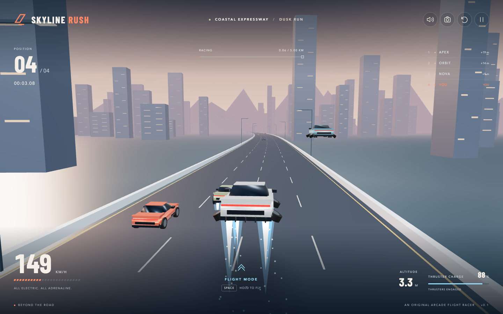

# Skyline Rush

A playable 3D coastal highway sprint with an electric sports car that can lift off on four blue thrusters. Race three opponents, fly over traffic, manage charge and land to recharge. Inspired by the supplied flying-car clip; the handling is fictional arcade physics.



## Run locally

Requires Node.js 22.12 or newer and a browser with WebGL 2 and hardware acceleration.

```sh
cd "$HOME/Documents/Workspace/skyline-rush"
npm ci
make run
```

Open the local URL Vite prints (normally http://127.0.0.1:5173). Assets and the font are bundled locally; gameplay makes no external requests. No backend or account is needed.

## Controls

| Action | Keyboard |
| --- | --- |
| Accelerate | W / ↑ |
| Brake | S / ↓ |
| Steer | A / D or ← / → |
| Fly | Hold Space once above 65 km/h |
| Land | Release Space |
| Boost | Hold Shift; consumes thruster charge |
| Start | Enter |
| Pause / resume | Esc / P |
| Restart | R |
| Change camera | C |
| Toggle sound | M |

Mobile layouts provide steering, accelerator, brake and flight buttons. Touch controls support simultaneous holds. Click the sound icon to enable synthesized engine/thruster audio. Leaving the tab pauses the race and clears input.

Flight charge lasts about five seconds at full thrust. At zero charge the car descends automatically; release the flight control and drive on the ground to recharge. The same charge powers boost. A contact slows the car; flying high enough avoids traffic. Finish the 5 km sprint ahead of NOVA, ORBIT and APEX. Personal best time is stored in this browser when storage is available.

## Verify

```sh
npm test                 # Deterministic simulation, input lifecycle and geometry
npm run build           # Production assets in dist/
npm run test:browser    # Real Chrome: desktop, mobile, graphics errors, full race
make check              # All three
```

Browser tests use an installed Google Chrome. Tests allow SwiftShader for headless rendering; normal gameplay uses the browser's available GPU. Screenshots are written to `artifacts/`; test traces/results are ignored. The full sprint test takes roughly a minute on a fast machine, longer when software rendering slows the simulation.

```sh
npm run preview         # Serve the production build after npm run build
```

## Project

- `src/game.js`: deterministic arcade simulation, opponents, traffic and finish order.
- `src/input.js`: keyboard and multi-pointer controls with cancellation and blur cleanup.
- `src/world.js`, `src/geometry.js`: Three.js renderer, procedural cars, highway, skyline, flight effects and cameras.
- `src/main.js`, `src/style.css`: start screen, telemetry, pause/results, responsive controls and lifecycle.
- `src/audio.js`: opt-in synthesized sound.
- `tests/`: unit and browser behavior tests.
- `docs/design.md`, `docs/verification.md`: scope and verification evidence.

All vehicle/scenery geometry and effects are generated in code. Barlow Condensed is bundled under its SIL Open Font License in `public/fonts/OFL.txt`. Three.js, Vite and Playwright retain their respective package licenses.

This is a local Git repository on `main`, with no remote configured. Single-player, one route, arcade physics. Browser verification covers desktop Chrome and emulated mobile viewports; physical phones and Safari have not been verified.
