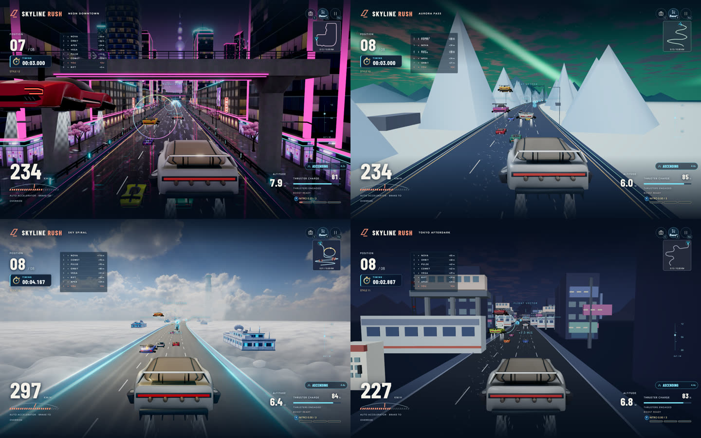

# Skyline Rush

**English** · [繁體中文](README.zh-TW.md)

[**Play Skyline Rush**](https://weskao.github.io/skyline-rush/)

A single-player 3D arcade racer where the road is only half the adventure. Race AI rivals, drift through corners, boost past traffic and fly over obstacles in a rocket-powered sports car. Play directly in your desktop or mobile browser.



[Desktop gameplay video](https://github.com/user-attachments/assets/ec0ffa92-5269-494c-bcbc-831759207046) · [Mobile gameplay video (emulated)](https://github.com/user-attachments/assets/1138325a-f4e8-4b7f-a426-0c39d70bebaf)

## Highlights

- **Drive, boost and fly:** use shared thruster charge for FLY and BOOST, collect energy pickups and rings, and earn NITRO through skillful driving.
- **Explore varied tracks:** coastal highways, neon cities, mountain roads and World Tour routes, with aerial shortcuts, weather and track-specific challenges.
- **Progress and personalize:** unlock tracks and Garage cars and paints, including the Roadster and Crimson GT; chase medals, daily challenges, personal records and Ghosts.
- **Make it yours:** adjustable graphics, audio and touch controls, remappable driving keys, an interactive driving tutorial, Photo Studio and English / Traditional Chinese.
- **Play as a guest:** progress is saved locally; optional Google sign-in enables Firebase cloud saves.

The development checkout may differ from the published game. Coming Soon tracks and Garage previews are not guaranteed to be available in the public build.

## Game modes

| Mode | What to do |
| --- | --- |
| Classic Race | Race AI rivals and unlock Career tracks. |
| Custom Race | Set your own rivals, difficulty, traffic and item rules. |
| Free Drive | Explore unlocked routes without racing for position. |
| Time Attack | Beat your best time or try a clean run. |
| Obstacle Run | Dodge hazards along the route. |
| Checkpoint Rush | Reach every gate and finish before time runs out. |
| Championship Cup | Compete across multiple tracks for points. |
| Stunt Attack | Chain tricks for a high score. |
| Elimination | Avoid last place and be the last driver standing. |
| Endless Highway | Survive traffic and set a distance record. |
| Circuit Race | Race multiple laps on Harbor Circuit. |

Event Lab Lite also lets you edit, import and export local obstacle and pickup layouts.

## Controls

| Action | Default keyboard |
| --- | --- |
| Accelerate / brake | W / S or ↑ / ↓ |
| Steer | A / D or ← / → |
| Fly / land | Hold / release Space |
| Boost | Hold Shift |
| NITRO | E / X |
| Drift | S + A / D at speed |
| Use item (where enabled) | Q |
| Pause / resume | Esc / P |
| Change camera / mute | C / M |
| Toggle AUTO | F2 |

On phones and tablets, use the on-screen controls in portrait or landscape. AUTO handles acceleration; the Controls panel lets you customize the touch layout and driving controls.

## Development

Built with Vue 3, TypeScript, JavaScript, Vite, Three.js, Web Audio and Firebase. Requires Node.js 22.12+, the pnpm version pinned in [package.json](package.json), Java 21+ for Firebase emulators, and a WebGL 2-capable browser.

```sh
git clone https://github.com/weskao/skyline-rush.git
cd skyline-rush
make setup
make dev
```

Open the URL printed by Vite. The Makefile starts local Auth and Firestore emulators for development.

| Command | Purpose |
| --- | --- |
| `make dev-unlocked` | Playtest race-ready tracks and Garage content locally. |
| `make phone` | Start a phone-accessible development server. |
| `make build` | Build the production site locally. |
| `make verify` | Run the project's verification suite. |
| `make help` | List available development commands. |

More details: [Game design](docs/design.md) · [Cloud saves](docs/cloud-save.md) · [Verification](docs/verification.md) · [Release process](docs/release-process.md).

---

An unofficial fan project inspired by the Tesla Roadster concept; not affiliated with Tesla or SpaceX. The bundled Barlow Condensed font uses the [SIL Open Font License](public/fonts/OFL.txt). Third-party dependencies retain their respective licenses.
