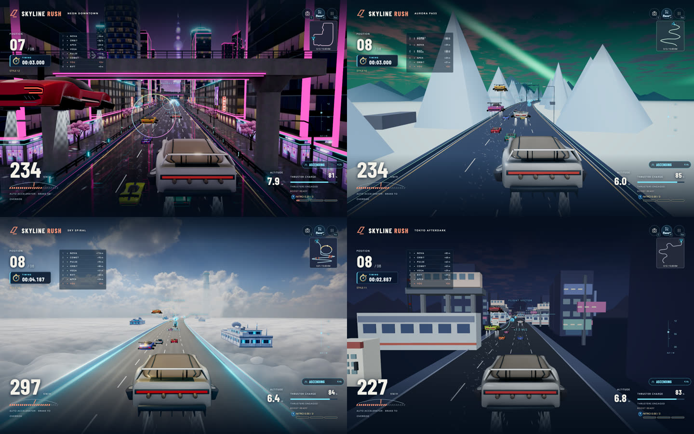

<!-- source-sha256: 0214e4761d1fbdce45c289bdd2d88efc416e2024dfb70b0c7a6a5cd92c247dda generated from README.md by scripts/readme-zh.mjs; edit README.md, then run the script -->
# Skyline Rush

[English](README.md) · **繁體中文**

[**立即遊玩 Skyline Rush**](https://weskao.github.io/skyline-rush/)

一款單人 3D 街機競速遊戲，公路只是冒險的起點。駕駛搭載火箭推進器的跑車，與 AI 對手競速、飄移過彎、加速超車，甚至飛越障礙。桌機與手機皆可直接透過瀏覽器遊玩。



[桌機遊戲影片](https://github.com/user-attachments/assets/ec0ffa92-5269-494c-bcbc-831759207046) · [手機遊戲影片（模擬環境）](https://github.com/user-attachments/assets/1138325a-f4e8-4b7f-a426-0c39d70bebaf)

## 遊戲特色

- **駕駛、加速與飛行：** FLY 與 BOOST 共用推進器電量，收集能量補給及光環，並透過駕駛技巧累積 NITRO。
- **探索多樣賽道：** 海岸公路、霓虹都市、山區道路及世界巡迴路線，搭配空中捷徑、天候與各賽道專屬挑戰。
- **解鎖與個人化：** 解鎖賽道、車庫車款與烤漆（車款包含 Roadster 與 Crimson GT），挑戰獎牌、每日挑戰、個人紀錄及幽靈車。
- **自訂遊戲體驗：** 可調整畫質、音訊及觸控操作、自訂駕駛按鍵，支援互動駕駛教學、照片模式及英文／繁體中文。
- **免登入遊玩：** 遊戲進度儲存在本機，亦可選擇 Google 登入並透過 Firebase 同步雲端存檔。

開發版本可能與已發布的遊戲不同。Coming Soon 賽道及車庫預覽內容不代表已於正式版本開放。

## 遊戲模式

| 模式 | 玩法 |
| --- | --- |
| 經典競速 | 與 AI 對手競速並解鎖生涯賽道。 |
| 自訂競速 | 自訂對手、難度、車流及道具規則。 |
| 自由駕駛 | 自由探索已解鎖的路線，不競爭名次。 |
| 計時挑戰 | 突破個人最佳時間，或挑戰零碰撞完賽。 |
| 障礙挑戰 | 閃避路線上的各種障礙。 |
| 限時計時關卡 | 在倒數結束前通過所有關卡並抵達終點。 |
| 錦標賽 | 於多條賽道競速，累積積分。 |
| 極限特技 | 串連特技並挑戰高分。 |
| 最後倖存競速 | 避免墊底遭淘汰，成為最後一名存活車手。 |
| 無盡公路 | 閃避車流並挑戰最遠行駛距離。 |
| 環道競速 | 在港灣環道進行多圈競速。 |

Event Lab Lite 也提供本機障礙與補給配置的編輯、匯入及匯出功能。

## 操作方式

| 動作 | 預設鍵盤按鍵 |
| --- | --- |
| 加速／煞車 | W / S 或 ↑ / ↓ |
| 轉向 | A / D 或 ← / → |
| 飛行／降落 | 按住／放開 Space |
| 推進加速 | 按住 Shift |
| NITRO | E / X |
| 飄移 | 行駛中按住 S + A / D |
| 使用道具（啟用時） | Q |
| 暫停／繼續 | Esc / P |
| 切換鏡頭／靜音 | C / M |
| 切換 AUTO | F2 |

手機和平板支援直向與橫向觸控操作。AUTO 可自動加速，並可透過操作設定面板自訂觸控配置與駕駛操作。

## 開發

採用 Vue 3、TypeScript、JavaScript、Vite、Three.js、Web Audio 與 Firebase。需要 Node.js 22.12+、[package.json](package.json) 指定的 pnpm 版本、供 Firebase 模擬器使用的 Java 21+，以及支援 WebGL 2 的瀏覽器。

```sh
git clone https://github.com/weskao/skyline-rush.git
cd skyline-rush
make setup
make dev
```

開啟 Vite 顯示的網址。Makefile 會啟動本機 Auth 與 Firestore 模擬器供開發使用。

| 指令 | 用途 |
| --- | --- |
| `make dev-unlocked` | 在本機測試已具備競速功能的賽道及車庫內容。 |
| `make phone` | 啟動可供手機連線的開發伺服器。 |
| `make build` | 在本機建置正式版本。 |
| `make verify` | 執行專案驗證流程。 |
| `make help` | 列出可用的開發指令。 |

更多資訊：[遊戲設計](docs/design.md) · [雲端存檔](docs/cloud-save.md) · [驗證方式](docs/verification.md) · [發布流程](docs/release-process.md)。

---

本遊戲為受 Tesla Roadster 概念啟發的非官方粉絲專案，與 Tesla 或 SpaceX 無關。內建 Barlow Condensed 字型採用 [SIL Open Font License](public/fonts/OFL.txt)，第三方套件保留各自的授權。
