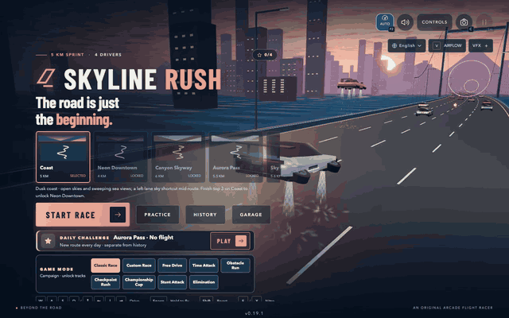

<!-- source-sha256: 96eb1379066d4ae8d1cabcac50b94a9a5125492c8e346cf17ac125643beb6bb7 generated from README.md by scripts/readme-zh.mjs; edit README.md, then run the script -->
# Skyline Rush

[English](README.md) · **繁體中文**

[**開玩 Skyline Rush →**](https://weskao.github.io/skyline-rush/)

這是一款可直接遊玩的 3D 海岸公路衝刺遊戲，主角是一輛飛行電動跑車，造型參考 Tesla Roadster 2 及其火箭推進器概念。靠四具藍色推進器升空，與三名對手競速，飛越車流，管理電量，並降落補充電力。操控屬於虛構的街機物理；這是非官方的粉絲專案，與 Tesla 或 SpaceX 無任何關聯。

## 遊戲介紹

在經典賽（Classic Race）中，Skyline Rush 是一場可在瀏覽器中重複遊玩的短程街機衝刺：一名玩家對上三名對手，加上夾雜其中的車流，電腦或手機皆可遊玩，無須安裝任何東西。其他模式提供單人駕駛、自訂規則與多階段挑戰。

- **先開車，再飛行。** 時速超過 65 km/h 後，按住 FLY 即可升空，飛越車流、穿過光環、跨越斷橋。飛行與 BOOST 共用同一份推進器電量，而且只能在路面上回充，所以每一次爬升都是一個抉擇。
- **靠good駕駛技巧賺取 NITRO。** 近距離超車、飄移、光環連續通過（PERFECT LINE）、尾流、落地桶滾與拾取道具，都會填滿三格的 NITRO 儲備；可以一次爆發用完，也可以連按延長時間。
- **十條賽道，依序解鎖。** 黃昏海岸、有低矮隧道的雨夜 Neon Downtown、有斷橋缺口與側風的 Canyon Skyway、有冰面與上坡路段的 Aurora Pass、擁有跳躍坡道與斷裂天橋的 360° 高架螺旋 Sky Spiral，接著是世界巡迴賽：Taipei Heritage、Tokyo Afterdark、Alpine Rail Pass、Coastal Horizon 與 Cosmic Orbit。每條賽道都有一條空中捷徑，留給能在空中穩住路線的玩家。
- **值得追逐的目標。** 每次完賽都會評定風格星等，用來解鎖車庫（Garage）中的塗裝。最佳成績幽靈、擁有專屬排行榜的每日挑戰，以及四枚獎章，都是再次出賽的理由。

一場經典衝刺約一分鐘；多階段挑戰則需要更久。音效由瀏覽器即時合成，進度儲存在本機儲存空間，因此不需要帳號，也沒有後端。




## 遊戲模式與重玩價值（開發分支）

> **進行中 · 2026 年 10 月 22 日。** 這些模式新增內容位於 [`feature/race-modes-p0`](https://github.com/weskao/skyline-rush/tree/feature/race-modes-p0)，不一定已包含在[已部署的 GitHub Pages 版本](https://weskao.github.io/skyline-rush/)中。上方現有的截圖呈現的是較早期的遊戲畫面；目前各模式的截圖連結在下方。[開發藍圖](TODO.md)還包含其他尚未完成的功能。

選擇一條**已解鎖的賽道**，在賽道卡片下方選擇**遊戲模式**，必要時展開規則說明，然後按下**開始比賽**（或按 Enter）。比賽仍使用相同的 Three.js 道路、飛行、FLY / BOOST / NITRO 與響應式觸控操作。開發分支提供七種模式：

| 模式 | 差異 | 勝利條件／進度 |
| --- | --- | --- |
| **經典賽（Classic Race）** | 在 10 條賽道之一進行標準的 3 名對手衝刺，包含車流、捷徑、光環與 NITRO。 | 登上頒獎台可解鎖下一條賽道；只有經典賽會頒發生涯星等、獎章與官方最佳成績。 |
| **自訂賽（Custom Race）** | 可選擇 **0–3 名對手**、簡單／普通／困難 AI、關閉／少量／普通／大量車流、NITRO 道具開關，以及普通／寬鬆的碰撞懲罰。內建五種預設：Standard、Traffic Rush、No Items、Air Focus 與 Precision。 | 非排名成績有獨立的歷史紀錄。可進行 **1 / 2 / 3 / 5 個衝刺階段**並比較總時間。各階段重複行駛點對點路線；它們**不是環形賽道的圈數**。 |
| **自由駕駛（Free Drive）** | 獨自探索任何已解鎖的賽道，可調整路上車流與道具，沒有名次，也不強制結束。 | 自由駕駛、飄移與飛行，然後重新開始或選擇其他賽道。這條人工設計的道路有終點；這**不是**無限世界模式。 |
| **計時賽（Time Attack）** | 單人計時衝刺，提供相容的最佳成績幽靈與領先／落後分段時間。可選擇開啟**無碰撞計時（Clean Time Trial）**。 | 依賽道與規則分別記錄最佳時間；開啟無碰撞計時時，只要發生任何碰撞，該次成績即告無效，且不會取代個人最佳。 |
| **障礙賽（Obstacle Run）** | 以種子產生的路邊障礙；密度分為**標準**或**極限**。部分障礙會橫向掃過；警示 HUD 會預告即將來臨的危險。 | 閃避危險、靠乾淨通過賺取風格分數，並使用一般路線的終點。障礙的擺放與碰撞共用確定性邏輯；經典賽不受影響。 |
| **檢查點競速（Checkpoint Rush）** | 穿越發光的 3D 拱門。起始時間為 **28 秒**；每通過一道乾淨的拱門可獲得 **+10 秒**（上限 60 秒）與 **250 風格分數**。 | 在倒數結束前通過所有拱門並抵達終點。漏掉拱門與逾時**不會**儲存有效的最佳成績。HUD 會顯示已通過的拱門數、剩餘時間與到下一個目標的距離。 |
| **錦標賽盃賽（Championship Cup）** | 選擇**3 或 5 條賽道**的盃賽，賽道僅限已解鎖的路線；每一站都要與 NOVA、ORBIT 和 APEX 競速。 | 名次依序獲得 **10 / 7 / 5 / 3 分**；累計積分與總時間決定冠軍，同分時以時間決勝。盃賽成績與生涯解鎖互不相干。 |

### 比賽設定、結果與無障礙

- 模式與賽道的選擇仍可用鍵盤與觸控操作；情境面板只顯示與所選模式相關的選項。無法使用的盃賽會說明還需要多少條賽道。
- HUD 會依模式調整：單人賽事會隱藏容易誤導的對手名次；多階段與盃賽會顯示階段進度；檢查點競速會顯示即時的拱門倒數；障礙賽會警示逼近的障礙；無碰撞計時會明確標示該次成績已失效。
- 練習、自訂、計時賽、障礙賽、檢查點競速與盃賽的結果，使用獨立的 `skyline-rush-mode-history-v1` 紀錄鍵。符合資格的練習幽靈有各自儲存的規則組合；經典賽的解鎖、星等、獎章、每日紀錄與官方時間不會受到練習成績影響。
- 在 **History → 挑戰模式紀錄** 可依模式篩選，查看每條賽道、每組規則各自的個人最佳，以及適用的 Time Attack 幽靈紀錄。歷史紀錄輪替超過 50 場仍保留永久最佳成績（`skyline-rush-mode-bests-v1`）。個人挑戰不會授予職涯星等或官方獎章。
- 模式名稱、結果說明、設定選項與危險警告支援英文與繁體中文。低畫質圖形、觸控操作與減少動態效果仍在驗證計畫之中。

### 實機遊戲截圖與驗證

用來檢視這些模式的截圖，都是**從執行中的瀏覽器遊戲**擷取的，不是概念圖。[下載實際的 Playwright 擷圖集](https://github.com/weskao/skyline-rush/actions/runs/39742666980/artifacts/12410172411)（自訂賽單人、自由駕駛、計時賽、障礙賽、極限障礙、檢查點競速與手機版模式選單）。GitHub Actions 的產出檔可能需要登入，而且會過期；若要在本機重現，請執行 `npx playwright test tests/race-modes-browser.spec.js`，然後開啟 `test-results/race-mode-*.png`。CI 截圖是以軟體算圖、降低解析度產生，無法代表最終裝置上的畫質。

**驗證快照，commit `beab3e2`：** `npm test`、正式版建置與世界巡迴賽的賽中測試皆通過；聚焦於賽事模式的瀏覽器工作回報 **11 項通過／1 項失敗**（無碰撞計時的瀏覽器測試逾時）。此分支**尚未完整驗證，也尚未部署**。未來的藍圖項目，包括特技挑戰（Stunt Attack）、無限程序生成道路、真正的封閉賽道圈數、主動式道具欄與賽道編輯器，除非在 [TODO.md](TODO.md) 中標為 `[x]`，否則仍待完成。

## 在本機執行

需要 Node.js 22.12 或更新版本，以及支援 WebGL 2 並啟用硬體加速的瀏覽器。

```sh
cd "$HOME/Documents/Workspace/skyline-rush"
make         # Installs dependencies on first run, then starts the Vite + Vue dev server
```

開啟 Vite 印出的本機網址（通常是 http://127.0.0.1:5173）。資源與字型皆已內建於本機；遊戲過程不會發出任何外部請求。不需要後端或帳號。

## 操作方式

| 動作 | 鍵盤 |
| --- | --- |
| 加速 | W / ↑ |
| 煞車 | S / ↓ |
| 轉向 | A / D 或 ← / → |
| 飛行 | 時速超過 65 km/h 後按住 Space |
| 降落 | 放開 Space |
| 加速推進 | 按住 Shift；消耗推進器電量 |
| NITRO | E / X（消耗一格完整電量；NITRO 期間再按一次可延長）。使用 WASD 的玩家用 E；使用方向鍵的玩家左手維持在 Shift / X / Space |
| 飄移 | 時速超過 162 km/h 時按住 S + A / D（僅限地面） |
| 開始 | Enter |
| 暫停／繼續 | Esc / P |
| 重新開始 | Backspace |
| 切換視角 | C |
| 全部音訊靜音／取消靜音 | M |
| 自動加速開／關 | F2 / AUTO 按鈕 |
| AIRFLOW 展示開／關 | V / AIRFLOW 按鈕 |

手機版面提供轉向、油門、煞車、加速推進、飛行與 NITRO 按鈕。觸控操作支援同時按住多個按鈕。AUTO 會持續按住油門，讓你專心轉向與飛行；煞車永遠優先於它。所有裝置預設開啟；你切換過一次後，這個瀏覽器就會記住你的選擇（`skyline-rush-auto`）。離開分頁會暫停比賽並清除按住的輸入。比賽中點擊 SKYLINE RUSH 標誌會先暫停並詢問：**繼續比賽**、**結束比賽**（回到賽道選擇，該次成績不儲存）或**回到首頁**（重新載入）；無論選哪一項，開始畫面都會重新開啟在剛跑完的賽道上，並捲動到賽道列的中央（第一條與最後一條賽道位於列的兩端）。按 Esc 會讓比賽維持暫停。視角與音效快捷鍵會保留按住中的駕駛操作。在觸控裝置上，在轉向板上往下滑動拇指會煞車，往下並往旁邊滑動則會飄移；在按鈕模式下，煞車按鈕位於轉向按鈕下方，因此煞車加轉向在那裡同樣可以飄移。

比賽前或暫停時開啟 **Controls**，可調整鍵盤轉向靈敏度，或重新對應駕駛動作。選取一個動作，然後按下按鍵；衝突的綁定會互換，固定的快捷鍵保留不可改，按 Escape 取消擷取。Reset keyboard 會還原預設值。綁定立即生效，並儲存在 `localStorage['skyline-rush-keymap']`。

同一個面板也控制觸控轉向模式、慣用手、滑動靈敏度、大小、不透明度，以及按住／切換式 FLY。**Edit touch layout** 讓你在比賽預覽上拖曳動作按鈕與經典轉向按鈕；**Done editing** 會保留你的配置，**Reset touch layout** 則會還原。位置在重新載入後仍會保留，隨慣用手左右鏡射，並在螢幕旋轉後維持在可視範圍內。在較矮的橫向螢幕上（高度低於 380 px，例如顯示著工具列的 iPhone Safari），開始畫面會省略標語，讓 START RACE 不需捲動就能按到，比賽 HUD 也會隱藏速度表與次要電量列，避免面板互相重疊。

所有音訊都由 Web Audio 合成；不需要下載任何音訊檔。背景音樂有兩首循環播放的合成器浪潮（synthwave）曲目：開始與結果畫面使用的片頭主題曲（約 64 秒），以及從倒數開始播放、節奏更快的比賽主題曲（約 55 秒）。每一首都會在循環中逐步堆疊，並在暫停時降低音量。音效涵蓋選單確認、三聲倒數滴答與 GO、馬達／風聲、升空與加速、煞車、車輛／護欄碰撞、降落、低電量警告、近距離超車獎勵與終點旋律。將音效靜音會停止尚未播放的提示音，暫停則會讓駕駛音效淡出。低電量警告只有在電量回充超過 30% 後才會重新啟用。

喇叭圖示會開啟音訊設定，內含音樂列與音效列，各有一個靜音開關與音量滑桿（開啟狀態見上方開始畫面截圖）。**Mute all**（或按 M）會同時讓兩者靜音。靜音時會保留各頻道的音量，因此取消靜音後會回到原本的音量；將滑桿拖到零，也會以同樣方式讓該頻道靜音。兩者預設皆為開啟、音量 100%，每個開關與音量都會以 cookie 記住一年（`skyline-rush-music`、`skyline-rush-sound`，以及記錄百分比的 `-volume` 變體）。在較矮的螢幕上，面板可以捲動。在瀏覽器允許自動播放的情況下，頁面一載入就會開始播放片頭音樂。若不允許（多數瀏覽器首次造訪時如此），第一次輕觸、點擊或按鍵就會開始播放。v0.20 之前儲存的音樂關閉設定（包含舊版「Play background music?」提示的 **Not now**）會重設為開啟一次，因為現在的儲存會附帶 `skyline-rush-audio-v=2`。在 iPhone 與 iPad 上，遊戲會要求媒體播放模式，因此靜音開關不會讓遊戲靜音；遊戲播放時也會暫停其他 App 的音訊。

飛行面板會顯示爬升、巡航、下降與觸地四個階段、剩餘推進秒數，以及接下來該使用的操作。青色光環標示出空中通道，而且是遊戲玩法的一部分：請見下方的光環一節。手機版另有一個按住加速推進的按鈕。橘色的碰撞報告會顯示撞擊類型與損失的速度；護欄現在會讓地面上的車輛反彈並減速。飛到護欄上方則可越過它們。

場景包含泛光（bloom）照明、夕陽海面、懸索橋、推進器蒸氣、碰撞火花與觸地漣漪。鏡頭運動與非必要的速度線會遵循你系統的減少動態效果偏好設定。音效為推進、碰撞與降落提供各自獨立的回饋。

右上角的 **VFX** 可選擇寫實、電影感或極致的視覺風格、低／中／高畫質（低畫質會關閉泛光並減少場景繪製）、舒適模式（無閃光、晃動、殘影或模糊）以及選用的觸覺回饋；**Fine tuning** 會把每項特效變成一支滑桿，**Reset visual settings** 則會還原預設值。**AIRFLOW**（或按 V）會把場景切換成空氣動力學展示：車身上的流線、遙測面板、低風阻或高下壓力，以及駕駛、前方、後方、側面或環繞的視角。展示期間，開始面板會退到一旁，只留下橘色的 **START RACE** 按鈕，固定在車子下方的底部中央。

三盞琥珀色起跑燈會在 GO 時轉為青色。玩家的車是一輛低矮楔形跑車，配有煙燻色快背式座艙、橫跨全寬的紅色尾燈條、四個後方推進口、在加速、煞車與飛行時升起的青銅色彈出式尾翼、旋轉的五輻輪圈，以及可轉向的前輪。每名對手都有各自的輪廓與燈光特徵：NOVA 是配有雙垂直尾翼與分離式洋紅色燈光的長尾車，ORBIT 是配有泡泡座艙與圓形青色車燈的圓潤 GT，APEX 則是配有前分流器、車頂進氣口、高大側板尾翼與琥珀色 C 形燈的賽道車。車流使用直立式的通勤車造型。轉向反應會快速趨於平順，放開加速推進後車速會逐漸下降，而不是瞬間切斷。所有駕駛與工具列按鈕的觸控目標至少為 44px，包括 320px 寬度的螢幕。

想獲得額外的電量獎勵，可在地面上以超過 126 km/h 的速度貼近超越車流。五秒內連續的乾淨超車可累積連擊至 ×5，並回充 8–16% 的電量（上限 100%）。發生碰撞會中斷連擊；在空中、距離過遠與恢復期間的超車不會獲得獎勵。HUD 會播報每一次超車與最後 500 公尺；結果畫面會顯示近距離超車與碰撞的總次數。

飛行電量在全推力下約可維持五秒。電量歸零時，車輛會自動下降；請放開飛行操作並在地面上行駛來回充。同一份電量也供加速推進使用。發生碰撞會讓車輛減速；飛得夠高就能避開車流。請在 NOVA、ORBIT 與 APEX 之前完成衝刺（依賽道不同為 4–8 公里）。在可使用儲存空間時，個人最佳時間會儲存在這個瀏覽器中。

### 操控細節

轉向會在 0.15 秒內推到全幅，高速時橫向速度上限為 9 m/s。在低於 65 km/h 時按住 Fly 會被記住 1.5 秒，待速度足夠後自動升空。在空中放開 Fly 會降低下墜加速度（11 → 7 m/s²），讓降落更柔和，並緩慢回充飛行電量（每秒 4，為地面回充速率的三分之一；電量說明文字顯示 GLIDE RECHARGE ACTIVE）。耗盡的推進器在放開 Fly 且電量回到 15 後即可再次解鎖，即使仍在空中也一樣。在距離斷橋 300 公尺以內（Sky Spiral 除外，它的坡道會直接把車拋過去），只要剩餘電量不足以在目前速度下推進飛越，HUD 中央就會警示 GAP AHEAD · NEED n% CHARGE。車輛在碰撞判定中的寬度為 1.7 公尺，因此有更多次超車會算作險些擦撞。輕微的護欄擦碰算作刮擦（保留 0.92 的速度、被推回道路上、不算碰撞、連擊保留）；正面撞擊仍算作碰撞。開啟 AUTO 時，放開轉向也會讓車輛緩緩回到最近的車道中央（車道輔助）。同時按住 Fly + Boost 時，每秒消耗 22 電量而非 29，保留加速推進的速度上限，並顯示 AIR DASH。

### NITRO 與飄移

NITRO 有自己的儲備（`player.nitro`，最多 3 格，每一格以浮點數填充）。三段式 HUD 會顯示部分電量，滿格的區段會發光，充滿時 NITRO MAX 會閃動（在舒適／減少動態效果模式下會抑制動態）。賽道上的拾取道具（藍色電池 +0.25、橘色罐子 +0.5、空中的金色油箱 +1、一個可填滿至上限的彩虹過充）依賽道種子擺放；每一項 NITRO 獎勵（道具、飄移、桶滾、光環、尾流）也會回充飛行電量（每儲存 0.25 = +5；過充不提供），超過上限的部分會轉為電量（每 0.25 = +8）。一格 NITRO 提供 2.5 秒，速度上限提高 30 m/s，並帶來更強的加速、排氣與鏡頭回饋；再按一次可延長 2 秒且速度不會疊加，因此按三次可連成 6.5 秒的爆發。NITRO 期間與車流碰撞會保留 70% 的速度，而非 45%。

在地面上超過 162 km/h 時，煞車 + 轉向會觸發飄移而非緊急煞車：只損失 3 m/s²，險些擦撞的連擊分數加倍，放開時依飄移時間給予 NITRO 與小幅加速（1 秒：+0.15 與 0.5 秒，2 秒：+0.3 與 0.8 秒，3 秒：+0.5 與 1.2 秒）。車身偏轉 25°，煙霧與藍／橘／紫色火花顯示等級，輪胎尖嘯聲逐漸增強，HUD 會標示飄移／小幅加速的狀態。升空、墜入缺口，或撞上車輛或障礙物，都會失去累積的進度。

NITRO 不消耗電量，因此 Fly + NITRO 永遠可以同時使用（Fly + Boost + NITRO 仍維持每秒 22 的 AIR DASH 消耗）。

**空中特技**：飛行時，快速甩動轉向（0.3 秒內連按兩次相反方向）會開始 0.7 秒的桶滾。以低於 11 m/s 的速度降落並完成桶滾，可獲得 +0.25 NITRO；較猛烈的降落（無動力下墜約 9 公尺或更高）則會失去獎勵。提早降落、撞到任何東西、隧道頂或缺口都會取消桶滾。車輛會旋轉（減少動態效果與舒適視覺特效會保留文字但省略旋轉），HUD 顯示 TRICK，並以 BARREL ROLL / TRICK +0.25 / HARD LANDING 的提示、呼嘯聲，以及觸控裝置上的短促觸覺震動標示桶滾與其獎勵。

**捷徑**：每條賽道都有一條位於邊緣車道上方 6 公尺的空中通道，標示為 SHORTCUT / FLY HIGH。在通道內，飛行不消耗電量，速度上限提高 12 m/s；通道沿途排列著 NITRO 電池，並在中段放置一個油箱，但交錯排列的柱子會算作撞上障礙。一塊使用賽道主題色的半透明甲板標出通道的地面；在通道內，HUD 顯示 SHORTCUT，飛行預算顯示 ∞（BOOST 仍會消耗電量）。

### 光環

5 公里的海岸賽道有 22 個光環，每 220 公尺一個，以 3 到 5 個為一組（依賽道種子擺放）。只有當車輛穿過光環的可見半徑時才算數；擦過邊緣不算。類型：青色充電（+20 電量）、金色 nitro（+0.5）、紫色尾流（3 秒小幅加速）、紅色風險（較小的光環，+1 NITRO 與 500 分）以及彩虹神祕（依種子隨機的一種效果：護盾 10 秒或直到第一次受擊、磁吸 5 秒、穿越車流的幽靈狀態 3 秒，或讓對手以半速凍結 2 秒）。收集過的光環會爆開一次後消失。整組通過會播報 PERFECT LINE 並給予 +1 NITRO；漏掉一個光環會讓它中斷，但已獲得的獎勵會保留。

### 對手、尾流與最終衝刺

緊跟在對手或車流車輛後方 1.5 秒，會獲得 +6 m/s 的速度上限與 +0.25 NITRO（離開尾流後才會重新啟用）。對手也會使用 NITRO，每人兩格，依個性而異：NOVA 從 8 秒起穩定施放，之後每 18 秒一次，ORBIT 在飛行時施放，APEX 則從比賽進行到 75% 時開始衝刺。輕微的橡皮筋機制（在 50 公尺以外最多 ±4% 的速度）讓比賽保持緊張。在最後 500 公尺，比賽音樂會加速到 115%，狀態列會顯示與前方和後方最近對手的差距（`FINAL 500 M · +N m · −N m`）。

### 儲存的資料

所有儲存都使用 try/catch，因此在儲存空間被封鎖時遊戲仍可執行。`skyline-rush-history`：每場完賽一筆紀錄，保留最近 50 筆，包含 `fuelOuts`（飛行電量耗盡的次數）與 `gapFalls`，用於調整飛行平衡。從開始或結果畫面開啟 **History**，可依賽道篩選、查看最佳成績與最近十次時間的圖表，並點擊某次成績查看詳情。`skyline-rush-best-tracks`：各賽道的最佳時間；舊版單一的 `skyline-rush-best` 會一次性遷移到 `coast`，且仍會為 coast 寫入。`skyline-rush-unlocked`：賽道解鎖狀態，即使較舊的成績已從 History 中移除也會保留。`skyline-rush-keymap`：按鍵綁定。`skyline-rush-controls` 與 `skyline-rush-vfx`：駕駛與視覺設定（幽靈開關位於 controls 中）。`skyline-rush-ghosts`：每條賽道一個最佳成績幽靈。`skyline-rush-medals`、`skyline-rush-stars`、`skyline-rush-paint`：附有獲得日期的獎章、各賽道最佳星等、已裝備的塗裝。`skyline-rush-daily`：每日挑戰的成績，保留最近 50 筆。每一筆儲存的值在載入時都會經過驗證；格式錯誤的內容會被忽略。

### 幽靈、每日挑戰、獎章與車庫

- **幽靈**：每次比賽會以每秒 10 次的頻率取樣車輛的距離、車道位置與高度。在某條賽道創下個人最佳時會儲存該次成績，之後在該賽道的比賽中會以半透明藍色車輛顯示。預設為關閉，可在 Controls 中的 **Show best-run ghost** 將它開啟。
- **每日挑戰**：History 會顯示今日的賽道與修飾條件，依當地日期挑選：禁止飛行、雙倍車流，或僅限金色光環。Canyon 永遠不會抽到禁止飛行，因為它的斷橋需要飛行。每日挑戰的成績只會記在自己的排行榜上（今日最快的前五名）；絕不會影響歷史紀錄、最佳時間、解鎖、星等或幽靈。重新開始會維持該挑戰，而 **Choose track** 則會離開它。
- **獎章**：首勝（獲勝）、無碰撞完賽（沒有任何碰撞）、完美飛行（單場比賽達成 5 次 PERFECT LINE）與三連爆發（一次爆發中使用 3 格 NITRO：一次按下加上兩次延長）。只有符合資格的經典賽完賽才能獲得獎章；每枚獎章都會保留首次獲得的日期。
- **車庫（Garage）**：你在各條賽道上的最佳風格星等會累加並解鎖塗裝：3 顆星解鎖 Aurora，6 顆解鎖 Glacier，10 顆解鎖 Coral，16 顆解鎖 Cobalt，24 顆解鎖 Obsidian（上限為 30）。現實世界中最受歡迎的車色——藍色與黑色——是長期目標。尚未解鎖的塗裝仍可預覽。塗裝只改變外觀，絕不影響車輛的數值。

### Sky Spiral（實驗性的第五條賽道）

Sky Spiral 加入了一條真正的 3D 上升螺旋道路，位於賽博龐克天際線之上。繞著發光的中央高塔完整行駛一圈水平迴轉，然後從三個專屬坡道飛越高架缺口。現有的 FLY、BOOST 與 NITRO 都能在這條新賽道上使用，並提供可選的飛行修正。這條賽道使用獨立的彎曲道路算圖器與自己的 3D 路徑對應器；目前仍在實體手機硬體上驗證中。

### 賽道與風格

從 Coast 開始。跑進前三名即可解鎖 Neon Downtown，接著依序是 Canyon Skyway、Aurora Pass、Sky Spiral、Taipei Heritage、Tokyo Afterdark、Alpine Rail Pass、Coastal Horizon 與 Cosmic Orbit。開始前請先選擇賽道；鍵盤使用者可用左／右鍵在賽道按鈕之間移動，並按 Enter 選擇。重新開始會保留所選賽道；結果畫面上的 **Choose track** 會回到選單。只要還有賽道處於鎖定狀態，登上頒獎台後結果畫面就會出現一個閃動的 **Next** 按鈕，可直接開始剛解鎖的賽道；當所有賽道都已開啟，以及在每日挑戰中，它都不會出現。如果瀏覽器中斷了 WebGL 連線（在 iPhone 鎖定螢幕或切換 App 之後很常見），圖形恢復後遊戲會清除警告；否則 **Start** 或 **Race again** 會重新載入頁面。每條賽道都有自己的天空、色盤與程序生成的場景：雨中的霓虹街道與低矮隧道、紅色沙漠峭壁與斷橋缺口／側風，或有極光與冰面的雪山。警告標誌會標示特殊路段。Aurora 的上坡路段回充地面電量的速率為正常的一半。

### 世界巡迴賽賽道、路線圖與賽道名稱

五條世界巡迴賽賽道共用同一個彎曲道路算圖器（`src/world-tour-scene.js`），並各有專屬的色盤、建築與地標（總統府與北門的剪影、霓虹十字路口與一座高塔、鐵路高架橋與山峰、一座燈塔與跨海大橋、環狀行星）。在首頁選擇一條世界巡迴賽賽道時，會把它的代表地標框在懸浮車輛的後方：總統府、東京鐵塔、一座阿爾卑斯山峰、一座燈塔或宇宙之門。朝它賽跑時，路邊景物會讓該地標保持清晰可見。每張賽道卡片都會顯示完整的主要路線，比賽中則有即時地圖標出 YOU、NOVA、ORBIT 與 APEX 的位置；空中捷徑不會被畫出來。在高度低於 500px 的螢幕，以及高度低於 700px 的窄版手機上，即時地圖會讓出空間，排行榜仍會列出各車手的名次。賽道名稱會依 **EN / 繁體中文** 切換開關所選的語言顯示（見下方語言一節）。

風格分數獎勵：近距離超車（100 × 連擊，飄移會使連擊加倍）、光環（150，風險光環另加 500）、PERFECT LINE（500）、移動中的滯空時間（每秒 10）以及每 500 公尺的乾淨行駛（100）。碰撞與墜入缺口會重置乾淨行駛的進度。結果畫面中，完賽可獲得一顆星，達到每公里 250 分得兩顆，達到每公里 500 分得三顆，與完賽名次無關。

燃料與 nitro 條會平順地趨向新數值，低於 20% 容量時發出警告，回充時閃爍，nitro 一格充滿時會脈動。舒適模式與系統的減少動態效果會停用這些動畫。滑動板在按住時會顯示浮動的圓環／圓鈕，並在比賽開始時顯示簡短提示；放開後轉向會回到中立。

HUD 使用共用的動態時間（120 / 240 / 480 ms）。速度表指針隨速度平順移動；名次變動時，名次數字會翻轉並附上綠色向上或紅色向下的箭頭，排行榜各列會滑動到新的位置。精簡的半透明事件提示位於畫面中央上方，避開 HUD 面板，並將險些擦撞、PERFECT LINE、NITRO 爆發、電量增加與飄移火花等級排入佇列，不會彼此重疊；同時回充飛行電量的 NITRO 獎勵會一併標明（NITRO · +20% CHARGE）。暫停、完賽與重新開始會清空佇列。按鈕在按下時會變暗但不改變大小，因此在邊框以內的任何位置按下都會被接受；按住的觸控按鈕會持續亮著。VFX 設定中的選用 **Haptic feedback** 會在支援的觸控裝置上，為碰撞、NITRO 與飄移獎勵提供觸覺訊號。舒適模式與系統的減少動態效果會保留文字與按下狀態的顏色，同時移除新增的動態與震動。

### 語言

整個介面皆提供英文與繁體中文（繁體中文）：開始畫面、車庫、History、HUD、比賽提示、結果、路線圖、設定，以及 3D 道路標誌。開始畫面賽道卡片下方的一個 **EN / 繁體中文** 開關，可一次切換全部內容，無須重新載入。語言依下列順序決定：

1. 你點擊開關所儲存的選擇（`skyline-rush-locale`；只會在點擊時寫入，絕不會由自動偵測寫入）；
2. 你的系統語言順序（`navigator.languages`）：第一個 `en*` 或 `zh*` 項目決定結果，其他語言會被略過（`['ja-JP', 'zh-TW']` 會選擇繁體中文），任何 `zh*` 標籤（zh-TW、zh-HK、zh-Hant、zh-CN、zh-Hans、單純的 zh）都會選擇繁體中文，清單為空或缺漏時則退回 `navigator.language`；
3. 否則使用英文。

品牌與遊戲術語在兩種語言中都維持英文：Skyline Rush、NITRO、FLY、BOOST，以及對手 NOVA、ORBIT 與 APEX。字串位於 `src/locales/`；`src/i18n.js` 負責偵測、`t()` 與目前的語系。

在地化圖片：`node scripts/capture-og-images.mjs` 會在 Chrome 中驅動真實的應用程式，並儲存 `public/og-image.en.jpeg` 與 `public/og-image.zh-TW.jpeg`（1440×900 的開始畫面），以及供繁體中文 README 使用的 `artifacts/{readme-start,readme-hero,mobile-flight,race-results}.zh-TW.jpeg`（`node scripts/capture-og-images.mjs og` 或 `readme` 只執行其中一半）。它絕不會動到英文版的 `artifacts/` 截圖。`public/manifest.webmanifest` 與應用程式圖示維持原樣：圖示不含文字，而且網頁應用程式 manifest 只有單一名稱與描述，不支援依語系區分的變體，因此再加一份 manifest 會破壞可安裝性。

## 驗證

```sh
npm test                 # Deterministic simulation, input lifecycle and geometry
npm run build           # Production assets in dist/
npm run test:browser    # Real Chrome: desktop, mobile, graphics errors, full race
npm run test:layout     # Home-screen fit, top bar and touch targets (runs on pre-push)
make run                # All three (test:browser builds first)
make deploy             # Trigger CI checks + GitHub Pages deployment of remote main
```

瀏覽器測試使用已安裝的 Google Chrome，並允許在無頭模式下以 SwiftShader 算圖。僅使用 CPU 的 CI 採用 0.25 的裝置像素比，讓 3D 場景維持流暢，同時保留相同的 CSS 視窗尺寸與遊戲玩法斷言；本機測試則以完整解析度算圖。一般遊玩使用瀏覽器可用的 GPU。英文 README 的截圖只有在檔案不存在，或執行 `UPDATE_ARTIFACTS=1 npm run test:browser` 時，才會以 JPEG（品質 70）寫入 `artifacts/`，因為即時 3D 場景每次執行都不一樣；測試的追蹤檔與結果會被忽略。完整的衝刺測試在快速的機器上大約需要一分鐘，軟體算圖拖慢模擬時則更久。

```sh
npm run preview         # Serve the production build after npm run build
```

若要在手機上檢查，請在你的網路上提供建置結果（`npx vite preview --host 0.0.0.0`），並加上 `?perf` 開啟（例如 `http://<computer-ip>:4173/?perf`）。頁面頂端會出現一條列，顯示最近 20 秒內的比賽影格時間：中位數（p50）、第 95 百分位數（p95）、平均 fps 與取樣長度。沒有 `?perf` 時，不會進行任何量測，也不會顯示任何內容。

## 部署

請至 [https://weskao.github.io/skyline-rush/](https://weskao.github.io/skyline-rush/) 遊玩。此網站是公開的：訪客不需要 GitHub 帳號或 Tailscale，開發者的電腦離線也沒有影響。

```sh
git tag v0.4.0 && git push origin v0.4.0   # Release: deploys once CI confirms the commit already passed on main
make deploy                              # Deploy remote main manually through the same CI flow
# The on-screen version (ready screen, desktop and mobile) is `package.json`'s version; `/release` bumps it
# after scripts/release-gate.sh has seen a green CI run for the commit on main.
```

CI（`.github/workflows/ci.yml`）會在推送到 `main`、拉取請求、版本標籤推送（`v*`）與手動執行時進行建置，並執行單元測試與 Chrome 瀏覽器測試。瀏覽器測試分成八個平行分片（`--shard=N/8`），而同一分支上較新的推送會取消被它取代的執行。手動執行會在所有檢查通過後發布；版本標籤推送則會重新執行單元測試，確認（`release-verified`）被標記的程式碼已在 `main` 上通過完整測試，而不是重新執行瀏覽器測試套件，然後發布並驗證公開網站。若標籤打在 CI 從未在 `main` 上通過的 commit 上，則不會部署。一般的分支推送與拉取請求只會執行檢查。Pages 建置使用 `--base=/skyline-rush/`，讓腳本、樣式與字型從專案網址載入。GitHub Pages 必須以 **GitHub Actions** 作為發布來源。手動部署需要已驗證的 GitHub CLI（`gh auth login`）；請先推送你的 commit，因為 `make deploy` 使用的是遠端 `main`。部署不再依賴本機的 pre-push hook 或 Netlify 登入。當任何檢查或部署在推送、標籤或手動執行時失敗，`notify-telegram` 工作會把失敗執行的連結傳送到 Telegram；它需要儲存庫的 secrets `TELEGRAM_BOT_TOKEN` 與 `TELEGRAM_CHAT_ID`（以 `gh secret set <NAME>` 設定，它會提示輸入值），缺少時則會靜默略過。

連結預覽圖片為 `public/og-image.jpeg`，是 `public/og-image.en.jpeg` 的複本；`node scripts/capture-og-images.mjs og` 會擷取兩種語言的封面並更新該複本。爬蟲無法切換語言，因此 `index.html` 只參照英文封面（`og:locale` 為 `en_US`，`og:locale:alternate` 為 `zh_TW`），而 `public/og-image.zh-TW.jpeg` 是供直接連結使用的中文對應版本。更換封面後，請提高 `index.html` 中 `og:image` 的 `?v=`，讓社群網站抓取新圖。

## 專案結構

- `src/game.js`：確定性的街機模擬、對手、車流與完賽順序。
- `src/input.js`：鍵盤與多指標控制，含取消與失焦清理；讀取已儲存的按鍵對應。
- `src/key-map.js`：純粹的按鍵對應，含 E / X NITRO、衝突互換式重新綁定、驗證與儲存。
- `src/history.js`：已儲存的遊戲資料：比賽歷史（最近 50 筆）、各賽道最佳成績與舊資料遷移、生涯統計、獎章、星等、已裝備的塗裝、幽靈與每日排行榜。
- `src/ghost.js`：10 Hz 的幽靈錄製、各賽道驗證與插值播放。
- `src/appearance.js`：塗裝目錄與星等解鎖門檻。
- `src/rng.js`：以種子產生的隨機串流；賽道道具與光環皆來自賽道種子。
- `src/world.js`、`src/geometry.js`：Three.js 算圖器、程序生成的車輛、公路、天際線、飛行特效與鏡頭。
- `src/effects.js`：固定 480 顆粒子的 GPU 粒子池，用於蒸氣、火花與降落塵土。
- `src/track-paths.js`、`src/world-tour-scene.js`：每條賽道一組距離到道路的對應，以及共用的世界巡迴賽道路、場景與地標。
- `src/route-map.js`、`src/i18n.js`：SVG 完整路線圖與即時車手地圖；語系偵測、已儲存的選擇、`t()` 與英文／繁體中文的賽道名稱；`src/locales/` 存放語言目錄。
- `scripts/capture-og-images.mjs`：從真實應用程式擷取英文與 zh-TW 的封面圖片，以及 zh-TW README 的截圖。
- `src/App.vue`、`src/icons.js`：Vue 3 的 UI 外殼（開始畫面、HUD、面板、觸控按鈕）及其共用的 SVG 圖示；只渲染一次，沒有響應式狀態。
- `src/main.js`、`src/style.css`：掛載 `App.vue`，然後在該 DOM 上驅動遙測、暫停／結果、響應式控制與生命週期。
- `vite.config.js`：搭配 `@vitejs/plugin-vue` 的 Vite。
- `src/perf.js`：供 `?perf` 裝置檢查讀數使用的影格時間百分位數。
- `src/audio.js`：合成音效與循環播放的片頭／比賽音樂序列器。
- `src/audio-settings.js`：讀取已儲存的音樂／音效開關與音量 cookie，以及滑桿的「靜音時保留音量」規則。
- `tests/`：單元與瀏覽器行為測試。
- `docs/design.md`、`docs/verification.md`：範圍與驗證證據。
- `README.zh-TW.md`：本檔案的繁體中文翻譯，由 `scripts/readme-zh.mjs` 保持最新（`check`、以 `claude -p` 翻譯的 `sync`，以及手動編輯後使用的 `stamp`）。當 commit 變更 README.md 時，`.githooks/pre-commit` hook 會重新產生它（可用 `SKIP_README_ZH=1` 跳過一次），而當被推送的 commit 動到首頁（`index.html`、`src/App.vue`、`src/main.js`、`src/style.css`、`src/locales/`）時，`.githooks/pre-push` 會執行 `npm run test:layout`（可用 `SKIP_LAYOUT_GATE=1` 跳過一次）；`make` 會以 `git config core.hooksPath .githooks` 啟用這些 hook。`.claude/settings.json` 中的 Claude Code Stop hook，會在某一輪編輯了 README.md 卻沒有更新它時，讓 Claude 回頭去更新。

所有車輛／場景的幾何與特效皆由程式碼生成。Barlow Condensed 依 SIL Open Font License 內建於 `public/fonts/OFL.txt`。Three.js、Vue、Vite 與 Playwright 保留其各自的套件授權。

來源：[weskao/skyline-rush](https://github.com/weskao/skyline-rush)。單人、十條賽道、街機物理。瀏覽器驗證涵蓋桌面版 Chrome 與模擬的手機視窗；iOS Safari 已在 iOS 模擬器中檢查過（直向與橫向，Coast 與 Neon），但尚未在實體手機上量測影格率（請使用 `?perf`，見驗證一節）。
