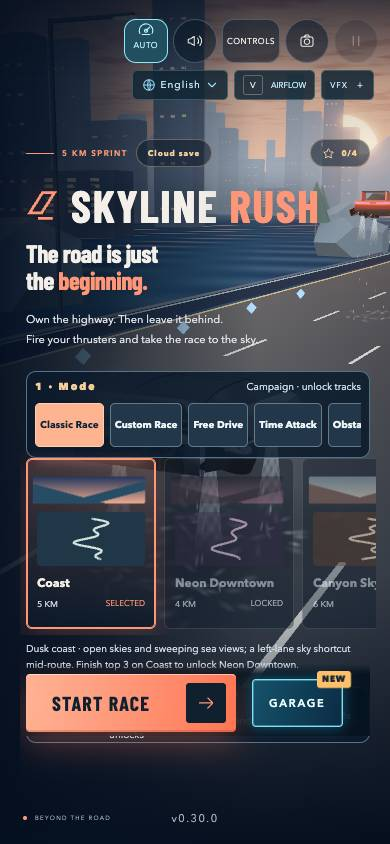
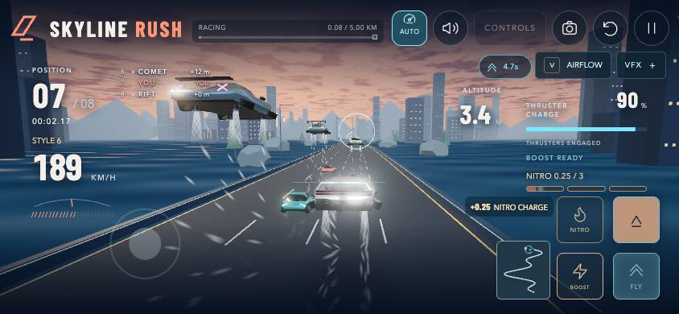

<!-- source-sha256: c70e534a50d9a5d557956d02daa15884adb3f15c365a497a387f34ea64b3fb03 generated from README.md by scripts/readme-zh.mjs; edit README.md, then run the script -->
# Skyline Rush

[English](README.md) · **繁體中文**

[**開始遊玩 Skyline Rush →**](https://weskao.github.io/skyline-rush/)

這是一款可直接遊玩的 3D 濱海公路衝刺遊戲，主角是一輛會飛的電動跑車，造型以 Tesla Roadster 2 及其火箭推進器概念為藍本。靠四具藍色推進器升空，與三名對手競速，飛越車流，管理電量並降落充電。操控手感為虛構的街機物理；這是非官方的粉絲專案，與 Tesla 或 SpaceX 無任何關係。

## 遊戲介紹

在 Classic Race 中，Skyline Rush 是一場可在瀏覽器中重複遊玩的短程街機衝刺：一名玩家對上三名對手，以及穿插其間的車流，桌機或手機皆可，無需安裝任何東西。其他模式提供單人駕駛、自訂規則與多賽段挑戰。

- **先開車，再飛行。** 時速超過 65 km/h 後，按住 FLY 即可升空，飛越車流、穿過光環、跨越斷橋。飛行與 BOOST 共用同一份推進器電量，而這份電量只能在路面上回充，因此每一次爬升都是一個抉擇。
- **靠好好開車賺取 NITRO。** 近距離超車、飄移、光環組合（PERFECT LINE）、氣流跟車、成功著陸的桶滾以及拾取道具，都會填滿三格的 NITRO 儲備；可以一次爆發用完，也可以連按延長時間。
- **十條賽道，依序解鎖。** 黃昏的 Coast、下著雨且有低矮隧道的 Neon Downtown、有斷橋與側風的 Canyon Skyway、有冰面與上坡的 Aurora Pass、具備跳台與斷裂天橋的 360° 高架螺旋 Sky Spiral，接著是世界巡迴賽：Taipei Heritage、Tokyo Afterdark、Alpine Rail Pass、Coastal Horizon 與 Cosmic Orbit。每條賽道都有一條空中捷徑，留給能在空中穩住路線的玩家。
- **值得追逐的目標。** 每次完賽都會獲得風格星數，用來解鎖 Garage 中的塗裝。最佳成績幽靈、擁有專屬排行榜的每日挑戰，以及四枚獎牌，都是再賽一場的理由。

一場 Classic 衝刺約一分鐘；多賽段挑戰則需要更久。音效由瀏覽器即時合成，進度儲存在本機儲存空間，因此不需要帳號，也沒有後端。

https://github.com/user-attachments/assets/e0ddb94c-794e-49ab-9b66-51cb5150f101

<p align="center"></p>

<p align="center"> </p>

### 在手機上遊玩

直向或橫向皆可使用觸控操作；AUTO 會持續按住油門。[觀看 MP4](artifacts/mobile-demo.mp4)

<p align="center"> </p>

以 Chrome 行動裝置模擬（390×844 與 844×390）在全新的設定檔上擷取；不代表實體手機的效能表現。

## 遊戲模式與重玩性（開發分支）

> **開發中 · 2026 年 10 月 29 日。** 這些模式新增內容合併於 `feature/roadmap-integration` 開發分支，尚未合併至 `main`，也未包含在[已部署的 GitHub Pages 版本](https://weskao.github.io/skyline-rush/)中。

選擇一條**已解鎖的賽道**，在賽道卡片下方選擇 **GAME MODE**，需要時展開規則說明，然後按下 **Start race**（或 Enter）。比賽仍使用同一套 Three.js 道路、飛行、FLY / BOOST / NITRO 與自適應觸控操作。開發分支包含下列模式：

| 模式 | 變化內容 | 獲勝條件／進度 |
| --- | --- | --- |
| **Classic Race** | 在 10 條賽道之一進行標準的 3 名對手衝刺，包含車流、捷徑、光環與 NITRO。 | 登上頒獎台可解鎖下一條賽道；只有 Classic 會頒發生涯星數、獎牌與正式最佳成績。 |
| **Custom Race** | 可選擇 **0–3 名對手**、Easy / Normal / Hard AI、Off / Light / Normal / Heavy 車流、NITRO 道具開／關，以及 Normal / Relaxed 碰撞懲罰。提供五種預設組合：Standard、Traffic Rush、No Items、Air Focus 與 Precision。 | 非排名結果擁有獨立的歷史紀錄。可進行 **1 / 2 / 3 / 5 個衝刺賽段**並比較總時間。各賽段重複同樣的點對點路線；它們**不是環形賽道的圈數**。 |
| **Free Drive** | 獨自探索任何已解鎖的賽道，可調整道路車流與道具，沒有名次，也不強制獲勝。 | 自由駕駛、飄移與飛行，直到道路盡頭；抵達終點後會以結果畫面結束這次行程，不儲存任何紀錄。這**不是**無限世界模式。 |
| **Time Attack** | 單人計時衝刺，提供相容的最佳成績 Ghost 與領先／落後分段時間。可選擇開啟 **Clean Time Trial**。 | 依賽道與規則分別記錄最佳時間；Clean 模式中只要發生任何碰撞，該次成績即作廢，不會取代個人最佳。 |
| **Obstacle Run** | 以種子生成的路邊障礙；密度分為 **Standard** 或 **Extreme**。部分障礙會橫向掃過；警示 HUD 會預告即將出現的危險。 | 閃避障礙，以乾淨通過賺取風格分數，並沿用一般路線的終點。障礙物的配置與碰撞共用確定性邏輯；Classic 不受影響。 |
| **Checkpoint Rush** | 穿越發光的 3D 閘門拱門。起始時間 **28 秒**；每通過一個乾淨的閘門可獲得 **+10 秒**（上限 60）與 **250 風格分數**。 | 在時間耗盡前通過每一座閘門並抵達終點。錯過閘門與逾時**不會**儲存有效的最佳成績。HUD 會顯示已通過的閘門數、剩餘時間與距下一個目標的距離。 |
| **Championship Cup** | 選擇由已解鎖路線組成的 **3 條或 5 條賽道** Cup；在每個賽段與 NOVA、ORBIT 及 APEX 對戰。 | 名次依序獲得 **10 / 7 / 5 / 3 分**；以累計積分與總時間決定冠軍，同分時以時間決勝。Cup 成績與生涯解鎖分開計算。 |
| **Stunt Attack** | 一場 **120 / 180 / 300 秒**的風格賽事，包含連續多個賽段：飄移、空中特技、近距離擦過與光環會累積連擊分數。 | 由計時器結束賽事，而非終點線；每種時長各有本機風格獎牌與最佳分數。 |
| **Elimination** | 四名車手的 Last Driver Standing：每十秒淘汰目前排名最後的車手。 | 撐到成為最後一名車手；提早被淘汰則結束本次行程，且沒有獎勵。 |

### Cup 復原

未完成的 Championship Cup 會在首頁提供 **Resume** 或 **Discard**。Resume 會保留已結算的賽段積分，只重新開始未完成的賽段；重試只會回溯正在重玩的那個賽段。完成或捨棄 Cup 都會清除其復原紀錄。刪除遊戲進度時也會一併移除檢查點，同時保留裝置偏好設定。復原功能使用此瀏覽器的儲存空間，無法還原瀏覽器拒絕儲存的資料。

### 自訂呈現與 Ghost

Custom Race 可為每個衝刺賽段重播最快的相容 Ghost。Custom 與 Free Drive 提供 Track / Day / Dusk / Night / Rain / Fog 呈現預設，以及即時規則摘要。這些外觀選項不會改變紀錄資格或規則集識別。重試會保留所選外觀；更換賽道或回到 Classic 時，則會恢復賽道原本的外觀。Photo Studio 關閉時會還原目前比賽的外觀。

### 可選道具與獎勵閘門

Custom 與 Free Drive 提供 **Off / Classic Mystery Rings / Active Items / All Items**。持有的道具僅佔用單一欄位：按 **Q** 或點按 **USE** 啟動，然後等待冷卻。NITRO 與 FLY/BOOST 保有各自的操作方式。All Items 會加入有上限的速度、空中電量與單次撞擊復原閘門；EMP 會短暫減慢附近的對手，在單人遊玩時則轉為 Magnet。復原不會影響正式的碰撞次數。Stunt Attack 與 Checkpoint Rush 可另外選擇開啟暫時且不可疊加的 ×2 分數閘門。Classic 的預設值維持不變。

### Event Lab Lite v1

**Event Lab Lite** 可編輯本機的路線範本，在已解鎖的路線上放置障礙、NITRO 光環與補給。可調整它們的車道與距離，對編輯進行 Undo/Redo/Reset，並以文字匯入或匯出經過驗證的路線。開始時會將路線編譯為真正的比賽事件；重試會保留路線與種子。路線成績與 Career 及 Custom 紀錄分開計算。圓錐、自製跳台、檢查點編輯與社群分享不在此第一版範圍內。

### Endless Highway

**Endless Highway** 讓 Coast 延伸到預設終點之外，成為以距離計算的生存活動。車流難度會上升到固定上限；發生五次碰撞即結束一次完整的嘗試。個人紀錄追蹤最長的絕對距離，與 Career 及 Ghost 分開。暫停與 WebGL 復原都會保留進行中的行程。第一版僅支援 Coast；其附近的景物與事件使用有上限的物件池。

### Circuit Race

**Circuit Race** 新增 Harbor Circuit，這是一條獨立、隨時可進入的 2 公里封閉環形賽道，提供 **1 / 3 / 5 圈**。依序通過每個區段即可完成一圈；倒退通過、傳送與復原都無法獲得圈數。HUD 與結果畫面會顯示分段時間、上一圈、個人最佳單圈與總時間。單圈最佳成績不會因滾動式 History 淘汰而消失；總時間與 Ghost 則依圈數設定各自獨立。原本的十條點對點路線維持原有的地理配置與 Career 進度。

### 賽道主題、障礙與風險路線

- **賽道主題**（在 Custom、Free Drive 與 Obstacle Run 中可選擇開啟）為每條路線帶來專屬的危險：Coast 的貨物與陣風、Neon 的道路施工、Canyon 的落石、Aurora 的雪堆、冰面與暴風雪、Sky Spiral 的能量閘門、Taipei 的節慶路障、Tokyo 的號誌閘門、Alpine 的雪崩、Coastal 的海浪水花，以及 Cosmic 的能量牆。危險會事先預警，永遠保留兩條車道暢通，且絕不改變 Classic。
- **Obstacle Run** 提供 **Mixed obstacles** 路線：包含擺盪的閘門、墜落的碎片，以及架在路障上的圓環，鼓勵玩家飛越或繞行。
- **風險路線**：高風險光環與近距離超車在 Custom Hard 中獎勵更高，也可以關閉以便輕鬆練習。
- 道路新增了非實體的路邊生活景象：觀眾、廣告看板、維修廂型車、鐵路月台、行駛的列車、船隻與無人機。較低的畫質設定會繪製較少的這類景物。

### 比賽設定、結果與無障礙

- 模式與賽道的選擇仍可透過鍵盤與觸控操作；情境面板只會顯示與所選模式相關的選項。尚不可用的 Cup 會說明還需要多少條賽道。
- HUD 會隨模式調整：單人活動會隱藏容易造成誤導的對手名次；多賽段與 Cup 會顯示賽段進度；Checkpoint Rush 顯示即時的閘門倒數；Obstacle Run 會警示即將出現的障礙；Clean Time Trial 會明確標示行程已作廢。
- Practice、Custom、Time Attack、Obstacle、Checkpoint 與 Cup 的結果使用獨立的 `skyline-rush-mode-history-v1` 紀錄鍵。符合資格的練習 Ghost 擁有各自儲存的規則集；Classic 的解鎖、星數、獎牌、Daily 紀錄與正式時間不會受練習行程影響。
- 在 **History → Challenge records** 中，可依模式篩選，查看每個確切賽道／規則集的個人最佳，以及符合資格的 Time Attack Ghost。即使最近 50 場行程輪替淘汰，終身最佳仍會保存在 `skyline-rush-mode-bests-v1` 之下。Challenge 紀錄明確地不屬於 Career 獎牌或星數。
- 模式標籤、結果說明、設定選項與危險警示支援英文與繁體中文。低畫質、觸控操作與減少動態效果仍屬於驗證計畫的一部分。

### 真實遊戲截圖與驗證

用來檢視這些模式的截圖是**從執行中的瀏覽器遊戲**擷取，並非概念圖。[下載實際的 Playwright 擷圖集](https://github.com/weskao/skyline-rush/actions/runs/39742666980/artifacts/12410172411)（Custom solo、Free Drive、Time Attack、Obstacle Run、Extreme obstacles、Checkpoint Rush 與手機模式選單）。GitHub Actions 的產出檔案可能需要登入且會過期；若要在本機重現，請執行 `npx playwright test tests/race-modes-browser.spec.js` 並開啟 `test-results/race-mode-*.png`。CI 截圖為軟體算圖且解析度較低，不代表最終的裝置畫質。

**驗證：** 每項功能的測試與完整檢查紀錄都列在 `TODO.md` 中。實體 iPhone 與 Android 的檢查仍待進行。

## 在本機執行

需要 Node.js 22.12 或更新版本，以及支援 WebGL 2 並啟用硬體加速的瀏覽器。

```sh
cd "$HOME/Documents/Workspace/skyline-rush"
make         # Installs dependencies on first run, then starts the Vite + Vue dev server
```

開啟 Vite 印出的本機網址（通常是 http://127.0.0.1:5173）。資源與字型皆已內建於本機；遊戲過程不會發出任何外部請求。不需要後端或帳號。

`make` 與 `make dev-unlocked` 也會啟動本機的 Firebase Auth/Firestore 模擬器（需要 Java 21+），因此雲端存檔的 Google 登入可搭配假的測試帳號使用，絕不會動到真實的存檔。專案擁有者的雲端存檔操作與 Spark 配額檢查請見 `docs/cloud-save.md`。

`make dev-diag` 與 `make phone-diag` 會提供相同的建置版本，並編入螢幕上的診斷橫幅（影格計數、頁面生命週期與觸控事件及其點擊目標，另有跨重新載入保留的最後幾個未捕捉錯誤），用於在實體手機上追查當機或按鈕失效。正式版建置絕不包含它：`npm run build` 會拒絕帶有診斷模組的封裝檔。

`make phone` 會開啟終端機選單，用來啟動、檢查或停止一個手機可以開啟的開發伺服器（透過 Tailscale 或同一個 Wi-Fi），並在伺服器回應後印出手機網址。選單會列出此工作目錄、其他 worktree 與最近的分支，也可輸入分支名稱；`make phone <name>` 會直接前往該分支（或 `feature/<name>`），需要時會在 `.claude/worktrees/` 下建立其 worktree，`make phone off` 會停止它啟動的所有伺服器（等同 `/phone-dev off`），而 `YES=1`（例如 `make phone YES=1 <name>`）會略過選單：每個問題都採用其 Recommended 選項，並印出每項選擇。它提供的是一般鎖定進度的建置版本；`make phone-unlocked [name]` 是相同的選單，但所有賽道與塗裝皆已解鎖，也是手機唯一能連上的全解鎖伺服器（`make dev-unlocked` 與 `make dev-feature` 仍僅限桌機）。它需要個人的 `phone-dev` Claude Code skill（`/phone-dev` 會詢問相同的選單），且不啟動模擬器，因此手機上的雲端存檔登入使用的是真實專案。

## 操作方式

| 動作 | 鍵盤 |
| --- | --- |
| 加速 | W / ↑ |
| 煞車 | S / ↓ |
| 轉向 | A / D 或 ← / → |
| 飛行 | 時速超過 65 km/h 後按住 Space |
| 降落 | 放開 Space |
| Boost | 按住 Shift；消耗推進器電量 |
| NITRO | E / X（一格完整電量；NITRO 期間再按一次可延長）。WASD 操作者使用 E；方向鍵操作者則讓左手維持在 Shift / X / Space 上 |
| 飄移 | 在 162 km/h 以上按住 S + A / D（僅限地面） |
| 開始 | Enter |
| 暫停／繼續 | Esc / P |
| 重新開始 | Backspace |
| 切換視角 | C |
| 靜音／取消靜音所有音訊 | M |
| 自動油門開／關 | F2 / AUTO 按鈕 |
| AIRFLOW 展示開／關 | V / AIRFLOW 按鈕 |
| 在首頁切換賽道 | 向左／向右滑動或拖曳 3D 預覽，或在觸控板上用兩指滑動 |

行動版介面提供轉向、油門、煞車、boost、飛行與 NITRO 按鈕。觸控操作支援同時按住多個按鈕。AUTO 會持續按住油門，讓你專心轉向與飛行；煞車一律優先於它。它在每台裝置上預設為開啟；一旦你切換過，你的選擇就會記錄在這個瀏覽器中（`skyline-rush-auto`）。離開分頁會暫停比賽並清除按住的輸入。在比賽中點擊 SKYLINE RUSH 標誌會暫停並先詢問：**Keep racing**、**End race**（回到賽道選擇，本次行程不儲存）或 **Back to home**（重新載入）；無論選哪一個，開始畫面都會重新開啟並停在剛跑過的賽道，捲動到賽道列的中央（第一條與最後一條賽道位於列的兩端）。Esc 會讓比賽維持暫停。視角與音效快捷鍵會保留按住中的駕駛操作。在觸控上，拇指在轉向板上向下滑動會煞車，向下並向側邊滑動則會飄移；在 Buttons 模式中，較細的煞車鍵位於轉向按鈕上方，避開拇指放置的那一排，因此只有刻意才會按到；將拇指從 ← 或 → 向上滑入煞車鍵，會同時保持轉向並煞車，因此一根拇指就能飄移，滑回下方則會放開煞車。觸控按鈕與螢幕角落保持距離，讓拇指更容易觸及，平板則會將它們上移並放大。

在比賽前或暫停時開啟 **Controls**，可調整鍵盤轉向靈敏度或重新對應駕駛動作。選取一個動作，然後按下按鍵；衝突的綁定會互換，固定的快捷鍵保留不可用，Escape 會取消擷取。Reset keyboard 會恢復預設值。綁定會立即生效，並儲存在 `localStorage['skyline-rush-keymap']` 之下。

同一個面板也控制觸控轉向模式、慣用手、滑動靈敏度、大小、不透明度與按住／切換式 FLY。**Edit touch layout** 讓你在比賽預覽上拖曳動作按鈕與經典轉向按鈕；**Done editing** 會保留你的配置，**Reset touch layout** 則會還原。位置會在重新載入後保留，隨慣用手鏡像翻轉，並在旋轉後維持在可視範圍內。在較矮的橫向螢幕上（高度低於 380 px，例如工具列顯示中的 iPhone Safari），開始畫面會省略標語，讓 START RACE 不需捲動即可按到，而比賽 HUD 會隱藏速度表與次要電量列，避免面板互相重疊。

所有音訊皆以 Web Audio 合成；不需下載任何音訊檔案。背景音樂有兩首循環播放的 synthwave 曲目：在開始與結果畫面播放的前奏主題（約 64 秒），以及從倒數開始播放、節奏更快的比賽主題（約 55 秒）。每首都會在循環中逐步堆疊，並在暫停時降低音量。音效涵蓋選單確認、三聲倒數滴答與 GO、馬達／風聲、升空與 boost、煞車、車輛／護欄碰撞、著陸、低電量警示、近距離超車獎勵，以及完賽旋律。靜音音效會停止尚待播放的提示音，暫停則會淡出行駛音效。低電量警示只會在電量回充超過 30% 之後才重新啟用。

喇叭圖示會開啟音訊設定，內含 Music 列與 Sound effects 列，各有一個靜音開關與音量滑桿（如上方開始畫面截圖中展開的樣子）。**Mute all**（或 M）會同時靜音兩者。靜音會保留各聲道的音量，因此取消靜音後會回到原本的音量；將滑桿拖到零，也會以同樣方式讓該聲道靜音。兩者預設皆為開啟且音量 100%，每項開／關選擇與音量都會記錄在 `localStorage` 中（`skyline-rush-music`、`skyline-rush-sound` 儲存 `on`/`off`，另有儲存百分比的 `-volume` 變體）；若沒有儲存任何值，兩個聲道皆為開啟，並會以 `on` 儲存。在較矮的螢幕上，面板可以捲動。在瀏覽器允許自動播放的情況下，頁面一載入就會開始播放前奏音樂。若不允許（Chrome 與大多數其他瀏覽器首次造訪時），則由第一次點按、點擊或按鍵來啟動。在 iPhone 與 iPad 上，遊戲會請求媒體播放，因此靜音開關不會讓它靜音；這也會在遊戲進行時暫停其他 App 的音訊。

飛行面板會顯示爬升、巡航、下降與著陸、剩餘推力秒數，以及下一個該使用的操作。青色光環標示出空中走廊，且屬於遊戲玩法的一部分：請見下方的 Rings。行動版另有按住即可 boost 的按鈕。橘色的碰撞報告會顯示撞擊類型與損失的速度；護欄現在會讓行駛中的車輛反彈並減速。飛得夠高就能越過護欄。

場景包含泛光照明、日落水面、懸索橋、推進器蒸氣、碰撞火花與著陸漣漪。鏡頭動態與非必要的速度線會遵循系統的減少動態效果偏好。音效為推力、碰撞與著陸提供各自獨立的回饋。

**VFX**（右上角）可選擇 Realistic、Cinematic 或 Extreme 風格，Low / Medium / High 畫質（Low 會關閉泛光並繪製較少的景物）、Comfort 模式（無閃光、震動、殘影或模糊），以及可選的觸覺回饋；**Fine tuning** 將每個效果以滑桿呈現，**Reset visual settings** 則還原預設值。**AIRFLOW**（或 V）會將場景切換為空氣動力學展示：車身上的流線、遙測面板、Low drag 或 High downforce，以及駕駛、前方、後方、側面或環繞視角。開始面板會為展示讓開，只留下橘色的 **START RACE** 按鈕，固定在車子下方的底部中央；左右滑動場景即可切換賽道。第一次開啟 AIRFLOW 時，會有動畫指尖示範該手勢。流線只會在 AIRFLOW 開啟時出現：關閉時，BOOST 與 NITRO 會顯示推進器噴流、尾跡與速度線，但沒有流線。

三盞琥珀色起跑燈會在 GO 時轉為青色。玩家的車是一輛低矮的楔形敞篷跑車，配有煙燻色的快背式座艙、橫貫全寬的紅色尾燈條、四個後推進器噴口、在 boost、煞車與飛行時升起的青銅色彈出式尾翼、旋轉的五輻輪圈，以及可轉向的前輪。每名對手都有自己的輪廓與燈光特徵：NOVA 是長尾車型，配有雙垂直尾翼與分離式洋紅色燈光；ORBIT 是圓潤的 GT，配有泡泡座艙與圓形青色車燈；APEX 是賽道車款，配有前分流器、車頂進氣口、高聳的端板尾翼與琥珀色 C 形燈。車流使用直立的通勤車造型。轉向會快速緩入，放開 boost 則會讓車子逐漸減速，而不是瞬間切斷速度。所有駕駛與工具列按鈕的觸控目標至少為 44px，即使在 320px 寬度下也一樣。

想獲得額外的電量獎勵，可在地面上以 126 km/h 以上的速度近距離超越車流。五秒內的乾淨超車最多可連鎖到 ×5，並回充 8–16% 的電量（上限 100%）。碰撞會中斷連鎖；在空中、距離過遠與復原中的超車不會獲得獎勵。HUD 會播報每一次超車與最後 500 公尺；結果畫面會顯示近距離超車與碰撞的總數。

飛行電量在全推力下約可持續五秒。電量歸零時，車子會自動下降；放開飛行操作並在地面上行駛即可回充。同一份電量也供 boost 使用。碰撞會讓車子減速；飛得夠高就能避開車流。對手與車流遵守相同的碰撞規則：它們會繞過較慢的車輛與玩家，和你一樣會撞上道具、障礙與危險物，而碰撞會讓兩輛車都減速並互相推擠（車流隨後會加速回到巡航速度）。在 NOVA、ORBIT 與 APEX 之前完成衝刺（依賽道不同為 4–8 公里）。個人最佳時間會在儲存空間可用時存放於此瀏覽器。

### 操控手感

轉向在 0.15 秒內升到最大，且高速時橫向速度上限為 9 m/s。在 65 km/h 以下按住 Fly 會被記住 1.5 秒，並在速度足夠時自動升空。在空中放開 Fly 會降低下墜加速度（11 → 7 m/s²）以便更柔和地著陸，並緩慢回充飛行電量（每秒 4，為地面速率的三分之一；電量說明文字顯示 GLIDE RECHARGE ACTIVE）。耗盡的推進器在放開 Fly 且電量回到 15 後即可再次使用，即使在空中也一樣。在距離斷橋 300 公尺內（Sky Spiral 除外，因為它的跳台會把車子拋過去），只要剩餘電量以目前速度無法推進越過，HUD 中央就會警示 GAP AHEAD · NEED n% CHARGE。車輛的碰撞寬度為 1.7 公尺，因此更多次的擦身而過會算作近距離超車。輕微的護欄擦碰算作刮擦（保留 0.92 的速度、被推回道路上、不算碰撞、連擊保留）；正面撞擊仍算作碰撞。在 AUTO 開啟時，放開轉向也會讓車子緩緩回到最近的車道中心（車道輔助）。同時按住 Fly + Boost 每秒消耗 22 電量而非 29，維持 boost 的速度上限，並顯示 AIR DASH。

### NITRO 與飄移

NITRO 有自己的儲備（`player.nitro`，最多 3 格，每格以浮點數填充）。三段式 HUD 會顯示部分電量，滿格的區段會發光，NITRO 全滿時 NITRO MAX 會閃動（在 comfort／減少動態效果模式下會抑制動態）。沿途的拾取物（藍色電池 +0.25、橘色罐子 +0.5、空中金色油箱 +1、一個可填滿至上限的彩虹過充）依賽道種子配置；每項 NITRO 獎勵（拾取物、飄移、桶滾、光環、氣流跟車）也會回充飛行電量（每存入 0.25 = +5；過充不提供），超過上限的部分則會轉為電量（每 0.25 = +8）。一格可提供 2.5 秒，速度上限提高 30 m/s，並有更強的加速度、排氣與鏡頭回饋；再按一次會延長 2 秒且速度不疊加，因此連按三次會形成 6.5 秒的爆發。NITRO 期間碰到車流時保留 70% 的速度，而非 45%。

在地面上超過 162 km/h 時，煞車 + 轉向會進行飄移而非緊急煞車：只損失 3 m/s²，近距離超車的連擊分數加倍，放開時會依飄移時間給予 NITRO 與迷你 boost（1 秒：+0.15 與 0.5 秒，2 秒：+0.3 與 0.8 秒，3 秒：+0.5 與 1.2 秒）。車身偏擺 25°，煙霧與藍／橘／紫色火花顯示階段，輪胎尖嘯聲逐漸增強，HUD 會標示飄移／迷你 boost 狀態。升空、墜入缺口，或撞上車輛或障礙，都會失去累積的進度。

NITRO 不消耗電量，因此 Fly + NITRO 一律可以同時使用（Fly + Boost + NITRO 仍維持每秒 22 的 AIR DASH 消耗）。

**空中特技**：飛行時，快速撥動轉向（0.3 秒內兩次相反方向的按壓）會啟動 0.7 秒的桶滾。以低於 11 m/s 的速度完成桶滾並著陸可獲得 +0.25 NITRO；較猛烈的著陸（無動力下從約 9 公尺或更高處墜落）會失去獎勵。提早著陸、撞到任何東西、隧道頂或缺口會取消桶滾。車子會旋轉（減少動態效果與 Comfortable VFX 會保留文字但省略旋轉），HUD 顯示 TRICK，並以 BARREL ROLL / TRICK +0.25 / HARD LANDING 提示、一聲呼嘯聲，以及觸控裝置上的短暫觸覺震動來標示桶滾與其獎勵。

**捷徑**：每條賽道都有一條位於邊緣車道上方 6 公尺的空中走廊，標示為 SHORTCUT / FLY HIGH。在其中飛行不消耗電量，速度上限提高 12 m/s；走廊兩側排列著 NITRO 電池，並在中途放有一個油箱，但交錯的塔柱會算作碰撞障礙。走廊地板以賽道主色調的半透明平台標示；進入其中後，HUD 會顯示 SHORTCUT，飛行預算顯示為 ∞（BOOST 仍會消耗電量）。

### Rings

5 公里的 Coast 有 22 個光環，每 220 公尺一個，以 3 到 5 個為一組（依賽道種子配置）。只有當車子穿過光環的可見半徑時才算數；擦到邊緣不算。類型有：青色電量（+20 電量）、金色 nitro（+0.5）、紫色氣流（3 秒迷你 boost）、紅色風險（小型光環，+1 NITRO 與 500 分）以及彩虹神祕（依種子隨機的一種效果：護盾 10 秒或直到第一次撞擊、磁鐵 5 秒、穿越車流的幽靈狀態 3 秒，或將對手凍結為半速 2 秒）。收集過的光環會爆開一次然後消失。通過整組光環會播報 PERFECT LINE 並給予 +1 NITRO；漏掉一個光環會中斷連擊，但保留已經獲得的獎勵。

### 對手、氣流跟車與最後衝刺

緊跟在對手或車流的車後面 1.5 秒，會獲得 +6 m/s 的速度上限與 +0.25 NITRO（離開尾流後才會重新啟用）。對手也會使用 NITRO，各有兩格，依個性而異：NOVA 從第 8 秒起穩定施放，之後每 18 秒一次；ORBIT 在飛行時施放；APEX 從比賽進行到 75% 時爆發。輕度的橡皮筋機制（超過 50 公尺後最多 ±4% 速度）讓比賽保持緊張。在最後 500 公尺，比賽音樂會加速到 115%，狀態列會顯示與前後最近對手的差距（`FINAL 500 M · +N m · −N m`）。

### 儲存的資料

所有存檔都使用 try/catch，因此即使儲存空間被封鎖，遊戲仍可執行。`skyline-rush-history`：每場完賽一筆紀錄，保留最近 50 筆，包含 `fuelOuts`（飛行電量耗盡的次數）與 `gapFalls`，用於調整飛行平衡。從開始或結果畫面開啟 **History**，可依賽道篩選、查看最佳行程與最近十次時間的圖表，並點按任一行程查看詳細資料。`skyline-rush-best-tracks`：各賽道的最佳時間；舊版單一的 `skyline-rush-best` 會一次性遷移到 `coast`，並仍會為 coast 寫入。`skyline-rush-unlocked`：賽道解鎖狀態，即使較舊的行程已從 History 淘汰仍會保留。`skyline-rush-keymap`：按鍵綁定。`skyline-rush-controls` 與 `skyline-rush-vfx`：駕駛與視覺設定（ghost 開關位於 controls 中）。`skyline-rush-ghosts`：每條賽道一個最佳成績 ghost。`skyline-rush-medals`、`skyline-rush-stars`、`skyline-rush-paint`：附有授予日期的獎牌、各賽道的最佳星數、已裝備的塗裝。`skyline-rush-daily`：每日挑戰的行程，最近 50 筆。每個儲存的值在載入時都會經過驗證；任何格式錯誤的內容都會被忽略。

### Ghost、每日挑戰、獎牌與 Garage

- **Ghost**：每次行程會以每秒 10 次的頻率取樣車子的距離、車道位置與高度。在某條賽道創下新的個人最佳時，會儲存該次行程，之後在該賽道的比賽中會以半透明藍色車輛顯示。預設為關閉；請在 Controls 中以 **Show best-run ghost** 開啟。
- **每日挑戰**：History 會顯示今天的賽道與修飾條件，依本機日期挑選：禁止飛行、雙倍車流，或僅限金色光環。Canyon 永遠不會出現禁止飛行，因為它的斷橋需要飛行。每日行程只會進入自己專屬的排行榜（今日最快的五名）；它們絕不會影響歷史紀錄、最佳時間、解鎖、星數或 ghost。Restart 會保留挑戰，而 **Choose track** 則會離開挑戰。
- **獎牌**：First victory（獲勝）、Clean run（無碰撞）、Perfect flight（單場比賽中 5 個 PERFECT LINE）與 Triple burst（單次爆發中使用 3 格 NITRO：一次按壓加上兩次延長）。只有符合資格的 Classic Race 完賽才能頒發；每枚獎牌都會保留首次獲得的日期。
- **Garage**：你在每條賽道上的最佳風格星數會加總並解鎖塗裝：Aurora 需 3、Glacier 需 6、Coral 需 10、Cobalt 需 16、Obsidian 需 24（最高為 30）。現實世界中最受歡迎的車色——藍色與黑色——是長期目標。尚未解鎖的塗裝仍可預覽。塗裝只改變外觀，絕不影響車輛的數值。

### Sky Spiral（實驗性的第五條賽道）

Sky Spiral 新增了一條真正的 3D 上升螺旋道路，位於賽博龐克天際線之上。環繞發光的中央高塔完整行駛一圈水平旋轉，然後從三個專用跳台發射，跨越高架缺口。現有的 FLY、BOOST 與 NITRO 都可在這條新賽道上使用，並附有可選的飛行修正。這條賽道使用獨立的彎曲道路算圖器與專屬的 3D 路徑對應器；目前仍在實體行動裝置上驗證中。

### 賽道與風格

從 Coast 開始。名列前三即可解鎖 Neon Downtown，接著依序是 Canyon Skyway、Aurora Pass、Sky Spiral、Taipei Heritage、Tokyo Afterdark、Alpine Rail Pass、Coastal Horizon 與 Cosmic Orbit。開始前先選擇賽道，或向左或向右滑動 3D 預覽（用滑鼠拖曳，或在觸控板上用兩指橫向滑動），像輪播一樣翻到相鄰的賽道：預覽會跟著手指移動，輕輕一撥就足夠，第一條與最後一條賽道有橡皮筋般的回彈，並有標示賽道名稱的標籤與分頁圓點；鍵盤使用者可用 Left/Right 在賽道按鈕之間移動，並以 Enter 選擇。Restart 會保留所選的賽道；結果畫面上的 **Choose track** 則回到選單。當仍有賽道處於鎖定狀態時，登上頒獎台後結果畫面會顯示閃動的 **Next** 按鈕，可直接開始剛解鎖的賽道；當所有賽道原本就已開啟，以及在每日挑戰中，這個按鈕都不會出現。如果瀏覽器中斷了 WebGL 連線（在 iPhone 上鎖定螢幕或切換 App 之後很常見），遊戲會在圖形恢復時清除警告；否則 **Start** 或 **Race again** 會重新載入頁面。每條賽道都有自己的天空、色盤與程序生成的景物：下著雨的霓虹街道與低矮隧道、紅色沙漠峭壁與斷橋缺口／側風，或是有極光與冰面的雪山。警告標誌會標示特殊路段。Aurora 的上坡路段以一半的正常速率回充地面燃料。

### World Tour 賽道、路線地圖與賽道名稱

五條 World Tour 路線共用同一個彎曲道路算圖器（`src/world-tour-scene.js`），各有專屬的色盤、建築與地標（總統府與北門的剪影、霓虹十字路口與一座塔、鐵路高架橋與山峰、燈塔與跨海大橋、帶環的行星）。在首頁選擇一條 World Tour 路線時，會在懸浮的車輛後方框出其標誌性地標：總統府、東京鐵塔、一座阿爾卑斯山峰、燈塔或宇宙之門。朝它競速時，路邊會讓該地標保持清晰可見。每張賽道卡片都會顯示完整的主要路線，而比賽中，即時地圖會在其上標出 YOU、NOVA、ORBIT 與 APEX；空中捷徑則絕不繪出。在高度低於 500px 的螢幕，以及高度低於 700px 的窄版手機上，即時地圖會讓開，排行榜仍會為車手排名。賽道名稱會跟隨以 **EN / 繁體中文** 切換開關選擇的語言（請見下方的 Language）。

風格分數獎勵近距離超車（100 × 連擊，飄移的連擊加倍）、光環（150，風險光環另加 500）、PERFECT LINE（500）、移動中的滯空（每秒 10）以及每 500 公尺的乾淨行駛（100）。碰撞與墜入缺口會重設乾淨距離的進度。結果畫面會頒發：完賽一顆星、每公里 250 分兩顆星、每公里 500 分三顆星，與完賽名次無關。

燃料與 nitro 條會緩緩趨近新的數值，在低於 20% 容量時發出警示，回充時閃爍，並在一格 nitro 完成時閃動。Comfort 模式與系統的減少動態效果會停用這些動畫。滑動板在按住時會顯示浮動的環與旋鈕，並在比賽開始時顯示簡短提示；放開後轉向會回到中立。

HUD 使用共用的動態時間（120 / 240 / 480 ms）。速度表指針會隨速度緩動；名次變化時，名次數字會翻轉並附上綠色向上或紅色向下的箭頭，排行榜列則滑入新的位置。精簡的半透明事件提示顯示在視野中央上方，避開 HUD 面板，並將近距離超車、PERFECT LINE、NITRO 爆發、電量增加與飄移火花階段排入佇列，不會互相重疊；同時回充飛行電量的 NITRO 獎勵會標明出來（NITRO · +20% CHARGE）。暫停、完賽與重新開始都會清空佇列。按鈕在按下時會變暗而不改變大小，因此按到邊框為止的任何位置都能被偵測到；按住的觸控按鈕會保持亮起。VFX 設定中可選的 **Haptic feedback** 會在支援的觸控裝置上為碰撞、NITRO 與飄移獎勵提供觸覺訊號。Comfort 模式與系統的減少動態效果會保留文字與按下狀態的顏色，同時移除新增的動態與震動。

### Language

整個介面皆提供英文與繁體中文（繁體中文）：開始畫面、Garage、History、HUD、比賽提示、結果、路線地圖、設定，以及 3D 路標。開始畫面賽道卡片下方的一個 **EN / 繁體中文** 開關會一次切換全部內容，無需重新載入。語言依下列順序決定：

1. 你點擊開關所儲存的選擇（`skyline-rush-locale`；只有在點擊時才會寫入，絕不會由自動偵測寫入）；
2. 你的系統語言順序（`navigator.languages`）：第一個 `en*` 或 `zh*` 項目決定結果，其他語言會被略過（`['ja-JP', 'zh-TW']` 會選擇繁體中文），任何 `zh*` 標籤（zh-TW、zh-HK、zh-Hant、zh-CN、zh-Hans、單純的 zh）都會選擇繁體中文，清單為空或缺漏時則退回使用 `navigator.language`；
3. 否則使用英文。

品牌與遊戲術語在兩種語言中都維持英文：Skyline Rush、NITRO、FLY、BOOST，以及對手 NOVA、ORBIT 與 APEX。字串位於 `src/locales/`；`src/i18n.js` 負責偵測、`t()` 與目前的語言。

在地化圖片：`node scripts/capture-og-images.mjs` 會在 Chrome 中驅動真實的 App，並儲存 `public/og-image.en.jpeg` 與 `public/og-image.zh-TW.jpeg`（1440×900 的開始畫面），以及供繁體中文 README 使用的 `artifacts/{readme-start,readme-hero,mobile-flight,race-results}.zh-TW.jpeg`（`node scripts/capture-og-images.mjs og` 或 `readme` 只執行其中一半）。英文的 `artifacts/` 截圖絕不會被它更動。`public/manifest.webmanifest` 與 App 圖示保持原樣：圖示不含文字，而且 web app manifest 只有單一的名稱與說明，沒有各語言的變體，因此再加第二份 manifest 會破壞可安裝性。

## 驗證

```sh
npm test                 # Deterministic simulation, input lifecycle and geometry
npm run build           # Production assets in dist/
npm run test:browser    # Real Chrome: desktop, mobile, graphics errors, full race
npm run test:layout     # Home-screen fit, top bar and touch targets (runs on pre-push)
make run                # All three (test:browser builds first)
make deploy             # Trigger CI checks + GitHub Pages deployment of remote main
make help               # List every make command with its options
```

瀏覽器測試使用已安裝的 Google Chrome，並允許在無頭算圖時使用 SwiftShader。僅有 CPU 的 CI 使用 0.25 的裝置像素比，以保持 3D 場景的流暢，同時維持相同的 CSS 視窗尺寸與遊戲斷言；本機測試則以完整解析度算圖。一般遊玩使用瀏覽器可用的 GPU。英文 README 截圖僅在檔案不存在，或使用 `UPDATE_ARTIFACTS=1 npm run test:browser` 時，才會以 JPEG（品質 70）寫入 `artifacts/`，因為即時 3D 場景每次執行都不同；測試追蹤紀錄與結果會被忽略。完整的衝刺測試在快速的機器上約需一分鐘，軟體算圖拖慢模擬時則更久。

```sh
npm run preview         # Serve the production build after npm run build
```

要在手機上檢查，請在你的網路上提供建置版本（`npx vite preview --host 0.0.0.0`），並加上 `?perf` 開啟（例如 `http://<computer-ip>:4173/?perf`）。頂端隨即會出現一條列，顯示過去 20 秒的比賽影格時間：中位數（p50）、第 95 百分位（p95）、平均 fps 與樣本長度。沒有 `?perf` 時，不會進行任何量測，也不會顯示任何內容。

```sh
make perf BASE=main         # A/B in Chrome at 412×915, CPU throttled 6× (RATE=20 for a low-end phone), 3 alternating rounds
make perf BASE=main VIEWPORT=desktop  # The same A/B at 1440×900 desktop size
make perf-phone             # Like make phone: asks base version, Tailscale/Wi-Fi and Telegram; logs phone temperatures
```

`make perf` 會建置此工作目錄，並在指定 `BASE=<git ref>` 時也建置該 ref（位於 `.claude/worktrees/perf-<sha>`，下次會重複使用），每次執行在 Coast 競速 24 秒，並印出每次執行的列，以及各建置版本的中位數。`make perf-phone` 對於未傳入的項目，會用與 `make phone` 相同的方式詢問（`BASE=`、`VIA=tailscale|wifi|auto`、`TG=0`），為每個建置版本印出並傳送一組 `?perf` 網址到 Telegram，在以 USB 連接的任何 Android 手機上以 Chrome 開啟第一個網址（`adb reverse`，因此任何網路都可行），按下 Ctrl+C 時傳送網址已過期的通知，並每 10 秒記錄手機的感測器溫度與降頻等級（`dumpsys thermalservice`）以及 Mac 的熱警告等級，直到按下 Ctrl+C。只有在相同的降頻等級下才比較各次執行：發熱的手機不論建置版本為何都會降頻並掉幀。iPhone 不回報溫度。

## 部署

請至 [https://weskao.github.io/skyline-rush/](https://weskao.github.io/skyline-rush/) 遊玩。網站為公開：訪客不需要 GitHub 帳號或 Tailscale，開發者的電腦也可以離線。

```sh
git tag v0.4.0 && git push origin v0.4.0   # Release: deploys once CI confirms the commit already passed on main
make deploy                              # Deploy remote main manually through the same CI flow
# The on-screen version (ready screen, desktop and mobile) is `package.json`'s version; `/release` bumps it
# after scripts/release-gate.sh has seen a green CI run for the commit on main.
```

CI（`.github/workflows/ci.yml`）會在推送到 `main`、`develop`、pull request、版本標籤推送（`v*`）與手動執行時，建置並執行單元測試與 Chrome 瀏覽器測試。瀏覽器測試以 13 個平行分片執行，World Tour 長時間執行則以 5 個分片，依 `tests/ci-durations.json` 中實測的每項測試時間來平衡（`scripts/ci-shards.mjs`），且僅在 `main` 與 `develop` 上執行（其他分支只執行單元與雲端存檔檢查，除非 commit 訊息含有 `[full-regression]` 或手動執行要求），而且對同一分支的較新推送會取消被它取代的執行。手動執行會在所有檢查通過後發佈；推送版本標籤時會重新執行單元測試，確認（`release-verified`）所標記的程式碼已在 `main` 上通過完整測試，而不是重新執行瀏覽器測試套件，然後發佈並驗證公開網站。若標籤所在的 commit 從未在 `main` 上通過 CI，就不會被部署。一般的分支推送與 pull request 只會執行檢查。當 `main` 的某個合併 commit 合併的不是 `develop` 或 `hotfix/*` 時，推送到 `main` 也會讓 `main-merge-source` 工作失敗（`scripts/check-main-merges.sh`），而該紅燈執行會阻擋發佈。Pages 建置使用 `--base=/skyline-rush/`，讓腳本、樣式與字型從專案網址載入。GitHub Pages 必須使用 **GitHub Actions** 作為發佈來源。手動部署需要已驗證的 GitHub CLI（`gh auth login`）；請先推送你的 commit，因為 `make deploy` 使用遠端的 `main`。部署不再依賴本機的 pre-push hook 或 Netlify 登入。當任何檢查或部署在推送、標籤或手動執行時失敗，`notify-telegram` 工作會將失敗執行的連結傳送到 Telegram；它需要儲存庫的 secrets `TELEGRAM_BOT_TOKEN` 與 `TELEGRAM_CHAT_ID`（各以 `gh secret set <NAME>` 設定，該指令會提示輸入值），缺少時則靜默略過。

連結預覽圖片為 `public/og-image.jpeg`，是 `public/og-image.en.jpeg` 的副本；`node scripts/capture-og-images.mjs og` 會擷取兩種語言的封面並更新該副本。爬蟲無法切換語言，因此 `index.html` 只參照英文封面（搭配 `og:locale` `en_US` 與 `og:locale:alternate` `zh_TW`），而 `public/og-image.zh-TW.jpeg` 是它的中文孿生版本，供直接連結使用。更換封面之後，請提高 `index.html` 中 `og:image` 的 `?v=`，讓社群網站抓取新的圖片。

## 專案結構

- `src/game.js`：確定性的街機模擬、對手、車流與完賽順序。
- `src/input.js`：鍵盤與多指標控制，具備取消與失焦清理；讀取已儲存的按鍵對應。
- `src/key-map.js`：純粹的按鍵對應，包含 E / X NITRO、衝突互換的重新綁定、驗證與儲存。
- `src/history.js`：已儲存的遊戲資料：比賽歷史（最近 50 筆）、各賽道最佳成績與舊版遷移、生涯統計、獎牌、星數、已裝備的塗裝、ghost 與每日排行榜。
- `src/ghost.js`：10 Hz 的 ghost 錄製、各賽道驗證與插值播放。
- `src/appearance.js`：塗裝目錄與星數解鎖門檻。
- `src/rng.js`：以種子產生的隨機串流；賽道拾取物與光環來自賽道種子。
- `src/world.js`、`src/geometry.js`：Three.js 算圖器、程序生成的車輛、公路、天際線、飛行效果與鏡頭。
- `src/effects.js`：固定的 480 顆粒子 GPU 池，用於蒸氣、火花與著陸塵土。
- `src/track-paths.js`、`src/world-tour-scene.js`：每條賽道一份距離到道路的對應，以及共用的 World Tour 道路、景物與地標。
- `src/route-map.js`、`src/i18n.js`：SVG 完整路線與即時車手地圖；語言偵測、已儲存的選擇、`t()` 與英文／繁體中文的賽道名稱；`src/locales/` 存放語系目錄。
- `scripts/capture-og-images.mjs`：從真實的 App 擷取英文與 zh-TW 的封面圖片，以及 zh-TW README 的截圖。
- `scripts/pickup-economy.mjs`：由腳本驅動的機器人跑遍每條賽道，並印出每分鐘 NITRO、BOOST 佔比、燃料耗盡次數與第一次取得 NITRO 的時間；`tests/pickup-economy.test.js` 鎖定光環／拾取物的配置。
- `scripts/ci-shards.mjs`：`plan` 為每個 CI 分片提供其 Playwright `--test-list`，依時間長短打包測試，讓每個分片幾乎同時完成；`refresh <run-id>` 會在測試套件大幅變動後，根據某次 CI 執行的記錄重寫 `tests/ci-durations.json`。
- `src/App.vue`、`src/icons.js`：Vue 3 的 UI 外殼（開始畫面、HUD、面板、觸控按鈕）及其共用的 SVG 圖示；只渲染一次，沒有響應式狀態。
- `src/main.js`、`src/style.css`：掛載 `App.vue`、串接各畫面控制器，並執行比賽生命週期（開始、暫停、重新開始、結果）與影格迴圈。
- `src/*-ui.ts`：每個畫面區域各有一個 TypeScript 控制器（比賽選擇、雲端存檔、觸控操作、按鍵對應、VFX、音訊、歷史對話框、拍照模式）。
- `src/race-hud.ts`、`src/race-hud-modes.ts`：比賽中的 HUD，於每個 HUD tick 以命令式方式寫入。
- `src/race-results.ts`、`src/result-screen.ts`、`src/session-progress.ts`：記錄完成的比賽（最佳成績、解鎖、獎牌、ghost）並顯示其結果畫面。
- `vite.config.js`：搭配 `@vitejs/plugin-vue` 的 Vite。
- `src/perf.js`：用於 `?perf` 裝置檢查讀數的影格時間百分位數。
- `src/audio.js`：合成音效與循環播放的音樂定序器；歌曲位於 `src/music-tracks.ts`，比賽到音效的事件位於 `src/race-audio-events.ts`。
- `src/audio-settings.js`：從 `localStorage` 讀取已儲存的音樂／音效開關與音量，以及滑桿「靜音保留音量」的規則。
- `tests/`：單元與瀏覽器行為測試。`tests/module-size.test.js` 讓每個原始碼模組保持在 400 行以內（較舊的大型檔案有只減不增的上限）。
- `docs/design.md`、`docs/verification.md`：範圍與驗證證據。
- `README.zh-TW.md`：本檔案的繁體中文翻譯，由 `scripts/readme-zh.mjs` 保持最新（`check`、以 `claude -p` 翻譯的 `sync`，以及手動編輯後的 `stamp`）。`.githooks/pre-commit` hook 會在 commit 變更 README.md 時重新產生它（可用 `SKIP_README_ZH=1` 略過一次），`.githooks/pre-push` 會在推送的 commit 涉及首頁時執行 `npm run test:layout`（`index.html`、`src/App.vue`、`src/main.js`、`src/style.css`、`src/locales/`；可用 `SKIP_LAYOUT_GATE=1` 略過一次），而 `.githooks/main-merge-guard`（由 `pre-merge-commit` 與 `pre-commit` 執行）會拒絕將 `develop` 或 `hotfix/*` 以外的任何分支合併到 `main`（fast-forward 不會執行 hook，因此請使用 `--no-ff`；可用 `ALLOW_MAIN_MERGE=1` 略過一次）；`make` 會以 `git config core.hooksPath .githooks` 啟用這些 hook。`.claude/settings.json` 中的 Claude Code Stop hook 會在某個回合編輯了 README.md 卻沒有同步更新它時，讓 Claude 回頭去更新。

所有車輛／景物的幾何與效果皆由程式碼產生。Barlow Condensed 依 SIL Open Font License 內建於 `public/fonts/OFL.txt`。Three.js、Vue、Vite 與 Playwright 保留其各自的套件授權。

來源：[weskao/skyline-rush](https://github.com/weskao/skyline-rush)。單人遊玩、十條賽道、街機物理。瀏覽器驗證涵蓋桌機 Chrome 與模擬的行動裝置視窗；iOS Safari 已在 iOS Simulator 中檢查過（直向與橫向，Coast 與 Neon），但實體手機上的影格率尚未量測（請使用 `?perf`，見驗證一節）。
