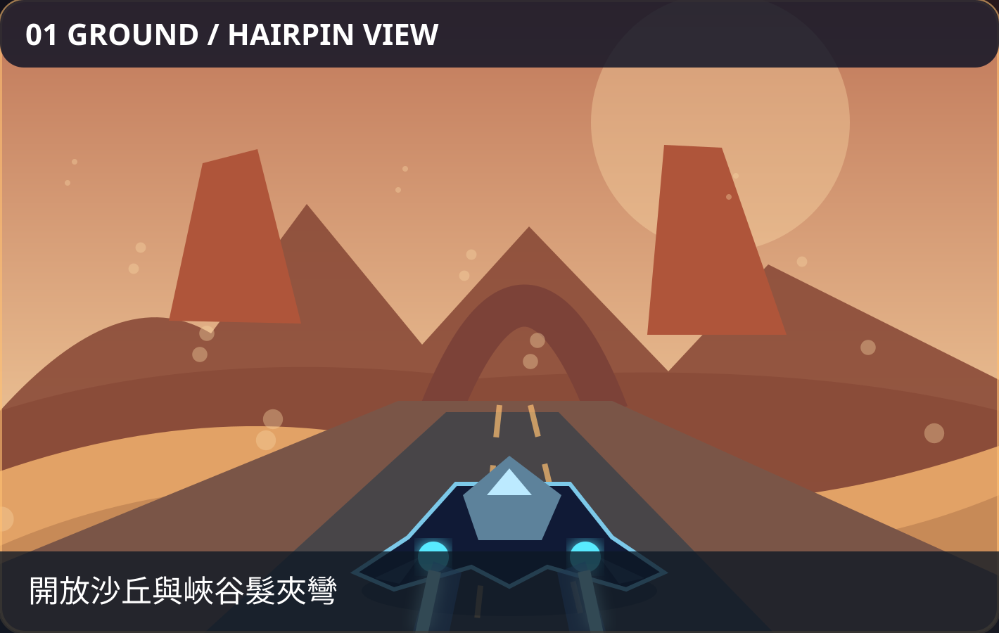
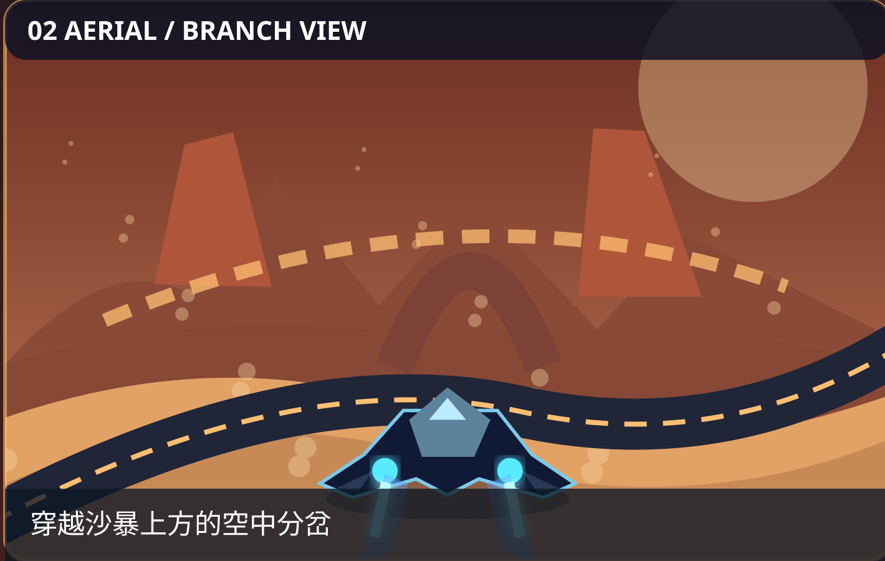
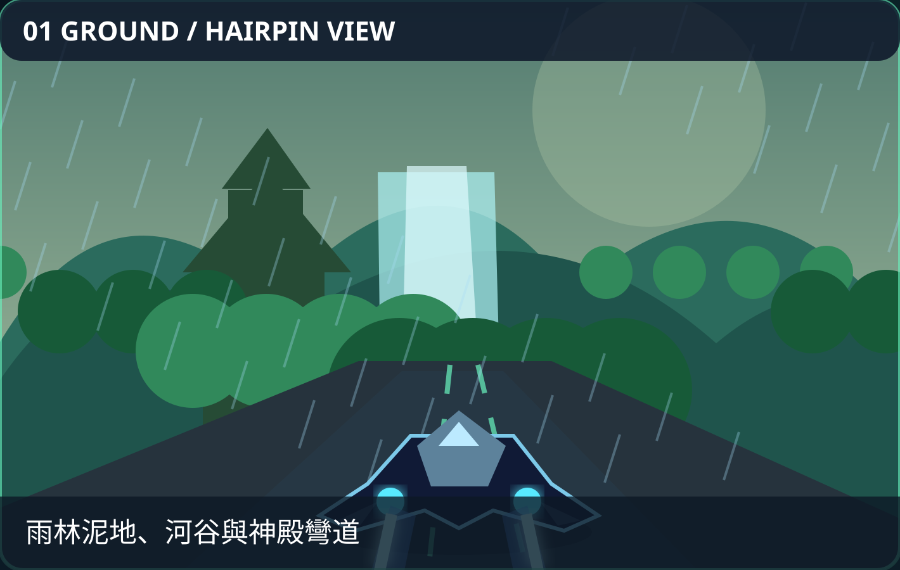
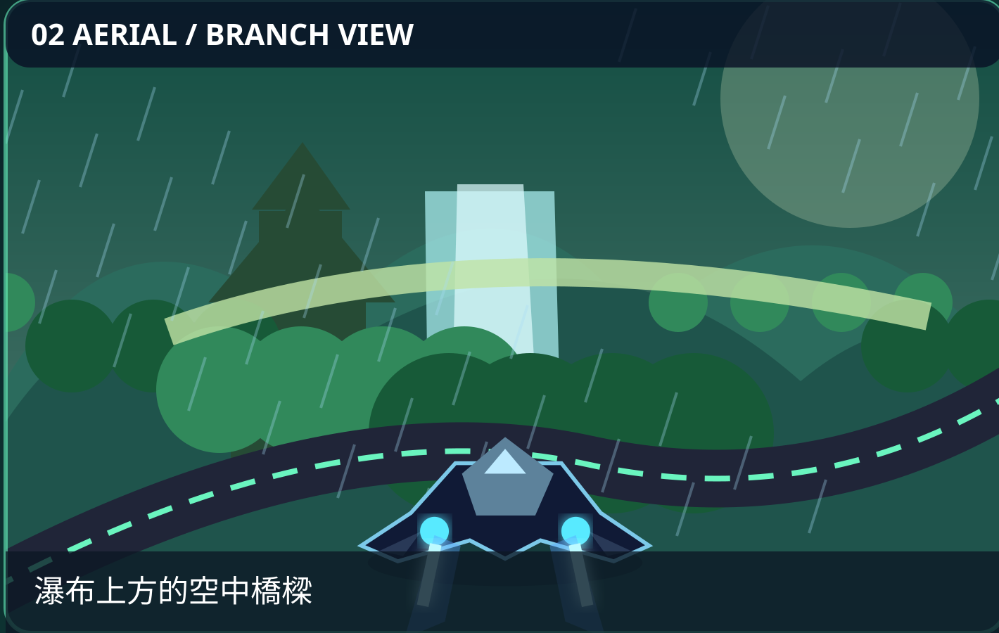
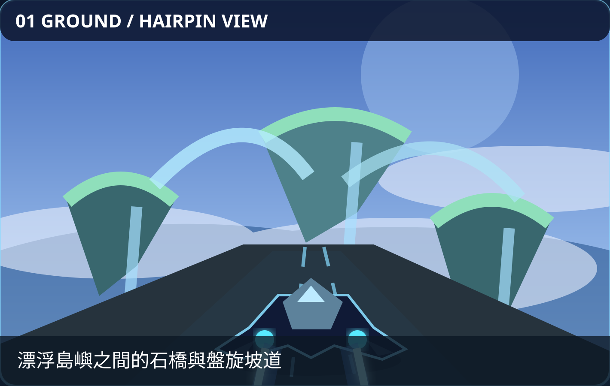
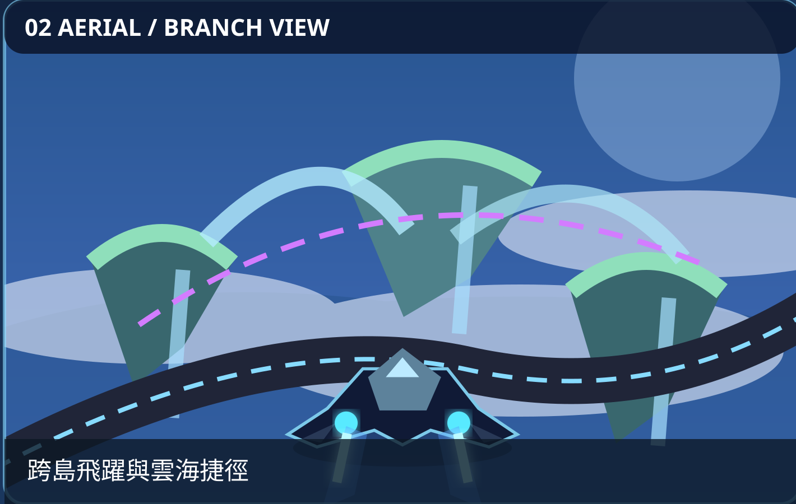
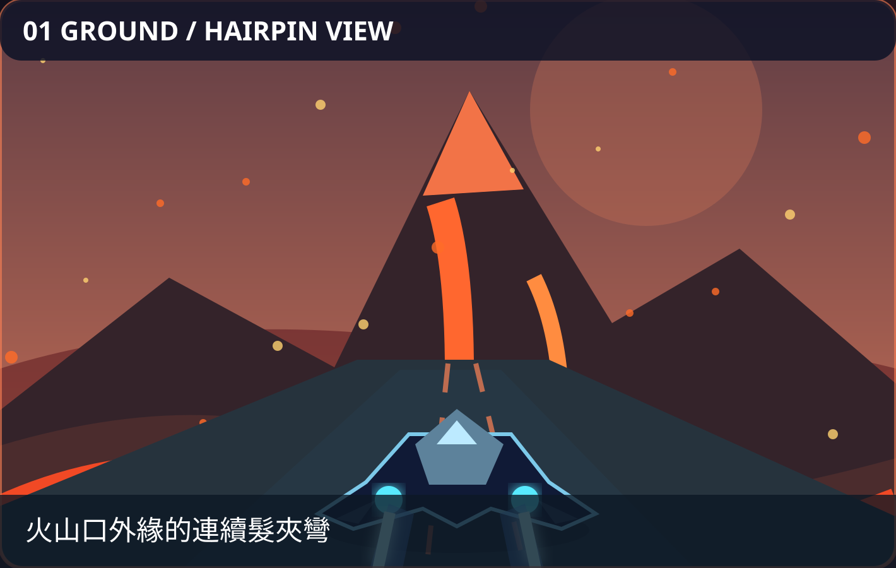
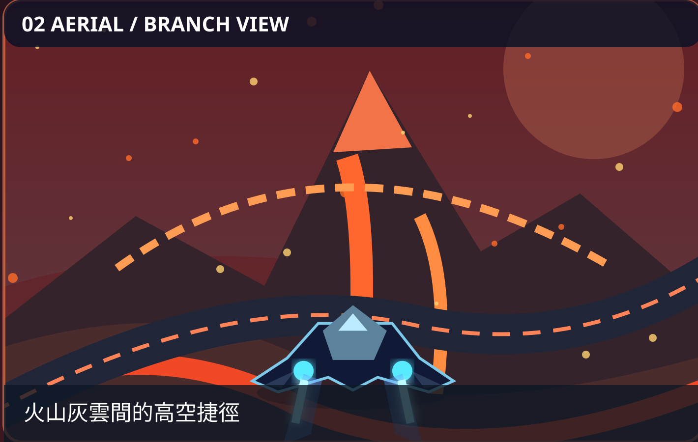
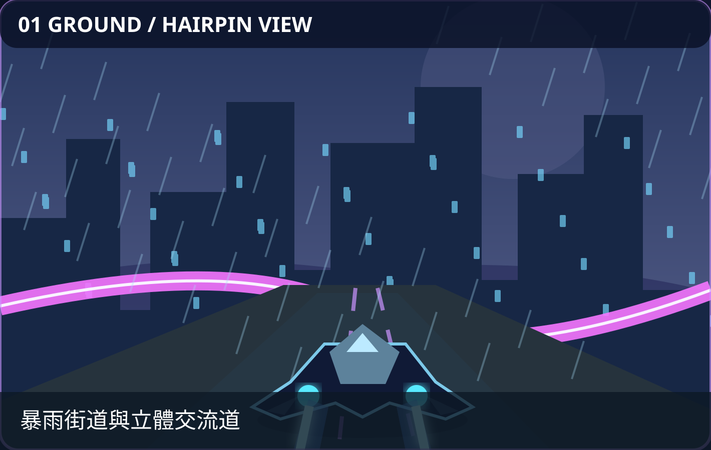
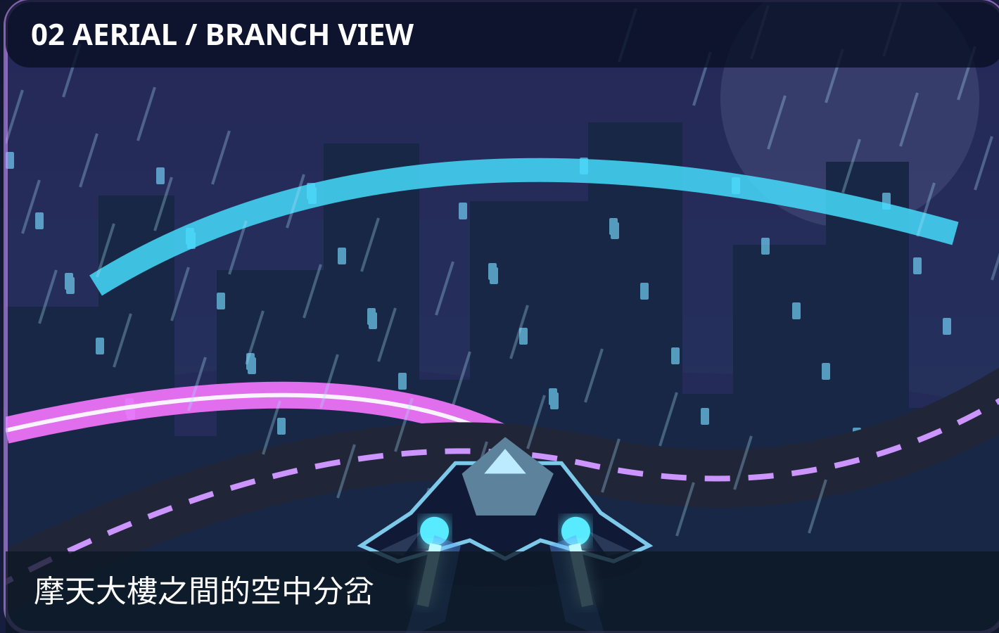

# Skyline Rush — Five Point-to-Point Expansion Tracks: Concept Art & Routes

**Planning branch:** `feature/epic-multiroute-longform-tracks`  
**Decision (2026-11-02):** **All five NEW tracks are POINT-TO-POINT, with one START and one separate FINISH.** No lap counting or loop-race variant on these five; existing ten sprint tracks retain the same single-finish mental model. Harbor Circuit remains a distinct mode.

## Stage 1 animated 3D homepage — P0 before full playable tracks

**User-confirmed requirement (2026-11-03):** The five initial proposed Stage 1 Coming Soon tracks must show **real animated Three.js showrooms on the homepage**, matching existing real 3D vehicle, hover/jets, scenery depth, moving environment and camera conventions. A static JPEG hero overlay or photo plane is not acceptable. Two existing JPEG concept views per map remain **art-direction references** and compact thumbnails only.

**Binding home stage:** [Animated Three.js homepage spec](../../superpowers/specs/2026-11-03-stage1-animated-3d-home-showcase-design.md) · [six GPT scene/renderer implementation prompts](../../superpowers/prompts/2026-11-03-six-chat-home-preview-implementation.md) · [TDD execution plan](../../superpowers/plans/2026-11-03-six-chat-home-preview-integration.md). Homepage showroom **does not make the full track playable**: Coming Soon selection remains preview-only with disabled bilingual Start, and no upcoming ID enters RaceFactory or the unlock/gameplay registry.

**Separate acceptance:** 5 individually animated **true 3D** environments + 5 unique scene landmarks and ground/air branch designs, shared real player/rival models, single existing WebGL renderer/composer, reduced-motion/quality tier support, actual time-separated WebGL screenshots (desktop/phone) vs both JPEG views, old-track regression and exact-HEAD CI. **None of this is marked as verified solely by this document.**

## Mandatory implementation fidelity gate

Before implementing any Stage 1 or Stage 2 track, follow [**Concept JPEG → real WebGL visual acceptance**](visual-acceptance-gate.md). All **20 committed JPEG scene references** (10 Stage 1 and 10 Stage 2) are moodboards and camera/scene anchors, not actual game captures. Review both views using deterministic race/camera settings, document the six visual categories and any approved deviations, and preserve point-to-point START/FINISH. Stage 2 JPEGs are resampled for reference viewing, not true original 3× texture assets.

## GitHub-saved image references

Each of the five **two-view storyboard SVGs** below is physically committed in this branch; each illustrates a ground driving camera and a separate aerial/branch camera plus explicit green START and red FINISH. The companion SVG is a deliberately simplified technical route sketch, not a copy of a looping minimap.

| Track | Two-view concept image | Ground/air route diagram |
| --- | --- | --- |
| **沙暴裂谷 / Dune Tempest** | [Scene design board](concept-art/dune-tempest-point-to-point-storyboard.svg) | [Single-finish route](route-schematics/dune-tempest.svg) |
| **雨林失落神殿 / Monsoon Ruins** | [Scene design board](concept-art/monsoon-ruins-point-to-point-storyboard.svg) | [Single-finish route](route-schematics/monsoon-ruins.svg) |
| **浮空群島 / Skyfall Archipelago** | [Scene design board](concept-art/skyfall-archipelago-point-to-point-storyboard.svg) | [Single-finish route](route-schematics/skyfall-archipelago.svg) |
| **熔火天脊 / Volcanic Crown** | [Scene design board](concept-art/volcanic-crown-point-to-point-storyboard.svg) | [Single-finish route](route-schematics/volcanic-crown.svg) |
| **霓虹暴雨都市 / Stormline Megacity** | [Scene design board](concept-art/stormline-megacity-point-to-point-storyboard.svg) | [Single-finish route](route-schematics/stormline-megacity.svg) |

- [Per-track composition, landmarks, weather, camera and acceptance criteria](visual-fidelity.md)
- [Machine-readable art and topology reference manifest](concept-manifest.json)
- [Original 12 PNG reference file names, sizes and SHA-256 checksums (pending GitHub import)](png-source-import-manifest.md)

## Ten standalone concept images (five maps × two camera views)

**GitHub committed:** The following **10 standalone SVG scene views** are part of this branch and can be opened individually. Each image is a viewport extracted from the original two-view vector storyboard (not a photoreal AI PNG and not a running-game screenshot). Each pair provides ground + aerial visual direction for one **point-to-point** track. Original cinematic PNGs and their checksums remain separately documented in [png-source-import-manifest.md](png-source-import-manifest.md) until binary import is completed.

| Map | 01 · Ground / natural-road view | 02 · Aerial branch / flight view |
| --- | --- | --- |
| **沙暴裂谷 / Dune Tempest** | [Ground SVG](concept-art/dune-tempest-ground-view.svg) | [Aerial SVG](concept-art/dune-tempest-aerial-view.svg) |
| **雨林失落神殿 / Monsoon Ruins** | [Ground SVG](concept-art/monsoon-ruins-ground-view.svg) | [Aerial SVG](concept-art/monsoon-ruins-aerial-view.svg) |
| **浮空群島 / Skyfall Archipelago** | [Ground SVG](concept-art/skyfall-archipelago-ground-view.svg) | [Aerial SVG](concept-art/skyfall-archipelago-aerial-view.svg) |
| **熔火天脊 / Volcanic Crown** | [Ground SVG](concept-art/volcanic-crown-ground-view.svg) | [Aerial SVG](concept-art/volcanic-crown-aerial-view.svg) |
| **霓虹暴雨都市 / Stormline Megacity** | [Ground SVG](concept-art/stormline-megacity-ground-view.svg) | [Aerial SVG](concept-art/stormline-megacity-aerial-view.svg) |

### 1. 沙暴裂谷 / Dune Tempest

**01 · Ground view** — 沙丘與天然峽谷地形，沒有強制馬路線；以髮夾彎、落日逆光和滾動沙塵牆呈現開闊越野感。

**02 · Aerial / fork view** — 由沙丘起跳，飛越斷崖與峽谷；空中分岔必須能看見目的地、安全著陸區與回到主線的匯合點。

**Source:** [combined storyboard](concept-art/dune-tempest-point-to-point-storyboard.svg) · [point-to-point route schematic](route-schematics/dune-tempest.svg).

### 2. 雨林失落神殿 / Monsoon Ruins

**01 · Ground view** — 暴雨雨林、積水泥地、寺廟遺跡與水霧中的 S 型彎；保證濕地路面與前方轉彎可辨識。

**02 · Aerial / fork view** — 瀑布附近起飛，掠過巨型石橋／遺跡上空，呈現落差與快速捷徑，但不以暴雨遮住著陸導引。

**Source:** [combined storyboard](concept-art/monsoon-ruins-point-to-point-storyboard.svg) · [point-to-point route schematic](route-schematics/monsoon-ruins.svg).

### 3. 浮空群島 / Skyfall Archipelago

**01 · Ground view** — 多層浮島石橋與雲海，主路線能在地面連續通行並清楚看到空中巨環及下一個島嶼。

**02 · Aerial / fork view** — 利用島嶼間的高低落差、浮空石環與瀑布實現跳躍／飛行分岔，再回到可辨識的主線。

**Source:** [combined storyboard](concept-art/skyfall-archipelago-point-to-point-storyboard.svg) · [point-to-point route schematic](route-schematics/skyfall-archipelago.svg).

### 4. 熔火天脊 / Volcanic Crown

**01 · Ground view** — 火山口外緣的連續髮夾彎、黑色玄武岩與岩漿河，透過橘紅發光裂縫建立地形辨識度。

**02 · Aerial / fork view** — 越過熔岩溪谷與火山口分支，展現火山灰、飛散火星與岩壁拱門，保持安全高度與落地視野。

**Source:** [combined storyboard](concept-art/volcanic-crown-point-to-point-storyboard.svg) · [point-to-point route schematic](route-schematics/volcanic-crown.svg).

### 5. 霓虹暴雨都市 / Stormline Megacity

**01 · Ground view** — 夜間暴雨與濕潤反光柏油，沿街道／高架交流道進入急彎，霓虹看板不應擋住賽道。

**02 · Aerial / fork view** — 透過多層交流道、樓宇間高架路與跳躍捷徑呈現垂直分岔，俯瞰城市雨霧和燈海。

**Source:** [combined storyboard](concept-art/stormline-megacity-point-to-point-storyboard.svg) · [point-to-point route schematic](route-schematics/stormline-megacity.svg).

**Non-negotiable gameplay interpretation:** Illustration composition is a *visual target*, not an authority for track graph. Route coordinates and gate placement must follow [route schematics](README.md#github-saved-image-references) plus validated game topology: separate START and FINISH, ordered gates, legal ground/air branches, no lap count. Implementations must compare actual WebGL captures to BOTH scene references and log differences.

## JPEG scene references (Stage 1) and Stage 2 expansion

**Stage 1:** ten JPEG files are **committed and linked**, converted from the original AI-generated ten scene PNG crops. The two unconverted overview PNG originals are still only retained in the chat ZIP; the originals themselves are not in GitHub. The JPEG content is the source reference for the Stage 1 real-WebGL visual comparisons.

| Stage 1 track | Ground JPEG | Aerial / shortcut JPEG |
| --- | --- | --- |
| 沙暴裂谷 | [Ground](source-concept-jpeg/dune-tempest/concept-view-01.jpg) | [Aerial](source-concept-jpeg/dune-tempest/concept-view-02.jpg) |
| 雨林失落神殿 | [Ground](source-concept-jpeg/monsoon-ruins/concept-view-01.jpg) | [Aerial](source-concept-jpeg/monsoon-ruins/concept-view-02.jpg) |
| 浮空群島 | [Ground](source-concept-jpeg/skyfall-archipelago/concept-view-01.jpg) | [Aerial](source-concept-jpeg/skyfall-archipelago/concept-view-02.jpg) |
| 熔火天脊 | [Ground](source-concept-jpeg/volcanic-crown/concept-view-01.jpg) | [Aerial](source-concept-jpeg/volcanic-crown/concept-view-02.jpg) |
| 霓虹暴雨都市 | [Ground](source-concept-jpeg/stormline-megacity/concept-view-01.jpg) | [Aerial](source-concept-jpeg/stormline-megacity/concept-view-02.jpg) |

**Stage 2:** [five additional point-to-point tracks, 10 JPEGs + 5 routes](stage-2/README.md), [Stage 2 visual fidelity](stage-2/visual-fidelity.md), [Stage 2 implementation spec](../../superpowers/specs/2026-11-02-stage2-five-longform-tracks-design.md). Ten planned new tracks altogether, none playable yet.

## Original high-detail AI PNG artwork — provenance / status

Two AI-generated collage originals and **ten cropped scene views (two per track)** are included in the chat-delivered `skyline-rush-five-tracks-concept-reference-pack.zip`. **Those original PNG bytes have NOT been uploaded to GitHub by this session.** The five boards above **are genuine GitHub files**, but they are separate newly authored vector references, **not copies of those previous AI PNGs**.

When the PNGs can be uploaded, use these target paths and verify actual GitHub file existence before changing any status:
- `source-concept-png/overview-01.png` and `source-concept-png/overview-02.png`.
- `source-concept-png/<track-id>/concept-view-01.png` (ground) and `concept-view-02.png` (flight), for each of the five track IDs.
- Commit a SHA-256 manifest and link actual files here. Until then, do not pretend those paths exist.

## Binding design rules for next stage

1. These five are **one-way long-form sprints**: a car reaches ordered checkpoint volumes, then distinct FINISH once; never simply repeat an entire course or show a lap indicator. Start and finish must not coincide physically.
2. The route may make U-turns, cross itself at different heights, allow broad offroad driving, fork into air and ground alternatives, and converge; that does **not** make it a closed circuit.
3. Show START / FINISH clearly on map thumbnails and track selection. Show a ground/flight split in 3D without obscuring the road; leave undiscovered secret shortcuts hidden on the in-game minimap.
4. **Reference fidelity:** visual goal is biome identity, scene scale, skyline silhouette, time-of-day/lighting, roadside detail, weather, car visual prominence and branch readability; never treat an image-generated loop-looking map as exact geometry.
5. Before claiming any scene finished, record actual WebGL screenshots for both reference views at desktop/mobile, Low/Medium/High and reduced-motion, compare to this design board and original PNGs if available, and record pass/fail/deviations. Benchmarks and manual device testing are separate gates.
6. Any new AI-generated **in-game raster asset** needs a genuine 3× source file. Reference SVGs are scalable vectors and not gameplay textures.
7. The future implementation uses SDD→BDD→TDD and must pass the existing full verification gate without changing legacy tracks. **This planning branch has no game implementation and no merge.**

## UI terminology

- Standard race: `單程競速 / Point-to-Point`, display `起點 → 終點`, progress and finish-distance (NOT `Lap 1/3`).
- Separate optional existing circuit mode: `環道競速 / Circuit`, only here show a 1/3/5-lap selector and lap counter.
- Do not place these two gameplay concepts in an unlabeled mixed track-selection list.
