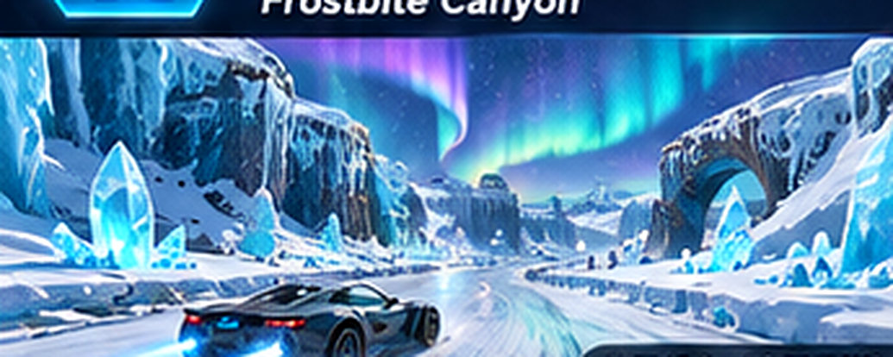
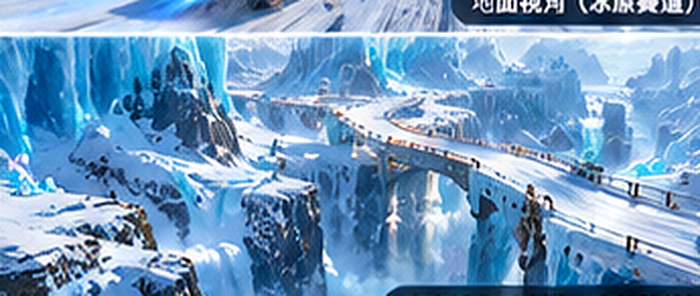
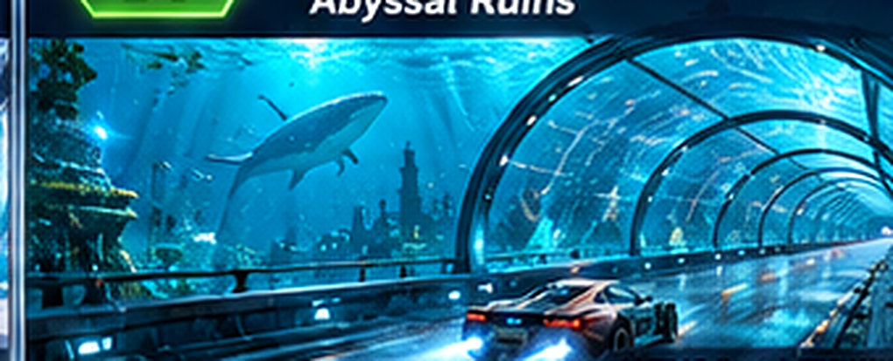
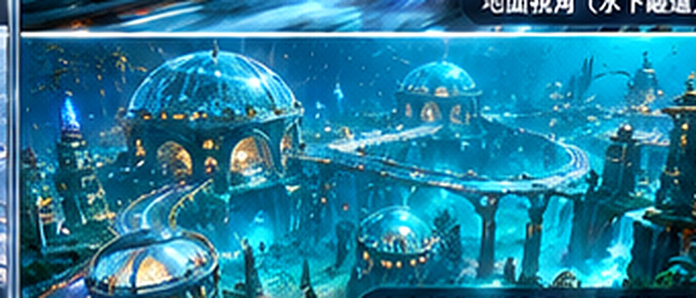
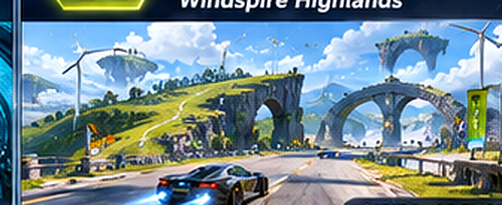
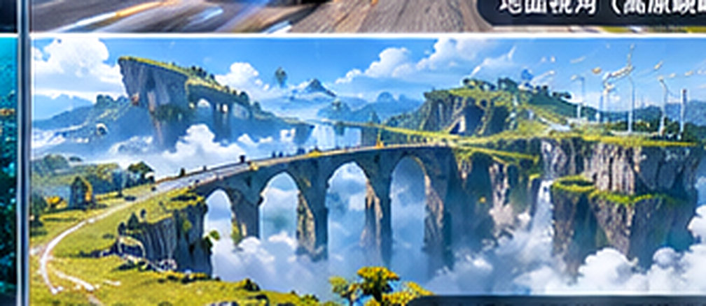
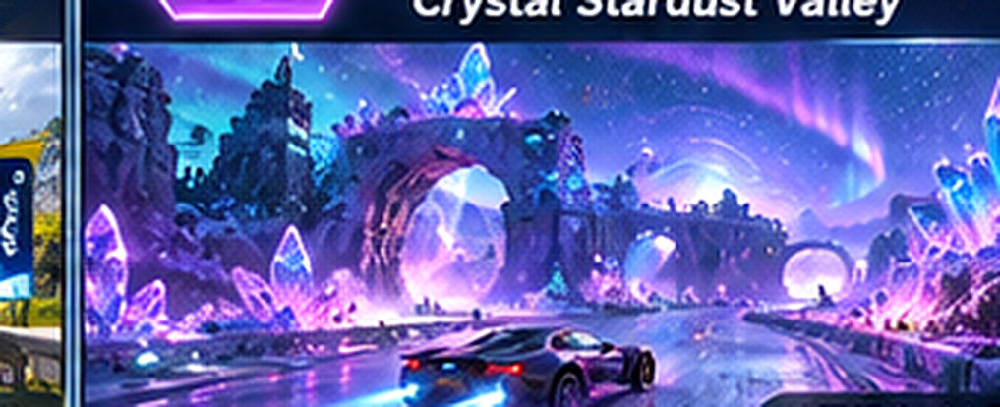
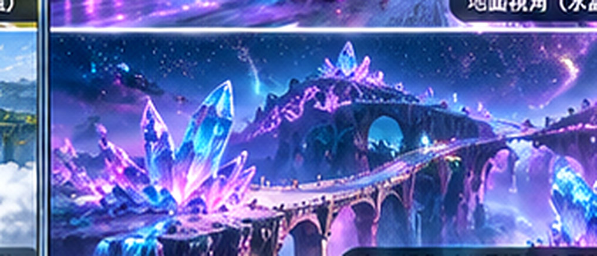
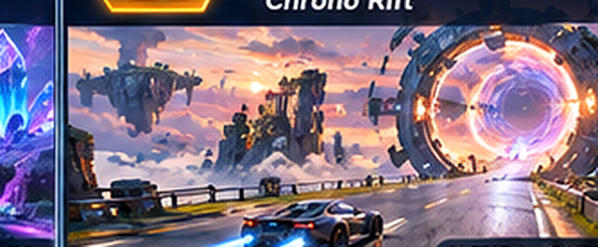
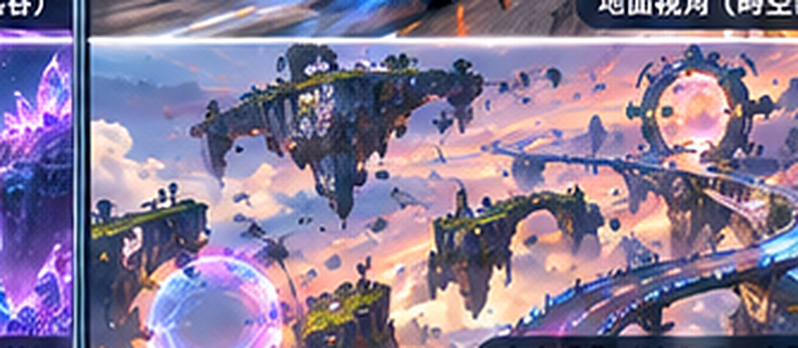

# Skyline Rush — 第二階段：五張全新單程賽道（Stage 2）

**規劃日期：** 2026-11-02  
**工作分支：** `feature/epic-multiroute-longform-tracks`  
**狀態：** 10 張 JPEG 概念圖與 5 張 SVG 路線圖已提交；遊戲內賽道尚未開發，也尚未完成 WebGL 驗收。  
**產品規則：** 新五張與第一階段五張、既有十張衝刺賽道一致，**全部 Point-to-Point 單程競速**，各有獨立 START / FINISH，沒有圈數計數器，通過必要檢查點後抵達終點即結束。環道競速仍是獨立模式。

## 五張地圖與 10 張 JPEG 預覽索引

| 地圖 | 主線設計長度 | 目標時間 | 地面視角 | 空中視角 | 單程路線圖 |
| --- | ---: | --- | --- | --- | --- |
| 6. 極地冰原峽谷 / Frostbite Canyon | 13.8 km | 3:20–4:40 | [地面 JPEG](source-concept-jpeg/frostbite-canyon/concept-view-01.jpg) | [空中 JPEG](source-concept-jpeg/frostbite-canyon/concept-view-02.jpg) | [路線 SVG](route-schematics/frostbite-canyon.svg) |
| 7. 深海遺跡城 / Abyssal Ruins | 15.2 km | 3:45–5:00 | [地面 JPEG](source-concept-jpeg/abyssal-ruins/concept-view-01.jpg) | [空中 JPEG](source-concept-jpeg/abyssal-ruins/concept-view-02.jpg) | [路線 SVG](route-schematics/abyssal-ruins.svg) |
| 8. 風之高原 / Windspire Highlands | 14.5 km | 3:25–4:45 | [地面 JPEG](source-concept-jpeg/windspire-highlands/concept-view-01.jpg) | [空中 JPEG](source-concept-jpeg/windspire-highlands/concept-view-02.jpg) | [路線 SVG](route-schematics/windspire-highlands.svg) |
| 9. 水晶星塵谷 / Crystal Stardust Valley | 13.6 km | 3:20–4:40 | [地面 JPEG](source-concept-jpeg/crystal-stardust-valley/concept-view-01.jpg) | [空中 JPEG](source-concept-jpeg/crystal-stardust-valley/concept-view-02.jpg) | [路線 SVG](route-schematics/crystal-stardust-valley.svg) |
| 10. 時空斷層 / Chrono Rift | 16.0 km | 3:50–5:00 | [地面 JPEG](source-concept-jpeg/chrono-rift/concept-view-01.jpg) | [空中 JPEG](source-concept-jpeg/chrono-rift/concept-view-02.jpg) | [路線 SVG](route-schematics/chrono-rift.svg) |

> 圖像來源：上述 JPEG 由一張新生成的第二階段 AI 概念總覽裁切而來，為保留檢視尺寸而以 Lanczos 放大 3 倍並做輕度銳化；**放大不增加原始細節**，不可當作真實 3× 畫質的美術素材或實際 WebGL 畫面。它們是風格、色彩、地標、鏡頭構圖和特效方向參考；精確路線拓撲以實作時通過測試的 CourseGraph 為準。

## 6. 極地冰原峽谷 — Frostbite Canyon

**長度目標：** 13.8 km；**完成時間目標：** 3:20–4:40（未實際遊玩驗證）。  
**環境與分岔：** 冰河裂隙、露天峽谷、可駕駛雪原；冰橋飛越。  
**天氣／粒子：** ice powder, cold fog, snow gusts。  
**區別與實作注意事項：** 以斷裂冰谷和冰橋交錯為特色，避免重複現有高山鐵道／極光道路。

### 01 — 地面競速視角

[直接檢視地面 JPEG](source-concept-jpeg/frostbite-canyon/concept-view-01.jpg)

### 02 — 空中捷徑／分岔視角

[直接檢視空中 JPEG](source-concept-jpeg/frostbite-canyon/concept-view-02.jpg) · [單程路線示意](route-schematics/frostbite-canyon.svg)

## 7. 深海遺跡城 — Abyssal Ruins

**長度目標：** 15.2 km；**完成時間目標：** 3:45–5:00（未實際遊玩驗證）。  
**環境與分岔：** 透明海底道路、珊瑚峽谷、沉沒古都；上層穹頂岔路。  
**天氣／粒子：** caustics, bubbles, distant fish schools。  
**區別與實作注意事項：** 先實作視覺化深海環境，不擴張至真正潛水或水壓物理。

### 01 — 地面競速視角

[直接檢視地面 JPEG](source-concept-jpeg/abyssal-ruins/concept-view-01.jpg)

### 02 — 空中捷徑／分岔視角

[直接檢視空中 JPEG](source-concept-jpeg/abyssal-ruins/concept-view-02.jpg) · [單程路線示意](route-schematics/abyssal-ruins.svg)

## 8. 風之高原 — Windspire Highlands

**長度目標：** 14.5 km；**完成時間目標：** 3:25–4:45（未實際遊玩驗證）。  
**環境與分岔：** 開闊草坡、自然無標線路面、石橋與風車；跨谷飛行。  
**天氣／粒子：** wind gusts, grass debris, cloud shadows。  
**區別與實作注意事項：** 地面風路安全可通過，風場機制必須預告並公平平衡。

### 01 — 地面競速視角

[直接檢視地面 JPEG](source-concept-jpeg/windspire-highlands/concept-view-01.jpg)

### 02 — 空中捷徑／分岔視角

[直接檢視空中 JPEG](source-concept-jpeg/windspire-highlands/concept-view-02.jpg) · [單程路線示意](route-schematics/windspire-highlands.svg)

## 9. 水晶星塵谷 — Crystal Stardust Valley

**長度目標：** 13.6 km；**完成時間目標：** 3:20–4:40（未實際遊玩驗證）。  
**環境與分岔：** 紫藍晶洞、稜鏡岩柱、晶橋、自然谷底彎道。  
**天氣／粒子：** glowing dust, refracted beams, soft fog。  
**區別與實作注意事項：** 強調明亮晶體但不得以強光、反射或大量 Bloom 遮擋彎道。

### 01 — 地面競速視角

[直接檢視地面 JPEG](source-concept-jpeg/crystal-stardust-valley/concept-view-01.jpg)

### 02 — 空中捷徑／分岔視角

[直接檢視空中 JPEG](source-concept-jpeg/crystal-stardust-valley/concept-view-02.jpg) · [單程路線示意](route-schematics/crystal-stardust-valley.svg)

## 10. 時空斷層 — Chrono Rift

**長度目標：** 16.0 km；**完成時間目標：** 3:50–5:00（未實際遊玩驗證）。  
**環境與分岔：** 斷裂空中遺跡、巨型時空環、石橋、上下層支路。  
**天氣／粒子：** temporal afterimages, aurora-like clouds, portal particles。  
**區別與實作注意事項：** 時間環是視覺導引，不實作真正時間倒流或傳送作弊。

### 01 — 地面競速視角

[直接檢視地面 JPEG](source-concept-jpeg/chrono-rift/concept-view-01.jpg)

### 02 — 空中捷徑／分岔視角

[直接檢視空中 JPEG](source-concept-jpeg/chrono-rift/concept-view-02.jpg) · [單程路線示意](route-schematics/chrono-rift.svg)

## 與第一階段共用規則

- 所有地圖的起點、終點均為不同節點與世界座標；路線可以 U 型迂迴、折返、交叉、分岔匯合，但不得把整張圖設為封閉多圈賽制。
- 每張至少包含兩處明顯髮夾彎、三個有效選路點、一條安全且無須飛行即可抵達終點的地面路線，以及至少一條空中／高低層替代路線。
- 寬敞的可駕駛自然地形／越野區域；無須全部畫上路面標線。避免沒有實際物件的隱形牆、硬性夾緊飛行的側向座標。
- 避免將地圖長度當成時間保證：實際完賽中位數需透過難度、車速、彎道、分岔與 20 次以上有效試跑調整，目標約 3～5 分鐘。
- 真正落地時每張需提供地面與空中各一張實際 WebGL 截圖，比對此處兩張 JPEG 的景觀、光影、特效、車身比例、景深與路線可讀性，逐項記錄差異。
- 新增 JPEG **僅為概念參考素材**，不得直接冒充生產用 3× 遊戲貼圖；日後實際使用的 raster texture 必須另外保存足量原始尺寸，並依遊戲內 1× 呈現。
- 可重用既有 `trackFrame`、場景 chunk / batching、`race-visuals.ts`、HUD 等系統；使用選配 CourseGraph，不能破壞舊路線、Ghost、AI、NITRO、FLY 或既有資料。

**實作設計：** [Stage 2 Spec](../../../superpowers/specs/2026-11-02-stage2-five-longform-tracks-design.md) · [Stage 2 Plan](../../../superpowers/plans/2026-11-02-stage2-five-longform-tracks.md) · [視覺驗收](visual-fidelity.md) · [機器可讀索引](concept-manifest.json)

