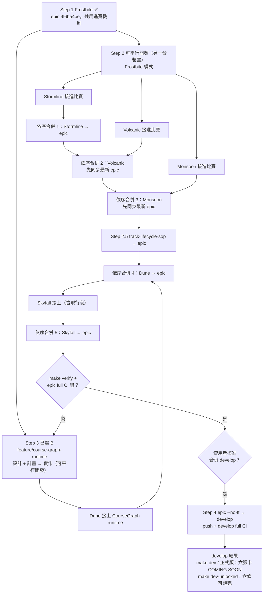

# 六條新賽道 playable 執行手冊（runbook）

狀態：2026-11-06 定稿。本檔取代先前以 Telegram 傳送的「賽道合併計畫 0/8–8/8」訊息，並已併入之後的使用者決定。
執行者（人或 agent）照本檔各 Step 依序處理即可；每個 Step 都附可直接複製的 prompt。

## 目標與最終狀態

六個新賽道（Frostbite Canyon、Stormline Megacity、Volcanic Crown、Monsoon Ruins、Dune Tempest、
Skyfall Archipelago）都在 `feature/epic-multiroute-longform-tracks`（以下稱 epic）上接進比賽，最後經使用者核准再合進
`develop`。合進 develop 後：

- `make dev-unlocked`（以及 `make dev-feature`）：六條都能從 START 實際跑到 FINISH 出成績。
- `make dev` 與正式版（`npm run build`）：六張卡都看得到、顯示 COMING SOON、START 停用；Enter、舊存檔 unlocks、
  storage 都無法繞過。
- 正式開放給玩家不在本手冊範圍：依 `feature/track-lifecycle-sop` 的生命週期 SOP，由使用者在 `TODO.md` 勾選核准後才做。

## 已定案的決定（2026-11-06）

| 決定 | 內容 | 理由 |
|---|---|---|
| 進賽機制 | `UPCOMING_READINESS`（`src/upcoming-tracks.ts`）+ `isUpcomingEnterable`：`src/access/dev-unlocked.ts` 只放行 readiness `playable` 且有 race track；`src/access/production.ts` 永遠 `false` | 開發模式可玩、正式版不可能進賽 |
| Frostbite / Stormline / Volcanic / Monsoon | 「Frostbite 模式」：CourseGraph `groundRoute` 攤平成 1D `TrackConfig`，分岔邊變成同一段的 shortcut section；只在開發模式開放 | 這四條分岔與對應主線長度差 2–18%，同段捷徑誤差可接受；此做法偏離 `playable-course-shared-template`「不得攤平分岔」，使用者已核准，偏差記在 `TODO.md` |
| Dune / Skyfall | **選 B**：把既有 CourseGraph runtime（`src/course-travel.ts`、`course-fleet.ts`、`course-measured-fleet.ts`、`course-signed-gates.ts`、`course-ai-standings.ts`）真正接進 `src/game.js` / `src/world.js`，在分支 `feature/course-graph-runtime` 實作；先 Dune 後 Skyfall | 這兩條捷徑只有主線的 30–75%，攤平會讓排名、AI、終點判定錯誤，Skyfall 的飛行段也無法呈現；選 A 之後正式驗收仍要重做。B 的模組與 adapter 已寫好且有測試，主要是接線 |
| 新 runtime 範圍 | 只有 Dune、Skyfall 走 CourseGraph runtime；既有 10 條、Frostbite 等四條維持 1D 引擎不動 | 不讓既有賽道退步 |
| Step 2 執行位置 | Stormline → Volcanic → Monsoon 由使用者在另一台裝置實作 | 其他 session 不得重做或搶先合併 |
| 生命週期 | `feature/track-lifecycle-sop`（stage：preview / development / playable / ready / released）在 Step 2 三條合入後才合進 epic；race 測試命名 `tests/<id>-race.test.js`、`tests/<id>-race-browser.spec.js` | 兩者都改 `src/upcoming-tracks.ts`；測試命名對齊 D-gate |

## 現況（2026-11-06）

| 賽道 | 分支 | 做法 | 狀態 | 依循文件 |
|---|---|---|---|---|
| Frostbite Canyon | `feature/playable-frostbite-canyon` | Frostbite 模式 | ✅ 已合入 epic（`9f6ba4be`，CI 綠） | 本檔 Step 1（紀錄） |
| Stormline Megacity | `feature/playable-stormline-megacity` | Frostbite 模式 | ⏳ 另一台裝置實作中；分支已同步 epic `9f6ba4be`（`52f17b43`） | 本檔 Step 2-1、`docs/superpowers/handoffs/2026-11-03-playable-stormline-megacity.md` |
| Volcanic Crown | `feature/playable-volcanic-crown` | Frostbite 模式 | ⏳ 同上（`bac4c219`） | 本檔 Step 2-2、`docs/superpowers/reviews/2026-11-03-playable-volcanic-crown-handoff.md` |
| Monsoon Ruins | `feature/playable-monsoon-ruins` | Frostbite 模式 | ⏳ 同上（`50c80c4f`） | 本檔 Step 2-3、`docs/designs/new-tracks/monsoon-ruins-playable-handoff.md` |
| Dune Tempest | `feature/course-graph-runtime` | B：CourseGraph runtime | 📝 設計與實作計畫撰寫中 | 本檔 Step 3、`docs/superpowers/specs/2026-11-06-course-graph-runtime-design.md`、`docs/superpowers/plans/2026-11-06-course-graph-runtime.md`（在該分支）、`docs/superpowers/reviews/2026-11-03-playable-dune-tempest-handoff.md` |
| Skyfall Archipelago | `feature/course-graph-runtime` | B：CourseGraph runtime | 等 Dune 完成 | 同上、`docs/designs/new-tracks/skyfall-playable-handoff.md` |

`feature/playable-dune-tempest` 與 `feature/playable-skyfall-archipelago` 的程式碼已與 epic 相同（只差文件 / `TODO.md`），
它們不再承載實作；Step 3 完成後可 `--no-ff` 合入 epic 僅保留歷史（合併前先確認 `git diff` 只有文件差異，否則停下來問）。

## 順序與原因

```
Step 1 Frostbite（完成）
  → Step 2 Stormline → Volcanic → Monsoon（可平行開發，合併必須依序、一次一條）
  → Step 2.5 track-lifecycle-sop 合入
  → Step 3 course-graph-runtime：Dune 合入 → Skyfall 合入
  → Step 4 epic → develop（需使用者明確核准）
```

所有步驟都會改到同一組登錄檔：`src/upcoming-tracks.ts`（`UPCOMING_READINESS`）、`src/race-tracks.ts`（`COURSE_TRACKS`）、
`src/world.js`（場景分派）、`src/game.js`（Step 3）、`TODO.md`。因此每次合入 epic 前，先把最新 epic 合進自己的分支、
兩邊條目都保留，再跑驗收。

## 共通規則（每個 prompt 都適用）

先讀 `CLAUDE.md`、`.claude/rules/playable-course-shared-template.md`、`.claude/rules/branch-release.md`、
`.claude/rules/ci-gates.md`、`docs/regression-first-workflow.md`。TDD 先 RED 後 GREEN；不得刪除或弱化測試；
CourseGraph 幾何測試比較實體弧長比例、浮點值用明確容差；不得量化公尺、道路接觸、checkpoint、飛行間隙。
不寫個人絕對路徑（公開 repo）。不得 push develop / main、不開 PR、不 deploy（Step 4 經核准除外）。
worktree 一律放在 `.claude/worktrees/` 底下；若該分支已在其他 worktree 簽出，就在那個 worktree 做。
Playwright 預設 port 5178 常被其他 session 佔用，請設 `PLAYWRIGHT_PORT`。
CI、本機測試、人工 WebGL / 視覺確認分開回報；沒跑的寫 NOT VERIFIED。

### 共通驗收（每條賽道都要，每項附證據：指令 + 實際輸出 / 截圖）

- `make dev-unlocked`：首頁選該賽道 → START 進入比賽 → 實際跑到 FINISH 出成績；地面段與每條分岔 / 飛行段都要實跑。
- `make dev`（不加 unlocked）與 `npm run build` 正式版：六張新卡都看得到、顯示 COMING SOON、START 停用；Enter、
  舊存檔 unlocks 都無法繞過（遊戲目前沒有 gamepad 輸入，不需測 gamepad）。
- 既有 10 條賽道、Circuit、World Tour、NITRO / FLY / BOOST、Garage 不退步。
- `npm test`、`npm run build`、`npm run test:browser`（桌機 + 手機）、`make verify` 全綠；桌機與手機真實 WebGL 截圖。

### 共通合併程序（合入 epic，必須依序、一次一條）

1. `git fetch`，在自己的分支 `git merge --no-ff origin/feature/epic-multiroute-longform-tracks`；衝突多在
   `UPCOMING_READINESS`、`COURSE_TRACKS`、`world.js` 場景分派、`TODO.md`，兩邊都保留。
2. 重跑共通驗收，push，等分支 exact-HEAD CI 綠。
3. 切到 epic：`git merge --no-ff <分支>`（訊息帶 `[full-regression]`），`npm test` + `npm run build`，push epic，
   確認 epic exact-HEAD full CI 綠。
4. 在 `TODO.md` 記錄 SHA、CI run ID、驗收結果，回報 PASS / FAIL / NOT VERIFIED。

---

## Step 1 Frostbite Canyon（✅ 已完成，保留作為參考）

合入 epic 為 `9f6ba4be`（epic 與分支 CI 皆綠，紀錄見 `TODO.md`）。它建立了共用進賽機制，是 Step 2 的參考實作：
`src/courses/frostbite-race.ts`、`src/frostbite-race-scene.ts`、`src/race-tracks.ts`（`COURSE_TRACKS` / `raceTrack` /
`assertTrackMode`）、`src/record-layout.ts`（topology-keyed 成績，例如 `frostbite-canyon@t1l1`）、
`tests/frostbite-race.test.js`、`tests/frostbite-race-browser.spec.js`。

當時的做法（之後新地圖可參考）：在 playable 分支合入 epic、解 18 個衝突；進賽機制以 Frostbite 版為準，移除 develop 的
`PLAYABLE_PREVIEW_IDS` / `isPlayablePreview` / `isCoverOnly` 並改用新機制；`world.js`、`upcoming-showcase.ts`、`main.js`、
`track-preview.ts`、`race-select-ui.ts` 兩邊功能都保留；teaser 圖檔依 develop（Frostbite blob `95264f93` 不變）；
`TODO.md` 兩邊都保留。

---

## Step 2 Stormline → Volcanic → Monsoon（Frostbite 模式，另一台裝置執行）

前置：Step 1 已合入且 epic CI 綠（已達成）。三條可平行開發，合入 epic 必須依序：Stormline → Volcanic → Monsoon。
三個分支已在 2026-11-06 同步過 epic `9f6ba4be`；epic 之後多了 handoff 文件合併（`0c951d49`），開工前再 merge 一次最新 epic 即可。

### Step 2-1 prompt：Stormline Megacity（合併順序第 1 條）

> 任務：把 `feature/playable-stormline-megacity` 合併進 epic，並比照 Frostbite 讓 Stormline Megacity 在
> `make dev-unlocked` 可從 START 跑到 FINISH，其他模式仍顯示 COMING SOON。遵守本手冊「共通規則」。
>
> （1）同步：`git fetch` 後 `git merge --no-ff origin/feature/epic-multiroute-longform-tracks`。以 epic 版為主；
> 本分支的地圖程式早已擷取進 epic（`5e86c801`、`bf511cda`）。本分支多出的 `style.css`、bonus-gates、`App.vue` 舊 CI
> 修正，epic 已有等價處理就捨棄並在 merge commit 訊息說明；`TODO.md` 兩邊保留；teaser 規則與圖檔 blob 依 epic。
>
> （2）接進比賽（參考 Step 1 的檔案）：
> - 新增 `src/courses/stormline-megacity-race.ts`：沿 CourseGraph `groundRoute` 累計弧長轉成 `TrackConfig`
>   （topology `'course-graph'`、topologyVersion 1），每條分岔邊轉成同一段的 shortcut section（x 偏移、altitude、
>   deck 或 span）。資料來源 `src/courses/stormline-megacity-runtime-adapter.ts`。
> - 分岔實測長度（分岔 / 對應主線）：skyway-cut 1228/1226 m、tunnel-cut 693/710 m、roof-flight（飛行）734/738 m，差距約 2%。
> - 新增 `src/stormline-megacity-race-scene.ts`，重用 `src/courses/stormline-scenery.ts`；不得新增第二套 renderer 或模擬。
> - 註冊：`COURSE_TRACKS` 加入；`UPCOMING_READINESS` 加 `'stormline-megacity': 'playable'`；只限 classic，不進
>   catalog、Daily、Cup。
> - 先 RED：`tests/stormline-megacity-race.test.js`（距離 → edge 映射、section 範圍、frame 連續無跳點）、
>   `tests/stormline-megacity-race-browser.spec.js`（START → FINISH，比照 Frostbite 的 browser spec）；擴充
>   `tests/upcoming-unlock-access.test.js` 與 `tests/access-build.test.js` 涵蓋 stormline-megacity。
> - 規則偏差（同段捷徑）記在 `TODO.md`。
>
> （3）共通驗收。（4）共通合併程序。

### Step 2-2 prompt：Volcanic Crown（合併順序第 2 條，Stormline 合入且 epic CI 綠之後）

> 任務：同 Step 2-1，對象為 `feature/playable-volcanic-crown` / Volcanic Crown。
>
> （1）同步：同 Step 2-1。
>
> （2）接進比賽：
> - 新增 `src/courses/volcanic-crown-race.ts`，資料來源 `src/courses/volcanic-crown-runtime-adapter.ts`，做法同 Step 2-1。
> - 分岔實測長度：rift-flight（飛行）1601/1383 m、vent-risk 1566/1592 m、gorge-flight（飛行）1623/1537 m，差距
>   2–16%，長度差以弧長比例對應。
> - 新增 `src/volcanic-crown-race-scene.ts`，重用 `src/courses/volcanic-crown-scene.ts` 與 `volcanic-crown-obstacles.ts`。
> - 註冊：`COURSE_TRACKS` 加入；`UPCOMING_READINESS` 加 `'volcanic-crown': 'playable'`；只限 classic。
> - 先 RED：`tests/volcanic-crown-race.test.js`、`tests/volcanic-crown-race-browser.spec.js`；擴充 access 兩支測試。
> - 規則偏差記在 `TODO.md`。
>
> （3）共通驗收。（4）共通合併程序（先合入已含 Stormline 的最新 epic）。

### Step 2-3 prompt：Monsoon Ruins（合併順序第 3 條，Volcanic 合入且 epic CI 綠之後）

> 任務：同 Step 2-1，對象為 `feature/playable-monsoon-ruins` / Monsoon Ruins。
>
> （1）同步：同 Step 2-1。
>
> （2）接進比賽：
> - 新增 `src/courses/monsoon-ruins-race.ts`，資料來源 `src/courses/monsoon-ruins-runtime-adapter.ts`，做法同 Step 2-1。
> - 分岔實測長度：river-ford 1544/1306 m、waterfall-skybridge（飛行）831/804 m、canopy-ruins 1262/1206 m，差距
>   3–18%，長度差以弧長比例對應。
> - 新增 `src/monsoon-ruins-race-scene.ts`，重用 `src/courses/monsoon-ruins-scene.ts`。
> - 註冊：`COURSE_TRACKS` 加入；`UPCOMING_READINESS` 加 `'monsoon-ruins': 'playable'`；只限 classic。
> - 先 RED：`tests/monsoon-ruins-race.test.js`、`tests/monsoon-ruins-race-browser.spec.js`；擴充 access 兩支測試。
> - 規則偏差記在 `TODO.md`。
>
> （3）共通驗收。（4）共通合併程序（先合入已含 Volcanic 的最新 epic）。

---

## Step 2.5 track-lifecycle-sop 合入（Step 2 三條都合入之後）

分支 `feature/track-lifecycle-sop`（設計 `docs/superpowers/specs/2026-11-06-track-lifecycle-design.md`、
計畫 `docs/superpowers/plans/2026-11-06-track-lifecycle.md`，皆在該分支）新增 `ready` stage、
`scripts/check-track-lifecycle.mjs`、每條賽道的 `docs/track-lifecycle/<id>.md` 紀錄與 Coming Soon 視角瀏覽器測試。
依其計畫實作完成後，合入前先 merge 最新 epic，把 Stormline / Volcanic / Monsoon 的紀錄檔更新為 `playable`，再走共通合併程序。
Dune / Skyfall 的紀錄維持 `preview`，直到 Step 3 各自升級。

---

## Step 3 Dune → Skyfall（選 B：CourseGraph runtime，分支 `feature/course-graph-runtime`）

前置：分支已從 epic `0c951d49` 切出。設計與實作計畫在該分支：
`docs/superpowers/specs/2026-11-06-course-graph-runtime-design.md`、`docs/superpowers/plans/2026-11-06-course-graph-runtime.md`。
開發可與 Step 2 平行；**合入 epic 必須在 Step 2 三條（與 Step 2.5）都合入之後**，因為都改 `game.js`、`race-tracks.ts`、
`upcoming-tracks.ts`、`world.js`、`TODO.md`。

### Step 3 prompt

> 任務：依 `docs/superpowers/plans/2026-11-06-course-graph-runtime.md` 逐項實作（建議 subagent-driven：每個 task
> 由新 subagent 實作、另一個新 reviewer 審閱），把 CourseGraph runtime 接進比賽迴圈，先讓 Dune Tempest、再讓 Skyfall
> Archipelago 在 `make dev-unlocked` 可從 START 跑到 FINISH，其他模式仍顯示 COMING SOON。遵守本手冊「共通規則」。
>
> - 只有 Dune、Skyfall 走新 runtime；既有 10 條與 Frostbite / Stormline / Volcanic / Monsoon 維持 1D 引擎，行為不得改變。
> - 不得攤平分岔：捷徑必須真正省距離，排名、AI、終點判定依 CourseGraph 實際路網。
> - Dune 分岔（分岔 / 對應主線）：dune-crest-cut 918/1240 m、canyon-air-crossing（飛行）1088/3554 m、
>   dry-wash-cut 743/1045 m。資料來源 `src/courses/dune-tempest-runtime-adapter.ts`；場景重用
>   `src/courses/dune-tempest-chunk.ts`、`dune-tempest-chasm.ts`。
> - Skyfall 分岔（全為飛行）：a-air 1150/2842 m、b-air 868/2452 m、c-air 1237/2395 m。資料來源
>   `src/courses/skyfall-archipelago-runtime-adapter.ts`；場景重用 `src/courses/skyfall-world.ts`。
> - 不得新增第二套 renderer、AIRFLOW、Garage 或 Studio 系統。
> - 註冊：`COURSE_TRACKS`（或計畫指定的 runtime 登錄）、`UPCOMING_READINESS` 加 `'dune-tempest': 'playable'` /
>   `'skyfall-archipelago': 'playable'`；只限 classic，不進 catalog、Daily、Cup。
> - 先 RED：`tests/dune-tempest-race.test.js`、`tests/dune-tempest-race-browser.spec.js`、
>   `tests/skyfall-archipelago-race.test.js`、`tests/skyfall-archipelago-race-browser.spec.js`（含「捷徑確實省時」「排名正確」，
>   browser 走主線與走捷徑各一次）；擴充 `tests/upcoming-unlock-access.test.js`、`tests/access-build.test.js`。
> - 每幀成本依計畫量測並回報前後數字；熱迴圈不得新增配置。
> - 計畫的 open questions 若需使用者決定，先用 AskUserQuestion（繁中、第一個選項標 Recommended）並 /tgsend 詢問。
>
> 順序：Dune 完成 → 共通驗收 → 共通合併程序合入 epic → /done-report；再做 Skyfall → 共通驗收 → 合入 epic → /done-report。
> 之後可選擇把 `feature/playable-dune-tempest`、`feature/playable-skyfall-archipelago` `--no-ff` 合入 epic 只保留歷史
> （先確認只有文件差異）。

---

## Step 4 epic → develop（最後，需使用者明確核准）

前置：Step 1–3 全部合入 epic，epic exact-HEAD full CI 綠，且使用者明確核准合併 develop。

> 任務：把 epic 合併進 `develop` 並 push。遵守本手冊「共通規則」；只有本步驟、且使用者已明確核准時才可 push develop；
> 不得 push main、不開 PR、不 deploy。
>
> （1）`git fetch`。若 develop 在 epic 之後有新 commit，先在 epic 上 `git merge --no-ff origin/develop`、解衝突
> （有衝突先停下來問使用者）、push epic、等 CI 綠。
>
> （2）在已簽出 develop 且乾淨的 worktree：`git merge --no-ff origin/feature/epic-multiroute-longform-tracks`
> （訊息帶 `[full-regression]`），在合併結果上跑 `npm test`、`npm run build`、`make verify`。
>
> （3）develop 驗收：`make dev` 與正式版六張新卡都 COMING SOON、START 停用，任何輸入與舊存檔都無法進賽；
> `make dev-unlocked` 六條都能從 START 跑到 FINISH；既有 10 條、Circuit、World Tour、Garage 不退步；桌機與手機真實 WebGL 截圖。
>
> （4）push develop，確認 develop exact-HEAD full CI（quality-gate）綠；紅燈就修根因，不得弱化測試。
>
> （5）在 `TODO.md` 記錄 develop SHA、CI run ID、六條賽道的驗收證據，回報 PASS / FAIL / NOT VERIFIED。

---

## 流程圖



## 檢查指令

| 指令 | 用途 |
|---|---|
| `npm test` | Node 單元測試（`node --test tests/*.test.js`） |
| `npm run build` | 正式版建置 + 確認正式 bundle 不含 dev-unlock 模組 |
| `npm run test:browser` | Playwright（桌機 + 手機）；會先建置 |
| `make verify` | 完整本機關卡：unit、build、browser、World Tour 長跑 |
| `gh run list --branch <branch> --limit 3` | 查 exact-HEAD CI |
