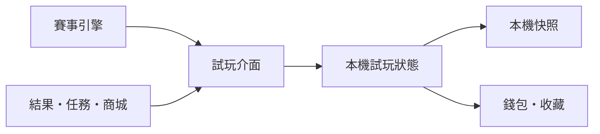

# Skyline Rush Wave 3 試玩經濟端到端實作計畫

- **文件日期**　2026-11-13
- **交付目標**　玩家可離線完成比賽、領取任務、累積三種資源、兌換外觀、收藏與裝備。每次操作後都能從畫面與本機存檔核對餘額。
- **實作順序**　BDD 驗收情境 → SDD 狀態與交易契約 → TDD RED → GREEN → REFACTOR。
- **技術基線**　Vue 3、TypeScript、Vite、Three.js、Node 22.12+、Node Test、Playwright。
- **工作基線**　功能分支 `feature/wave3-demo-economy` 的 `048a324`。前端實作開始時重新核對最新 HEAD 與 `develop`，保留現有經濟與結算版面。
- **後端時程**　先以本機試玩完成驗收。Go、Firebase Auth／Firestore、正式帳本、正式外觀權益與付款安排在後續階段。

## 1. 現況與文件關係

| 已核對的來源 | 用途與狀態 |
| --- | --- |
| [前端試玩 SDD 與經濟附錄](../specs/2026-11-10-wave3-frontend-first-experience-design.md) | 定義試玩點數、金幣、鑽石與既有介面契約。本計畫補足端到端對帳、持久化、重試與驗收。 |
| [Wave 3 前端總計畫](wave3-remaining-implementation-master-plan.md) | 保留 F01–F08、Garage VFX、既有素材與驗收範圍。其中歷史狀態以現行分支與 CI 證據更新判讀。 |
| [經濟基礎](../specs/2026-10-31-garage-economy-foundation-design.md)、[商城](../specs/2026-10-31-garage-store-readiness-design.md)、[任務與獎勵](../specs/2026-10-31-garage-rewards-and-missions-design.md) | 沿用正式權益邊界、既有外觀目錄及素材。 |
| [Go 後端計畫](2026-11-06-wave3-go-backend-implementation.md) | 保留 Phase 0–9 與服務端驗證責任。第 8 節提供錢包、任務與商城的接入契約。 |
| [賽後獎勵提交 059ec40](https://github.com/weskao/skyline-rush/commit/059ec407afc5b52c5927b0b100eb86fd851a3cfe) | 原功能分支已合入 `develop` 並刪除。賽後點數、名次係數及約 0.9 秒入帳動畫已存在。 |
| [試玩經濟提交 048a324](https://github.com/weskao/skyline-rush/commit/048a3243361fdc1d86276b8e671f9beaa3ee36f0)、[完整 CI](https://github.com/weskao/skyline-rush/actions/runs/43426963809) | 功能分支已有金幣、鑽石、兌換及 v1 存檔相容的程式。撰寫時已重跑 64 個針對性單元測試，全部通過。瀏覽器完整回歸與實機驗收仍須取得對應 HEAD 的證據。 |

### 前端優先補強

- **已重現 UTC 過期領取。** 將可領的每日任務留到 UTC 換日，直接呼叫 `claimMission`，若中途沒有讀取快照，舊任務會回 `completed` 並發 40 金幣。領取時必須自行同步任務週期。
- **已重現存檔容量中斷。** 同一個本機狀態累計 1,025 筆事件後，`saveCheckpoint` 回傳 `false`。目前去重集合持續增長，快照有 1,024 筆索引與 64 KiB 限制。長期遊玩必須仍能儲存最新餘額、收藏與任務。
- **需驗收賽後寫入順序。** 現在事件進度和錢包結算分別發布。應驗證正常完賽只有一筆完整的經濟結果，避開刷新或失敗時任務進度先入帳、錢包卻未入帳的情況。
- **需驗收實際裝備與瀏覽器呈現。** 快照的已裝備狀態、Garage VFX 和下一場賽事要一致。核對重新載入、重新選車、重設、切換帳號及試用終止。手機橫向仍需驗證金幣明細與比賽按鈕的可操作性。
- **需驗收多分頁。** 兩個分頁從同一份存檔起跑，若各自覆寫快照，可能還原已扣款的餘額或遺失外觀。以第 5 節定義的行為做瀏覽器測試。

## 2. BDD 玩家驗收

| ID | Given | When | Then |
| --- | --- | --- | --- |
| E01 | 全新的訪客，本機試玩版 | 開啟首頁並完成 Coast 5 km Time Attack | 首頁初始為 20 點／0 金幣／0 鑽石。結算顯示 +20 點／+70 金幣，總額為 40／70／0。只增加計時賽任務的完賽進度。 |
| E02 | E01 的存檔已完成並重新載入 | 重播同一結算 ID、重新開結算頁或換語言，再跑一場新的 Coast Time Attack | 舊結算的差額為 0，動畫重繪也不發獎。新一場再加 20 點／40 金幣，成為 60／110／0。 |
| E03 | 可用賽事與其他模式 | 完成 Classic、盃賽、自訂多回合、計時特技或合資格淘汰賽 | 使用真實賽事結果與第 3 節的規則。多回合只在整個系列完成時結算一次。中間回合、退出、自由駕駛、無盡公路、教學和失敗不計入試玩經濟。 |
| E04 | 每日競速已達成，且每週競速已累積五場 | 分別領取兩項任務，再重按領取 | 每日 +10 點／+40 金幣。每週 +10 點／+5 鑽石。每個任務週期只領一次。任務進度達成時先顯示可領取。 |
| E05 | 已到 UTC 換日或週一 00:00，頁面保留舊的領取按鈕 | 從同一分頁直接送出領取 | 判定當前週期，過期請求的三種差額都是 0。換日保留當週進度。合法的新週期可以再次領取。 |
| E06 | 看得到三種幣別的商品，對應餘額剛好等於售價 | 分別確認兌換 | 每件商品只扣標價幣別，該餘額降到 0，另外兩種維持原值。收藏出現同一個 `itemId`，重複兌換不扣款。 |
| E07 | 餘額不足、取消確認、商品不可兌換、確認已過期或帳號已切換 | 操作商城或從舊確認畫面送出 | 餘額與收藏都維持原值。以對應語言提示可做的下一步。 |
| E08 | 已兌換外觀、舊版 v1、損壞的快照或儲存權限被封鎖 | 裝備後進入下一場，重新載入、換帳號、重新切回或重設 | 裝備狀態與實際 VFX 對應。v1 點數及收藏保留，新增幣別為 0。資料依帳號隔離。儲存被封鎖時當次遊玩可繼續，並告知當次資料可能在刷新後消失。 |
| E09 | 兩個分頁、長時間遊玩或快照寫入失敗 | 同時兌換、累積超過 1,024 個事件、超過快照上限或中途刷新 | 同一操作不重複扣款，餘額與收藏一起更新。超量時保留最新可讀的經濟狀態與有效的去重區間。失敗時可辨識儲存狀態。 |
| E10 | 桌面、手機直向、短橫向或開啟減少動態／關閉 VFX | 看結果、回首頁、領取與兌換 | 結算差額、首頁總額、商城可用餘額都來自同一交易。短橫向的金幣明細可用「詳情」打開。減少動態或 VFX Off 直接顯示最終值。 |
| E11 | 遊戲資源已載入，Go、登入、Firebase 與付款服務都不可用 | 從賽事跑到收藏，再開下一場 | 當次試玩流程可完成。對純靜態初次載入的網路需求及完全離線刷新，依現有快取能力分別驗收與標示。 |

## 3. SDD 獎勵、名次與商城

### 3.1 賽後點數

`試玩點數 = round((10 + 2 × clamp(有效公里數, 1, 12)) × 賽道係數 × AI 難度係數 × 名次係數)`

- 一般賽道 `1.00`，側風／冰面／爬坡 `1.10`，斷崖／螺旋／符合規則的 CourseGraph 障礙 `1.15`，取最高適用級別。多賽道按每段有效距離加權，最後才四捨五入。
- 簡單／普通／困難 AI 分別 `0.85 / 1.00 / 1.22`。第 1–8 名為 `1.40 / 1.25 / 1.15 / 1.05 / 1.00 / 0.97 / 0.93 / 0.90`。單人不套 AI 與名次係數。Classic 使用賽事實際名次，困難欄為對應賽制的比較值。
- `classic`、`time`、`checkpoint`、`gauntlet`、`stunt`、`cup`、`custom`、`circuit`、`elimination` 依實際成功狀態與模式規則結算。圈賽使用總距離，盃賽採總排名，自訂多回合採平均名次後取最近整數，計時特技與淘汰採行駛距離。缺少有效距離的既有相容路徑是 20 點，必須記錄測試樣本，避免掩蓋正常比賽漏傳資料。
- 12 km 以上仍保留原賽道難度；距離部分封頂，最高點數基準 67。賽道實際距離以目前程式的有效配置為準。

| 賽道／賽制 | 距離 | 單人 | 普通第 1 | 普通第 2 | 普通第 3 | 普通第 8 | 困難第 1 |
| --- | ---: | ---: | ---: | ---: | ---: | ---: | ---: |
| Neon Downtown | 4.0 km | 18 | 25 | 23 | 21 | 16 | 31 |
| Coast | 5.0 km | 20 | 28 | 25 | 23 | 18 | 34 |
| Aurora Pass | 5.5 km | 23 | 32 | 29 | 27 | 21 | 39 |
| Canyon Skyway | 6.0 km | 25 | 35 | 32 | 29 | 23 | 43 |
| Alpine Rail Pass | 7.6 km | 28 | 39 | 35 | 32 | 25 | 47 |
| Harbor Circuit，3 圈 | 6.0 km | 22 | 31 | 28 | 25 | 20 | 38 |
| Harbor Circuit，5 圈 | 10.0 km | 30 | 42 | 38 | 35 | 27 | 51 |
| Dune Tempest | 13.93 km | 39 | 55 | 49 | 45 | 35 | 67 |
| Skyfall Archipelago | 16.46 km | 39 | 55 | 49 | 45 | 35 | 67 |

### 3.2 金幣、鑽石與任務

| 事件 | 點數差額 | 金幣差額 | 鑽石差額 |
| --- | ---: | ---: | ---: |
| 新的本機試玩／重設 | 初始 20 | 初始 0 | 初始 0 |
| 合資格完賽 | 獎勵公式所得 P | `2 × P` | 0 |
| 已知賽道的首次合資格完賽 | 0 | 額外 30 | 0 |
| 領取每日競速任務，1 場 | 10 | 40 | 0 |
| 領取每週競速任務，5 場 | 10 | 0 | 5 |
| 領取其餘既有試玩任務 | 10 | 0 | 0 |

- 首次完賽按試玩檔案與標準賽道 ID 記錄，圈數及賽制共用該 ID。整個系列只為最後一站結算首次獎勵，延續現有規則。
- 每日於 00:00 UTC、每週於週一 00:00 UTC 重置。台北時間為每日 08:00 與週一 08:00。計時賽走獨立的時間挑戰，競速週任務不計 Time Attack。現有每日／每週任務門檻為競速 1／5、計時 1／3、漂移 2／6、連擊 1／4。
- 每個餘額是非負安全整數，上限 1,000,000,000。顯示實際入帳差額，滿額時只顯示可入帳的部分。金幣基準取公式 P，個別幣別獨立飽和。
- 延續首輪試玩定價。一般外觀用金幣，高級 VFX 可用鑽石。三種幣別獨立，無兌換、贈送或提款流程。15／25 顆的外觀分別需 3／5 次週獎勵。週期切換驗收以測試時鐘推進，玩家以正常遊玩取得。

### 3.3 試玩商城價格

| 商品 ID | 外觀 | 幣別 | 售價 |
| --- | --- | --- | ---: |
| `thruster-ion` | 離子推進器 | 點數 | 25 |
| `thruster-plasma` | 電漿螺旋 | 點數 | 100 |
| `nitro-trail-cyan` | 青色尾跡 | 金幣 | 150 |
| `airflow-slipstream` | 流線氣流 | 金幣 | 500 |
| `nitro-trail-gold` | 金色脈衝尾跡 | 金幣 | 1,200 |
| `thruster-void` | 虛空脈衝 | 鑽石 | 15 |
| `airflow-prism` | 稜鏡氣流 | 鑽石 | 25 |

每個商品使用既有目錄的穩定 ID、單一幣別與正整數價格。確認視窗顯示商品、價格、可用餘額與預計剩餘值。送出時以當前快照重查價格、幣別、試玩檔案、是否已取得與可用餘額。成功時同一筆更新扣款與加入收藏。取消或失敗時沒有部分扣款。車庫可預覽的外觀、可兌換的外觀及已取得外觀應能在介面上辨識。

## 4. 前端分層與畫面責任

| 層 | 既有檔案與本輪責任 |
| --- | --- |
| 賽事資料 | `src/wave3-race-events.ts`、`src/race-results.ts`。由真實完賽輸出穩定的 `completionId`、試玩檔案、賽道、模式、時間、合資格狀態與距離／難度／名次。賽事引擎保留既有玩法與分數。 |
| 前端業務 | `src/wave3-experience-contract.ts`、`src/wave3-local-demo.ts`、`src/wave3-demo-settlement.ts`、`src/wave3-demo-missions.ts`。用既有 `Wave3ExperiencePort` 統一結算、領取、兌換、裝備、重設與帳號切換。 |
| 本機儲存 | `src/wave3-demo-storage.ts`。保存驗證過的同一筆完整快照，含餘額、任務、首次完賽、收藏、裝備及必要去重資訊。 |
| 呈現 | `src/wave3-demo-results-view.ts`、`src/wave3-demo-results-ui.ts`、`src/Wave3CurrencyStrip.vue`、`src/GarageMissionBoard.vue`、`src/Wave3DemoStore.vue`、`src/Wave3DemoCollection.vue`。投影已生效的差額與總額，交易計算集中在業務層。 |
| 裝備整合 | `src/Wave3DemoEntry.vue`、`src/garage-skin-runtime.ts`。同步當前試玩外觀與實際 Garage／賽事 VFX，測試原有永久權益、其他模式及原有外觀配置。 |

- 成功的操作以單一快照發布。同一幣別滿足 `after = before + appliedDelta`，失敗或重複請求的差額為 0。結果、首頁與商城只使用這份回執或最新快照；畫面重繪、點數動畫及切語言均為讀取。
- 回執帶操作結果、穩定 ID、試玩檔案及三種已入帳差額。每筆以操作／幣別作為動畫識別，同一回執只播放一次。正常 VFX 約 0.9 秒，收合的橫向明細打開即有正確數字，切換頁面或停用動畫時立即落在最終值。
- 賽後顯示獲得值和總額，首次獎勵可放在詳情。首頁保持現有三個小欄位與滑鼠懸停／手機點擊說明。商城展示商品所需幣別及可用量；餘額為零顯示 `0`。螢幕閱讀器宣告一次最終結果，避免每幀朗讀。覆蓋繁中／英文、鍵盤、觸控、缺圖、短橫向與減少動態。
- 本輪用現有靜態 `trial` build 與核准 WebP。驗證 `coming-soon` 和 `released` 的現有可見性規則，並保持正式金幣與試玩數值的視覺辨識。

## 5. 交易、資料與故障行為

1. **完賽交易。** 使用 `(profileId, completionId)` 去重。驗證身份、結果、模式與回合，將本次有效任務事件、首次完賽旗標、點數和金幣在同一次狀態更新發布及嘗試持久化。已套用的重試回傳 `duplicate` 和零差額。重啟賽事產生新的 ID。重設或切換帳號前開始的未完成賽事不得寫入新的試玩世代。
2. **任務領取。** 讀取權威的本機時鐘後先同步日／週期，再比較操作帶入的週期 ID 與資格。去重鍵為 `(profileId, missionId, periodId)`。常駐任務用固定 ID。相同週期的快速點擊、同時重試及跨日的舊確認不得再發。
3. **兌換與裝備。** 確認後按單一品項執行，先查價格及餘額，再原子扣款與授予試玩收藏。以 `(profileId, itemId)` 防止同一外觀重購。裝備只接受該試玩檔案已取得、且仍可在當前試玩會話使用的外觀。實際套用失敗就維持原裝備並回報。重設只影響當前試玩檔案與其試玩外觀。
4. **舊檔與容量。** 沿用 `skyline-rush-wave3-demo:v1:<profile>`，接受缺少 `demoEconomy` 的有效 v1，新增餘額和首次完賽集合從零開始。保留既有 64 KiB、七天滾動保留期與正式 Cloud Save 隔離。先修補索引無界增長。採近期有界去重索引，持久化時以實際 UTF-8 大小優先縮減高頻的舊漂移／連擊事件，再依近期期限限制完賽 ID，永遠保留最新餘額、任務領取、首次完賽、收藏及裝備。去重視窗外的舊完成資料不得從 UI 或儲存佇列重新送出。對重啟後的近期重播、容量上限及七天到期各寫測試。
5. **寫入失敗與多分頁。** 本機狀態操作在支援的環境以帳號作用域序列化，寫入前從最新有效快照重新驗證。可優先評估原生 Web Locks 加 `storage` 事件通知，或既有可用的本機交易機制。若無可用序列化機制，採單一可寫遊戲分頁或明確的會話模式，避免舊快照覆寫。Storage 阻擋、額滿或 IO 失敗時保留可用的本次會話，顯示「此裝置未能儲存本次進度」，並避免把舊檔說成最新。單一分頁仍可離線操作。
6. **損壞、帳號與時間。** 驗證 schema、型別、整數、幣別、版本和 profile。壞檔可回復到安全的試玩初始狀態，其他帳號、比賽紀錄、正式星星／獎牌與原有車庫資料不受影響。UTC 週期基於裝置時鐘，時鐘倒退或跳轉的處理須有測試，試玩狀態不作為正式證明。

## 6. 可重播的對帳腳本

使用測試時鐘與真實狀態介面建立以下固定例。瀏覽器至少完整開一場真實賽事並從可見按鈕走完剩餘操作。其他多週場景可用固定種子、正常完賽橋接與測試時鐘縮短驗收時間。

| 步驟 | 操作 | Δ 點數／金幣／鑽石 | 操作後 點數／金幣／鑽石 |
| --- | --- | ---: | ---: |
| 1 | 全新訪客開啟試玩 | — | 20／0／0 |
| 2 | Coast Time Attack 首次完賽 | +20／+70／0 | 40／70／0 |
| 3 | 刷新後重播第 2 步回執 | 0／0／0 | 40／70／0 |
| 4 | 新一場 Coast Time Attack | +20／+40／0 | 60／110／0 |
| 5 | 同一週五場 Coast 普通 AI 第 1 名 | +140／+280／0 | 200／390／0 |
| 6 | 領每日競速 | +10／+40／0 | 210／430／0 |
| 7 | 領每週競速 | +10／0／+5 | 220／430／5 |
| 8 | 確認兌換離子推進器 | −25／0／0 | 195／430／5 |
| 9 | 確認兌換青色尾跡 | 0／−150／0 | 195／280／5 |
| 10 | 嘗試兌換 15 鑽石外觀、取消其他確認、重播已兌換品項 | 0／0／0 | 195／280／5 |
| 11 | 再跨兩個週期，每週同樣五場競速並領一次週任務 | +300／+560／+10 | 495／840／15 |
| 12 | 確認兌換虛空脈衝 | 0／0／−15 | 495／840／0 |
| 13 | 裝備、切換語言、回首頁、重新載入 | 0／0／0 | 495／840／0 |
| 14 | 重設試玩 | 回到初始值 | 20／0／0 |

第 11 步的測試時間應跨不同 UTC 週，但相鄰兩次活動小於七天，例如第一週週日、第二週週三、第三週週一。實跑的名次依實際賽果逐筆計算，避免為了對齊固定樣本而修改遊戲結算。14 個固定餘額已用 `createWave3LocalDemo` 與 `createWave3DemoStorage` 驗算。實作驗收時，每一步都核對 `ExperienceResult`、首頁、商城、任務、收藏及重新載入後的狀態。短橫向另核對詳情與結果按鈕的觸控。

## 7. 前端實作順序與完成門檻

| 順序 | BDD／TDD 任務 | 檔案及最小交付 |
| --- | --- | --- |
| F0 | 記錄基線，鎖定 E01–E11、兩項已重現問題與真實瀏覽器流程 | 用 `tests/wave3-demo-economy.test.js`、`tests/wave3-early-access-browser.spec.js` 先固定數字、測試範圍與失敗證據。 |
| F1 | 對 E03／E04／E05 建立 RED，先修週期與完賽交易 | `wave3-local-demo.ts`、`wave3-race-events.ts`、`wave3-demo-missions.ts`。直接領取過期任務回零差額，完賽事件與獎勵一次提交，覆蓋首完、重試與跨帳號。 |
| F2 | 對 E08／E09 建立 RED，修補本機持久化 | `wave3-demo-storage.ts`、`wave3-experience-contract.ts`，延續 v1 相容。測 1,025 筆事件、近 64 KiB、刷新、同時兩分頁與 IO 失敗。 |
| F3 | 對 E06／E07／E08 建立 RED，完成兌換及裝備鏈路 | `Wave3DemoStore.vue`、`Wave3DemoCollection.vue`、`Wave3DemoEntry.vue`、`garage-skin-runtime.ts`。三種幣別各驗證一次實際扣款至零、收藏可見與真實 VFX。 |
| F4 | 對 E01／E02／E10 建立 RED，核對數字與動畫 | 結算 view／UI／CSS、首頁錢包、任務面板。覆蓋已入帳差額、總額、減少動態、重開不重播及短橫向詳情。 |
| F5 | 對 E11 與第 6 節逐筆完成端到端回歸 | `wave3-early-access-browser.spec.js`、`wave3-demo-results-layout-browser.spec.js`、`wave3-demo-store-browser.spec.js`、`wave3-currency-browser.spec.js`。包含真實賽事、實際點擊、數值差額、故障路徑及設備證據。 |

- 每步先寫會在舊碼失敗的測試，記錄失敗原因，再改對應來源、確認通過並重構。使用目前的測試工具與測試資料注入點。瀏覽器樣本使用遊戲內操作，固定時鐘只用於驗收跨週期。
- 本機至少跑 `node --test tests/module-size.test.js`、`npm test`、`npm run typecheck`、`npm run build`、試玩版建置與 `make verify`。瀏覽器回歸須實跑，環境限制與測試失敗分開記錄。
- 手動試玩使用 `GARAGE_VFX_RELEASE_MODE=trial npm run build` 後執行 `npm run preview -- --host 127.0.0.1`。先正常載入頁面與素材，再切斷網路測完賽、領取、兌換及裝備。回到線上後刷新，驗證之前的本機進度可讀取。
- 專項瀏覽器測試可先執行 `npm run test:browser -- tests/wave3-early-access-browser.spec.js tests/wave3-demo-store-browser.spec.js tests/wave3-demo-results-layout-browser.spec.js tests/wave3-currency-browser.spec.js`，再跑完整的 `make verify`。
- 裝置矩陣包含 1440×900 桌面、390×844 與 360×740 直向、844×390 與 667×375 短橫向，以及實體 iOS Safari、Android Chrome。保留對帳結果、短橫向截圖／錄影、無意外 console error 及實機結果。
- 推送功能分支後核對 exact-HEAD `[full-regression]` 的 `quality-gate`、Browser、World Tour 與適用工作，在 `TODO.md` 記錄提交、測試、機型、餘額與證據。依專案既有合併與發佈流程處理。
- 驗收定義是三種幣別皆可由正常操作增加及減少，重新載入、重播、雙分頁、週期重設與失敗操作能按表對帳。手動、CI、單元測試各自記錄結果。

## 8. 未來後端接入規劃

正式版沿用 [Go 後端計畫 Phase 0–9](2026-11-06-wave3-go-backend-implementation.md)。下列名稱是預留的 API 契約，前端試玩目前由本機 adapter 運作。未來可用非同步 server adapter 映射相同的畫面狀態、錯誤及回執。Go 驗證 Firebase 身分並從 token 取得 UID。

| 介面草案 | 輸入及服務端責任 | 回傳與一致性 |
| --- | --- | --- |
| `GET /v1/wallet`、`GET /v1/missions`、`GET /v1/catalog`、`GET /v1/inventory` | 回傳該帳號當前正式資料、最新目錄與週期。價格由伺服器版本化。 | 帳號作用域、版本／revision、整數餘額與發放狀態。較舊回應不得覆蓋新 revision。 |
| `POST /v1/race-completions` | 只接受服務端比賽 ID、版本和驗證需要的證據。依 Go 計畫設計重播或其他可信驗證，不能採信前端的名次或獎勵金額。 | `pending`、`rejected` 或 `committed`；驗證完成後依伺服器規則在一個交易寫入完賽、任務事件、首次完賽與帳本。 |
| `POST /v1/mission-claims` | `missionId`、`periodId` 和請求 ID；服務端時間驗證資格。 | 帳號／任務／週期唯一。回執帶三種差額、結果餘額及 revision；重試回原回執。 |
| `POST /v1/redemptions` | `itemId`、`catalogVersion` 和請求 ID；服務端重查目錄、價格、庫存權益與餘額。 | 在同一交易寫入扣款與權益。變價要重新確認。缺額或已擁有不扣款。 |
| 付費鑽石，獨立階段 | 如決定開放，使用固定 SKU 與區域報價，金額以當地最小貨幣單位存整數。由服務端驗證供應商憑證與交易狀態。 | 依供應商交易 ID 去重，入帳一次。退款與爭議以對應的調整分錄處理。商品組合、實際售價、稅務和平台上架規則待核定。 |

- **帳本。** Firestore 或核定的持久化交易層保存 append-only 分錄及可重建的餘額投影。分錄含 UID、請求 ID、來源、幣別、差額、規則／目錄版本、時間及相關商品。相同請求 ID 和相同內容回原回執，內容不同回衝突。確認、扣款與發放必須原子處理。
- **安全與故障。** 客戶端不得寫入正式帳本、定價、驗證紀錄或永久外觀。重試使用同一請求 ID，結果未知先查回執再更新畫面。離線可進入既有本機試玩，待驗證的正式交易不增加餘額。測不同帳號、重複／並發請求、過期權杖、未知結果、退款與撤銷。
- **遷移。** 正式帳本只從已核准的正式來源建立。既有比賽資料、星星、獎牌、外觀與本機試玩存檔各依現有契約保留。試玩點數、金幣、鑽石、任務與兌換結果不轉成正式資產。
- **導入次序。** Go 與模擬器契約測試 → 唯讀／影子驗證 → 非付費獎勵與兌換 → 可選付費。每一階段都有獨立開關與回滾方案。正式幣別設計先採金幣靠玩、鑽石用於外觀，實際數值由玩法數據與正式風險評估決定。

## 9. 交付紀錄

- [x] F0 已重跑 64 個針對性測試，驗算 14 個對帳步驟，重現 UTC 領取與 1,025 筆事件兩項缺口。
- [ ] F0 完成可重播的真實瀏覽器基線與實機證據。
- [ ] F1–F4 各自的 RED／GREEN、驗證命令、資料相容與回執已記錄。
- [ ] F5 跨三幣別的端到端對帳、真實瀏覽器及實機證據已完成。
- [ ] 最新功能提交的完整 CI、裝置驗收結果與剩餘限制已記錄。
- [ ] 後端進入獨立階段時，以第 8 節與 Go Phase 0–9 開始評估。
