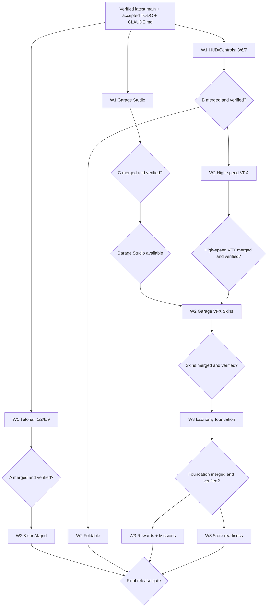

# Skyline Rush — Multi-Wave SDD → BDD → TDD Dispatch and Gatebook

**Repo:** https://github.com/weskao/skyline-rush  
**Planning branch:** `feature/ux-ui-combo-mobile-controls`  
**Date:** 2026-10-31  
**State:** DOCUMENTATION ONLY. This file does not authorize coding, merging, payment deployment or continuous monitoring.

## Individual GPT chats: files to copy/paste

| Wave | Branch | TODO | Prerequisite | Ready-to-use docs |
| --- | --- | --- | --- | --- |
| Wave 1 | [`feature/tutorial-ux-combos`](https://github.com/weskao/skyline-rush/tree/feature/tutorial-ux-combos) | 1/2/8/9 | none | [SDD + BDD](https://github.com/weskao/skyline-rush/blob/feature/tutorial-ux-combos/docs/superpowers/specs/2026-10-31-tutorial-ux-combos-design.md) · [TDD plan](https://github.com/weskao/skyline-rush/blob/feature/tutorial-ux-combos/docs/superpowers/plans/2026-10-31-tutorial-ux-combos-plan.md) · [GPT dispatch](https://github.com/weskao/skyline-rush/blob/feature/tutorial-ux-combos/docs/superpowers/prompts/2026-10-31-tutorial-ux-combos-dispatch.md) · [Visual design](https://github.com/weskao/skyline-rush/blob/feature/tutorial-ux-combos/docs/superpowers/prompts/2026-10-31-tutorial-ux-combos-visual-design.md) |
| Wave 1 | [`feature/mobile-controls-hud`](https://github.com/weskao/skyline-rush/tree/feature/mobile-controls-hud) | 3/6/7 | none | [SDD + BDD](https://github.com/weskao/skyline-rush/blob/feature/mobile-controls-hud/docs/superpowers/specs/2026-10-31-mobile-controls-hud-design.md) · [TDD plan](https://github.com/weskao/skyline-rush/blob/feature/mobile-controls-hud/docs/superpowers/plans/2026-10-31-mobile-controls-hud-plan.md) · [GPT dispatch](https://github.com/weskao/skyline-rush/blob/feature/mobile-controls-hud/docs/superpowers/prompts/2026-10-31-mobile-controls-hud-dispatch.md) · [Visual design](https://github.com/weskao/skyline-rush/blob/feature/mobile-controls-hud/docs/superpowers/prompts/2026-10-31-mobile-controls-hud-visual-design.md) |
| Wave 1 | [`feature/garage-preview-studio`](https://github.com/weskao/skyline-rush/tree/feature/garage-preview-studio) | 5 Studio | none | [SDD + BDD](https://github.com/weskao/skyline-rush/blob/feature/garage-preview-studio/docs/superpowers/specs/2026-10-31-garage-preview-studio-design.md) · [TDD plan](https://github.com/weskao/skyline-rush/blob/feature/garage-preview-studio/docs/superpowers/plans/2026-10-31-garage-preview-studio-plan.md) · [GPT dispatch](https://github.com/weskao/skyline-rush/blob/feature/garage-preview-studio/docs/superpowers/prompts/2026-10-31-garage-preview-studio-dispatch.md) · [Visual design](https://github.com/weskao/skyline-rush/blob/feature/garage-preview-studio/docs/superpowers/prompts/2026-10-31-garage-preview-studio-visual-design.md) |
| Wave 2 | [`feature/race-difficulty-eight-car-grid`](https://github.com/weskao/skyline-rush/tree/feature/race-difficulty-eight-car-grid) | 11/12 | tutorial-ux-combos | [SDD + BDD](https://github.com/weskao/skyline-rush/blob/feature/race-difficulty-eight-car-grid/docs/superpowers/specs/2026-10-31-race-difficulty-eight-car-grid-design.md) · [TDD plan](https://github.com/weskao/skyline-rush/blob/feature/race-difficulty-eight-car-grid/docs/superpowers/plans/2026-10-31-race-difficulty-eight-car-grid-plan.md) · [GPT dispatch](https://github.com/weskao/skyline-rush/blob/feature/race-difficulty-eight-car-grid/docs/superpowers/prompts/2026-10-31-race-difficulty-eight-car-grid-dispatch.md) · [Visual design](https://github.com/weskao/skyline-rush/blob/feature/race-difficulty-eight-car-grid/docs/superpowers/prompts/2026-10-31-race-difficulty-eight-car-grid-visual-design.md) |
| Wave 2 | [`feature/high-speed-vfx`](https://github.com/weskao/skyline-rush/tree/feature/high-speed-vfx) | 10 | mobile-controls-hud | [SDD + BDD](https://github.com/weskao/skyline-rush/blob/feature/high-speed-vfx/docs/superpowers/specs/2026-10-31-high-speed-vfx-design.md) · [TDD plan](https://github.com/weskao/skyline-rush/blob/feature/high-speed-vfx/docs/superpowers/plans/2026-10-31-high-speed-vfx-plan.md) · [GPT dispatch](https://github.com/weskao/skyline-rush/blob/feature/high-speed-vfx/docs/superpowers/prompts/2026-10-31-high-speed-vfx-dispatch.md) · [Visual design](https://github.com/weskao/skyline-rush/blob/feature/high-speed-vfx/docs/superpowers/prompts/2026-10-31-high-speed-vfx-visual-design.md) |
| Wave 2 | [`feature/foldable-layout-adaptation`](https://github.com/weskao/skyline-rush/tree/feature/foldable-layout-adaptation) | 4 | mobile-controls-hud | [SDD + BDD](https://github.com/weskao/skyline-rush/blob/feature/foldable-layout-adaptation/docs/superpowers/specs/2026-10-31-foldable-layout-adaptation-design.md) · [TDD plan](https://github.com/weskao/skyline-rush/blob/feature/foldable-layout-adaptation/docs/superpowers/plans/2026-10-31-foldable-layout-adaptation-plan.md) · [GPT dispatch](https://github.com/weskao/skyline-rush/blob/feature/foldable-layout-adaptation/docs/superpowers/prompts/2026-10-31-foldable-layout-adaptation-dispatch.md) · [Visual design](https://github.com/weskao/skyline-rush/blob/feature/foldable-layout-adaptation/docs/superpowers/prompts/2026-10-31-foldable-layout-adaptation-visual-design.md) |
| Wave 2 | [`feature/garage-vfx-skins`](https://github.com/weskao/skyline-rush/tree/feature/garage-vfx-skins) | 5 Skins/trial | garage-preview-studio + high-speed-vfx | [SDD + BDD](https://github.com/weskao/skyline-rush/blob/feature/garage-vfx-skins/docs/superpowers/specs/2026-10-31-garage-vfx-skins-design.md) · [TDD plan](https://github.com/weskao/skyline-rush/blob/feature/garage-vfx-skins/docs/superpowers/plans/2026-10-31-garage-vfx-skins-plan.md) · [GPT dispatch](https://github.com/weskao/skyline-rush/blob/feature/garage-vfx-skins/docs/superpowers/prompts/2026-10-31-garage-vfx-skins-dispatch.md) · [Visual design](https://github.com/weskao/skyline-rush/blob/feature/garage-vfx-skins/docs/superpowers/prompts/2026-10-31-garage-vfx-skins-visual-design.md) |
| Wave 3 | [`feature/garage-economy-foundation`](https://github.com/weskao/skyline-rush/tree/feature/garage-economy-foundation) | 5 Economy boundaries | garage-vfx-skins | [SDD + BDD](https://github.com/weskao/skyline-rush/blob/feature/garage-economy-foundation/docs/superpowers/specs/2026-10-31-garage-economy-foundation-design.md) · [TDD plan](https://github.com/weskao/skyline-rush/blob/feature/garage-economy-foundation/docs/superpowers/plans/2026-10-31-garage-economy-foundation-plan.md) · [GPT dispatch](https://github.com/weskao/skyline-rush/blob/feature/garage-economy-foundation/docs/superpowers/prompts/2026-10-31-garage-economy-foundation-dispatch.md) |
| Wave 3 | [`feature/garage-rewards-and-missions`](https://github.com/weskao/skyline-rush/tree/feature/garage-rewards-and-missions) | 5 Rewards/missions | garage-economy-foundation | [SDD + BDD](https://github.com/weskao/skyline-rush/blob/feature/garage-rewards-and-missions/docs/superpowers/specs/2026-10-31-garage-rewards-and-missions-design.md) · [TDD plan](https://github.com/weskao/skyline-rush/blob/feature/garage-rewards-and-missions/docs/superpowers/plans/2026-10-31-garage-rewards-and-missions-plan.md) · [GPT dispatch](https://github.com/weskao/skyline-rush/blob/feature/garage-rewards-and-missions/docs/superpowers/prompts/2026-10-31-garage-rewards-and-missions-dispatch.md) · [Visual design](https://github.com/weskao/skyline-rush/blob/feature/garage-rewards-and-missions/docs/superpowers/prompts/2026-10-31-garage-rewards-and-missions-visual-design.md) |
| Wave 3 | [`feature/garage-store-readiness`](https://github.com/weskao/skyline-rush/tree/feature/garage-store-readiness) | 5 Coming Soon store | garage-economy-foundation | [SDD + BDD](https://github.com/weskao/skyline-rush/blob/feature/garage-store-readiness/docs/superpowers/specs/2026-10-31-garage-store-readiness-design.md) · [TDD plan](https://github.com/weskao/skyline-rush/blob/feature/garage-store-readiness/docs/superpowers/plans/2026-10-31-garage-store-readiness-plan.md) · [GPT dispatch](https://github.com/weskao/skyline-rush/blob/feature/garage-store-readiness/docs/superpowers/prompts/2026-10-31-garage-store-readiness-dispatch.md) · [Visual design](https://github.com/weskao/skyline-rush/blob/feature/garage-store-readiness/docs/superpowers/prompts/2026-10-31-garage-store-readiness-visual-design.md) |

## Wave map

**Planning for all ten branches is independent** and already committed. **Implementation is not all independent**; honor the conditions written in each branch. W2 work that depends on only one W1 branch need not wait for unrelated W1 branches, but this gatebook recommends a whole-Wave checkpoint for simpler operation. The `garage-vfx-skins` branch is intentionally dependent on both Studio and high-speed renderer. "Merged" always means an explicit, user-approved merge, with successful tests on the final integrated HEAD — never an assumed result.

## Wave handoff review prompt (copy into a separate GPT coordinator chat)

使用已連接的 GitHub，檢查 `https://github.com/weskao/skyline-rush`。

你是 Skyline Rush 的**只讀多分支整合協調員**，不要編輯遊戲程式碼、不要自行建立 PR、不要自動合併到 main，也不要憑前次聊天的摘要判定成功。

1. 閱讀 `feature/ux-ui-combo-mobile-controls` 的 `TODO.md` 與本檔案，確認 12 項需求與 S1–S3 的跨裝置／畫質規範；再閱讀每個所需分支的 `docs/superpowers/specs/2026-10-31-<slug>-design.md`、`docs/superpowers/plans/2026-10-31-<slug>-plan.md` 與其實際變更。
2. 依當前想啟動的 Wave，逐一核對必要前置分支是否真的完成 BDD/TDD RED→GREEN、`npm run typecheck`、`npm test`、`npm run build`、`make verify`、實際 WebGL／手機直橫向／桌面／Low-Medium-High 驗收，以及最新 HEAD 的完整 GitHub Actions `quality-gate`（沒有證據則列為 `Not verified`）。
3. 取得最新 main HEAD 與每個分支的 compare/diff；確認功能已被使用者授權並合併至 main 且不存在未解衝突。只讀核對 `TODO.md` 中已驗證子項目是否 `- [x]`；未完成仍維持 `- [ ]`。如果最新 main 尚未包含原規劃 TODO，請提出非破壞式同步方案，**不可直接以舊 TODO 覆蓋新檔**。
4. 依 dependency DAG 列出 `Ready to start`、`Blocked`、`Verification pending` 和 `Already merged` 的精確分支。若前置項缺失，不能放行相依分支；對於互相獨立的分支可獨立放行。
5. 等所有功能真正完成後，才進行全專案 **10 張賽道 × 競速模式 × Android/iOS 直橫向 × Desktop × Low/Medium/High × en/zh-TW** 的整合驗收、規則版本／Ghost／Cloud Save／8車性能及無界面遮擋的檢查；如果組合過多採 pairwise 覆蓋並對高風險路徑做全矩陣，列出未測條件。
6. 產出明確的檢查表和每分支 commit / CI URL / 未驗證原因，不要宣稱沒有證據的綠燈；**任何後續合併或發佈都必須重新取得使用者明確批准**。

## Wave 2 / Wave 3 — GPT visual-generation and transparent-asset requirements (2026-10-31 update)

**These are conditional future-implementation gates, not a request to generate images in this planning-only round.** Each assigned GPT must inspect existing SVG/CSS, `src/icons.ts`, `public/icons/` and current shared Three.js resources *first*. Create new artwork **only if justified** by interface clarity, missing asset or proven renderer need, with actual image-generation tool if available. Generated concept boards are not production assets or proof of a playable scene.

| Wave | Feature | Image-generation decision | Asset/background rule |
| --- | --- | --- | --- |
| 2 | [AI / 8-car grid](https://github.com/weskao/skyline-rush/tree/feature/race-difficulty-eight-car-grid) | Optional original rank/car-number medallions, but physical grid and live leaderboard must use data-driven SVG/Vue/Three.js | Separated insignia require **true transparent RGBA**, backgrounds only for non-runtime diagrams |
| 2 | [High-speed VFX](https://github.com/weskao/skyline-rush/tree/feature/high-speed-vfx) | Storyboards for speed ramp; optional particle/ring sprite **only if measured**. Real BOOST/NITRO must remain live shaders/FOV/particles | Full-scene storyboard may be opaque; particle/ring sprite true transparent Alpha, no baked motion blur image |
| 2 | [Foldable layout](https://github.com/weskao/skyline-rush/tree/feature/foldable-layout-adaptation) | Prefer CSS/SVG/Mermaid wireframe; no runtime image normally needed | Transparent only for optional design annotation overlay, never a device-specific hardcoded runtime mask |
| 2 | [Garage VFX Skins](https://github.com/weskao/skyline-rush/tree/feature/garage-vfx-skins) | **Strongest image need:** four category icons, skin thumbnail candidates, possibly Studio background | Icon/badge/effect cutout: transparent PNG/WebP true Alpha; Studio scene: separate compressed opaque background if needed |
| 3 | [Garage Economy Foundation](https://github.com/weskao/skyline-rush/tree/feature/garage-economy-foundation) | **No image generation.** Entitlement, trials, schema and storage only | No font/icon/photo generation prerequisite or paid wallet illustration |
| 3 | [Rewards / Missions](https://github.com/weskao/skyline-rush/tree/feature/garage-rewards-and-missions) | Optional original achievement/mission/provisional soft-currency glyphs after economic authorization | Transparent symbols, no text/numbers/rates baked into art; actual rewards data-driven and once-only |
| 3 | [Store Readiness](https://github.com/weskao/skyline-rush/tree/feature/garage-store-readiness) | Optional muted Coming Soon artwork; not necessary for usable disabled store | Transparent small icon or decorative cutout; opaque only for standalone background; **no** paid checkout art, price or BUY CTA |

**In each of these seven existing branches, the matching four files have been updated where applicable:** `docs/superpowers/specs/2026-10-31-<slug>-design.md` (image/ownership BDD), `docs/superpowers/plans/2026-10-31-<slug>-plan.md` (optional Task V0), `docs/superpowers/prompts/2026-10-31-<slug>-dispatch.md` (copy-paste implementation directive), plus `...-visual-design.md` (ready-to-use image-generation brief) for all except economy foundation.

**Asset gate:** use existing icons where sufficient → SDD signoff on actual need, output dimensions, destination and fallback → when justified, create real original image → inspect Alpha over multiple contrasting backgrounds (not an embedded checkerboard) → optimize PNG/transparent WebP or genuine SVG, avoid large uncompressed textures → BDD/TDD missing-asset tests → actual in-game Vue/Three.js integration and Android/iOS portrait/landscape + desktop + Low/Medium/High/Reduced Motion validation → capture real WebGL evidence, network bytes, memory/FPS/Draw Calls/p95 frame-time. Never mark `TODO.md` `- [x]` from a generated concept image alone.

**CI gate:** documentation pushes may trigger GitHub Actions even though no code changed. Do not claim green on queued/cancelled/failed runs. Only check and remediate real failures at exact branch HEAD; the existing main CI failure is separate and must be root-caused before considering implementation branches releasable. Never auto-merge or publish on an unverified status.

## Independent artwork pre-production results (2026-10-31)

**GitHub asset work completed in the owning branches without starting dependent gameplay/UI implementation.** Reuse these preproduced original SVGs and inspect branch `plan.md` / `ASSET-MANIFEST.md` before launching a new GPT worker. Artwork completion **does not mark TODO feature items as done**.

| Wave | Branch | Preproduced assets | Status / next gate |
| --- | --- | --- | --- |
| 2 | [Garage VFX Skins](https://github.com/weskao/skyline-rush/tree/feature/garage-vfx-skins) | [4 transparent SVG icons](https://github.com/weskao/skyline-rush/tree/feature/garage-vfx-skins/public/feature-assets/garage-vfx-skins) — thruster, airflow, nitro-trail, launch-flare; [commit `45f0649`](https://github.com/weskao/skyline-rush/commit/45f0649e9c07fc39f2432659322addd995c021bd) | Asset files ready; wait for Studio + high-speed renderer to integrate Skins, trials, real VFX |
| 2 | [High-speed VFX](https://github.com/weskao/skyline-rush/tree/feature/high-speed-vfx) | [NITRO/BOOST four-stage SVG storyboard](https://github.com/weskao/skyline-rush/blob/feature/high-speed-vfx/docs/designs/high-speed-vfx/sprint-vfx-storyboard.svg); [commit `e891bc8`](https://github.com/weskao/skyline-rush/commit/e891bc8069ccc603a0aaeaa626ef0ccd9cdb2316) | Opaque concept image only; wait for Mobile HUD + actual Three.js performance verification |
| 2 | [8-car AI grid](https://github.com/weskao/skyline-rush/tree/feature/race-difficulty-eight-car-grid) | None needed: ranks/positions must remain data-driven Vue/CSS/SVG | Deferred until tutorial/core engine gate; optional icon only if proven necessary |
| 2 | [Foldable](https://github.com/weskao/skyline-rush/tree/feature/foldable-layout-adaptation) | None needed: later hinge-safe CSS/SVG layout | Deferred until Mobile HUD gate |
| 3 | [Rewards / Missions](https://github.com/weskao/skyline-rush/tree/feature/garage-rewards-and-missions) | [4 transparent SVG icons](https://github.com/weskao/skyline-rush/tree/feature/garage-rewards-and-missions/public/feature-assets/garage-rewards-and-missions) — medal, daily, weekly, trophy; [commit `2acc0e4`](https://github.com/weskao/skyline-rush/commit/2acc0e484296f74123866dd30842b1d98b840a48) | Icons ready; real currency art and settlement await Economy approval |
| 3 | [Store Readiness](https://github.com/weskao/skyline-rush/tree/feature/garage-store-readiness) | [2 transparent SVG icons](https://github.com/weskao/skyline-rush/tree/feature/garage-store-readiness/public/feature-assets/garage-store-readiness) — coming-soon, collection; [commit `4802122`](https://github.com/weskao/skyline-rush/commit/480212262d5e5ae0d2dd11065cec7f489d685ef3) | Icons ready; no real Buy/Pay; wait for Economy Foundation |
| 3 | [Economy Foundation](https://github.com/weskao/skyline-rush/tree/feature/garage-economy-foundation) | None needed: typed data/entitlements only | No image generation; wait for Garage Skins prerequisite |

**Count:** 10 independent, transparent-root 96×96 SVG icons, 1 standalone intentionally opaque storyboard SVG, 4 GitHub asset commits, and 7 updated per-branch Superpowers plans / dispatch prompts. These are actual committed image files, not PNGs renamed to SVG. The earlier GPT image-generation concept sheet is **not** a production asset and has not been committed to any branch. Background image, per-Skin texture/thumbnail, shaders, game viewport layout, money/paid store and results screens remain dependency-gated and unimplemented.

**Verification performed:** Source SVG files were fetched back through GitHub and checked for expected transparent roots, 96×96 viewport, titles, balanced XML-like tag structure, and absence of external resources/scripts. These checks **do not** constitute actual iPhone/Android/desktop screenshot, UI integration, TDD or green CI evidence. When integrating, test missing-asset fallbacks, readable bilingual labels, Low/Medium/High, Reduced Motion and exact-HEAD CI before marking any `TODO.md` `- [x]`.

## Visual Fidelity — original AI reference restoration and branch gates (2026-10-31)

The user's original rich neon/metallic style images have been **located** as real PNG files in the current conversation, cropped into **14 candidate reference images**, and packaged in `skyline-rush-design-reference-crops.zip` (conversation download; **the PNG bytes are not yet in GitHub**). This matters: earlier simplified 96px SVGs and dark CSS sketches do not have the same fidelity as original art, and CI green does not certify visual consistency.

**Source hashes for provenance:**

- `image(20261030-194940).png`: `b5c230027dd8c7923e73550135ec05f216d9941c2e2b725177764fd0f153ab7d`
- `a_clean_high_resolution_game_ui_asset_showcase_sh.png`: `ed04a69c57a9d6982f0f5f6ed02aa7542821c617134065fbdd040d7ef91bca41`
- `a_detailed_infographic_style_concept_design_mockup.png`: `80db0c6a726362ac3df9981b98427eff96e558809368404ab2734919d22943c3`

**Shared specification:** [Visual Fidelity Gate](https://github.com/weskao/skyline-rush/blob/feature/ux-ui-combo-mobile-controls/docs/superpowers/specs/2026-10-31-visual-fidelity-gate.md). All ten feature branches now have a `docs/designs/<slug>/VISUAL-FIDELITY.md` listing original reference crop(s), actual code owners and pending approval. Two Wave 1 branches also contain **editable DRAFT** layout SVGs (`feature/garage-preview-studio` desktop/mobile and `feature/mobile-controls-hud` portrait/landscape). They are placement sketches, *not* accepted production-grade artwork.

**Correct workflow for visually affected implementation:** Import and preserve approved image bytes into the feature branch with real Git blob SHAs; lock the viewport-responsive geometry, graphics/lighting/typography/camera and interactivity contract; obtain design approval; RED BDD/Playwright tests and baseline real screenshots; GREEN Vue 3 strict TypeScript/CSS + shared Three.js implementation and actual assets; refactor and run screenshot/video comparison + performance and browser tests; final exact-HEAD CI; only then mark verified TODO child items `- [x]`. If screenshots or design approval cannot be obtained, record **BLOCKED / PENDING_REVIEW**, never claim parity or infer a percent score. All artwork and reviews must remain true for Android/iOS portrait+landscape, desktop, Low/Medium/High and Reduced Motion.

**Reference locations per branch:** [Tutorial](https://github.com/weskao/skyline-rush/blob/feature/tutorial-ux-combos/docs/designs/tutorial-ux-combos/VISUAL-FIDELITY.md) · [HUD](https://github.com/weskao/skyline-rush/blob/feature/mobile-controls-hud/docs/designs/mobile-controls-hud/VISUAL-FIDELITY.md) · [Garage](https://github.com/weskao/skyline-rush/blob/feature/garage-preview-studio/docs/designs/garage-preview-studio/VISUAL-FIDELITY.md) · [High-speed VFX](https://github.com/weskao/skyline-rush/blob/feature/high-speed-vfx/docs/designs/high-speed-vfx/VISUAL-FIDELITY.md) · [Garage Skins](https://github.com/weskao/skyline-rush/blob/feature/garage-vfx-skins/docs/designs/garage-vfx-skins/VISUAL-FIDELITY.md) · [Rewards](https://github.com/weskao/skyline-rush/blob/feature/garage-rewards-and-missions/docs/designs/garage-rewards-and-missions/VISUAL-FIDELITY.md) · [Store](https://github.com/weskao/skyline-rush/blob/feature/garage-store-readiness/docs/designs/garage-store-readiness/VISUAL-FIDELITY.md).

## Coordination notes

- UI/UX planning TODO `feature/ux-ui-combo-mobile-controls` has not been merged into `main`. Implementation branches were created from `main` (2026-10-31; `bea47cf61c162b4341021fa6d24ca45850af7796`). Before TDD work begins, reconcile approved requirements without overwriting their history.
- Every implementation branch has one SDD/BDD spec, one Superpowers plan and one GPT dispatch prompt. Nine visually affected branches also have one visual design/asset prompt. `garage-economy-foundation` is intentionally data-only and does not need illustration.
- Visual concepts and source assets are different. An image generation prompt does not imply generation already happened. Only create and integrate original design assets during the assigned future work after review. All real WebGL rendering and full CI claims require observed evidence.
- No app source code was changed as part of this planning work. All items remain `- [ ]` until implemented and verified.
